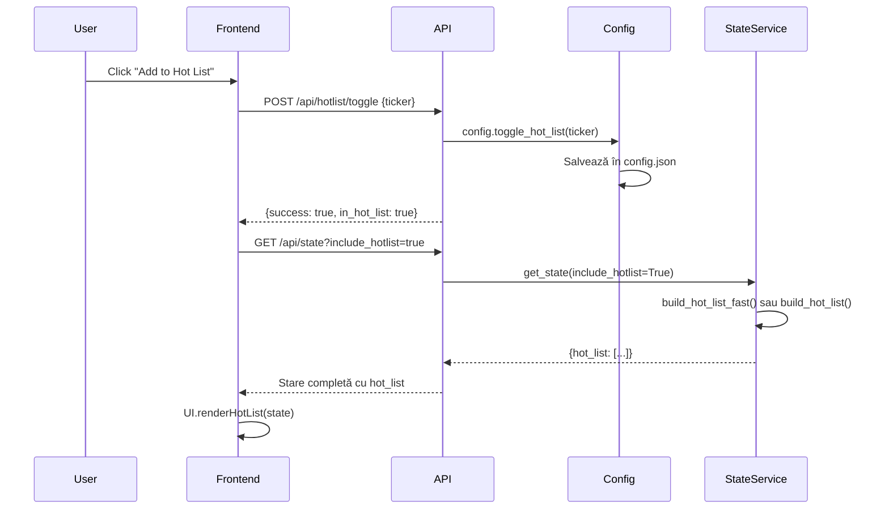
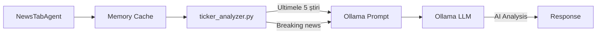
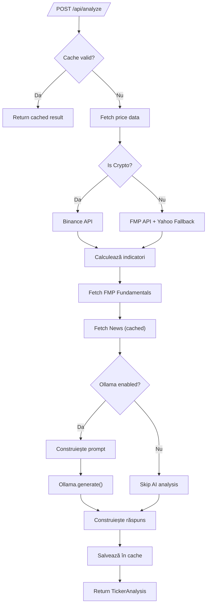

## Update 2026-02-07: Earnings Play Engine

HotList now includes earnings-focused decision fields and multi-window news scoring.

- New hotlist fields per ticker:
  - `earnings_edge_score` (0-100)
  - `earnings_play` (`PLAY_PRE|PLAY_POST|WAIT|AVOID`)
  - `earnings_setup` (`A|B|C`)
  - `earnings_risk_flags` (list[str])
  - `risk_level` (`low|med|high`)
  - `news_signals` (counts + top headlines + sentiment trend + risk events)
  - `momentum_1w`, `momentum_1m`
  - `top_risk`
- Deterministic scoring module: `core/hotlist_scoring.py` (`compute_earnings_edge_score`).
- News window helper with cache: `core/hotlist_news.py`
  - `get_ticker_news(ticker, days=7|30|90)`
  - `summarize_ticker_news_signals(...)`
- Group sort in BMO/AMC/TBA:
  1. `earnings_days` ascending
  2. `earnings_edge_score` descending
  3. tickers without `earnings_risk_flags` first
- `/api/analyze-ticker` now uses two-pass Ollama prompting and strict JSON validation (`core/ai_analysis_schema.py`).
- Adaptive TTL:
  - earnings window (`earnings_days <= 5`): 10 minutes
  - outside earnings window: 30 minutes

---
# Market Signals V7 - Sistemul HotList

Acest document descrie în detaliu funcționalitatea completă a sistemului **HotList**, incluzând:
- Arhitectura și fluxul de date
- Cum se clasifică și interpretează știrile
- Prompturile Ollama folosite pentru AI Analysis
- Logica de construcție a cardurilor
- Endpointurile API
- Sursele de date

---

## Cuprins

1. [Arhitectura HotList](#arhitectura-hotlist)
2. [Fluxul de Date](#fluxul-de-date)
3. [Endpointuri API](#endpointuri-api)
4. [Sursele de Date (FMP Client)](#sursele-de-date-fmp-client)
5. [Construcția Cardurilor HotList](#construcția-cardurilor-hotlist)
6. [Analiza AI cu Ollama](#analiza-ai-cu-ollama)
7. [Sistema de Știri și Clasificare](#sistema-de-știri-și-clasificare)
8. [Cache și Optimizări](#cache-și-optimizări)

---

## Arhitectura HotList

```mermaid
flowchart TB
    subgraph Frontend["Frontend (app.js)"]
        UI["UI.renderHotList()"]
        Detail["UI.showHotListDetail()"]
        FMP["UI.renderHotListFmpSection()"]
    end

    subgraph API["API Layer (main.py)"]
        State["/api/state"]
        Toggle["/api/hotlist/toggle"]
        Analyze["/api/analyze"]
    end

    subgraph Services["Services"]
        StateService["state_service.py"]
        ActionService["actions_service.py"]
    end

    subgraph Core["Core Logic"]
        FMPClient["fmp_client.py"]
        TickerAnalyzer["ticker_analyzer.py"]
        OllamaClient["ollama_client.py"]
    end

    subgraph External["External APIs"]
        FMP_API["FMP API"]
        OLLAMA["Ollama LLM"]
        Yahoo["Yahoo Finance"]
        Binance["Binance API"]
    end

    UI -->|GET| State
    State --> StateService
    StateService -->|build_hot_list()| FMPClient
    FMPClient --> FMP_API

    Toggle -->|POST| StateService
    Analyze --> TickerAnalyzer
    TickerAnalyzer --> OllamaClient
    OllamaClient --> OLLAMA
    TickerAnalyzer --> FMPClient
    TickerAnalyzer --> Yahoo
    TickerAnalyzer --> Binance
```

---

## Fluxul de Date

### 1. Adăugare Ticker la HotList



### 2. Încărcare Detalii HotList

Când utilizatorul apasă "Încarcă detalii", se apelează:

```
GET /api/state?include_hotlist=true&hotlist_details=true
```

Acest lucru declanșează `build_hot_list()` din `state_service.py` care:
1. Iterează prin toate ticker-ele din HotList
2. Pentru fiecare ticker, apelează `FMPClient.get_hot_list_data(ticker)`
3. Adună date live despre trenduri dacă lipsesc
4. Rezolvă datele despre earnings

---

## Endpointuri API

### 1. Toggle HotList

**Endpoint:** `POST /api/hotlist/toggle`

**Request Body:**
```json
{
    "ticker": "AAPL"
}
```

**Response:**
```json
{
    "status": "ok",
    "ticker": "AAPL",
    "in_hot_list": true
}
```

**Locație cod:** `api/main.py` → `api_toggle_hot_list()`

```python
@app.post("/api/hotlist/toggle")
async def api_toggle_hot_list(request: TickerRequest):
    config = get_shared_config()
    is_now_in = config.toggle_hot_list(request.ticker)
    return {"status": "ok", "ticker": request.ticker, "in_hot_list": is_now_in}
```

---

### 2. Get State (include HotList)

**Endpoint:** `GET /api/state`

**Query Parameters:**
| Parametru | Tip | Default | Descriere |
|-----------|-----|---------|-----------|
| `include_news` | bool | true | Include știri în răspuns |
| `include_hotlist` | bool | true | Include datele HotList |
| `hotlist_details` | bool | false | Forțează încărcare detalii complete (FMP data) |

**Exemplu:**
```
GET /api/state?include_hotlist=true&hotlist_details=true
```

**Locație cod:** `api/main.py` → `api_get_state()`

**Răspuns HotList:**
```json
{
    "hot_list": [
        {
            "ticker": "AAPL",
            "price": 185.50,
            "change_pct": 1.25,
            "trend_1d": "BULL",
            "trend_4h": "BULL",
            "trend_1h": "BEAR",
            "trend_30m": "BULL",
            "trend_5m": "NEUTRAL",
            "rsi": 58.5,
            "macd_hist": 0.0023,
            "earnings_date": "2024-01-25",
            "earnings_days": 5,
            "earnings_when": "AMC",
            "strategy_notes": "...",
            "best_strategy": {"trade_mode": "PULLBACK", "risk_mode": "MEDIUM"},
            "_details_loaded": true,
            "insider": {...},
            "ratings": {...},
            "sector": {...},
            "target": {...},
            "financialScores": {...},
            "targetSummary": {...},
            "congressTrades": {...}
        }
    ]
}
```

---

### 3. Analyze Ticker (AI Analysis)

**Endpoint:** `POST /api/analyze`

**Request Body:**
```json
{
    "ticker": "AAPL",
    "include_heavy": true,
    "disable_ollama": false,
    "force_refresh": false
}
```

**Locație cod:** `api/main.py` → `api_analyze_ticker()`

Această funcție apelează `analyze_ticker()` din `core/ticker_analyzer.py` care:
1. Calculează toți indicatorii tehnici
2. Obține date fundamentale de la FMP
3. Generează analiză AI cu Ollama

---

## Sursele de Date (FMP Client)

Datele pentru HotList vin din **Financial Modeling Prep (FMP) API** via `core/fmp_client.py`.

### Funcția Principală: `get_hot_list_data()`

```python
@classmethod
def get_hot_list_data(cls, ticker: str) -> dict:
    """
    Get all relevant FMP data for a Hot List ticker.
    Aggregates: ratings, financial scores, price target, congress trades, sector.
    """
    ratings_snapshot = cls.get_ratings_snapshot(ticker)
    ratings_simple = cls.get_ratings(ticker)
    ratings = {**(ratings_snapshot or {}), **(ratings_simple or {})}
    
    scores = cls.get_financial_scores(ticker)
    target = cls.get_price_target(ticker)
    target_summary = cls.get_price_target_summary(ticker)
    congress = cls.get_congress_trades(ticker)
    insider = cls.get_insider_trading(ticker)
    adx = cls.get_adx(ticker)
    
    return {
        "ratings": ratings,
        "financialScores": scores,
        "target": target,
        "targetSummary": target_summary,
        "congressTrades": congress,
        "insider": insider,
        "adx": adx,
        "sector": {"name": cls.get_sector_for_ticker(ticker) or "N/A"},
    }
```

### Endpointuri FMP Folosite

| Endpoint FMP | Funcție Python | Descriere | TTL Cache |
|--------------|----------------|-----------|-----------|
| `/rating/{ticker}` | `get_ratings()` | Rating global (A-F) | 6h |
| `/rating-snapshot/{ticker}` | `get_ratings_snapshot()` | Scoruri detaliate (DCF, ROE, ROA) | 6h |
| `/score/{ticker}` | `get_financial_scores()` | Piotroski F-Score, Altman Z-Score | 14d |
| `/price-target/{ticker}` | `get_price_target()` | Target preț analiști | 6h |
| `/price-target-summary/{ticker}` | `get_price_target_summary()` | Rezumat ținte | 6h |
| `/insider-trading/{ticker}` | `get_insider_trading()` | Trades insideri | 24h |
| `/senate-trading/{ticker}` | `get_congress_trades()` | Trades congresmeni | 24h |
| `/historical-calendar/{ticker}` | `get_calendar_earnings()` | Date earnings | 24h |
| `/technical-indicator/adx` | `get_adx()` | ADX indicator | 1h |

---

## Construcția Cardurilor HotList

### Structura Card-ului (Frontend)

Cardurile sunt randate în `frontend/app.js` → `UI.renderHotList()`:

```javascript
UI.renderHotList = function (state) {
    const hotItems = state.hot_list || [];
    
    // Grupare după earnings timing
    const grouped = { BMO: [], AMC: [], TBA: [] };
    hotItems.forEach(item => {
        const group = normalizeWhenGroup(item);
        grouped[group].push(item);
    });
    
    // Sortare după zile până la earnings
    Object.values(grouped).forEach(list => list.sort(sortByEarnings));
    
    // Render carduri
    html += items.map(renderCard).join('');
    grid.innerHTML = html;
}
```

### Informații Extrase pe Card

| Câmp | Sursă | Descriere |
|------|-------|-----------|
| `ticker` | Config HotList | Simbolul ticker-ului |
| `price` | State/Live | Prețul curent |
| `change_pct` | State/Live | Schimbare procentuală 24h |
| `trend_1d/4h/1h/30m/5m` | Engine/Live | Trenduri multi-timeframe |
| `earnings_date` | FMP Calendar | Data următorului raport |
| `earnings_days` | Calculat | Zile până la earnings |
| `earnings_when` | FMP Calendar | BMO (Before Market Open) / AMC (After Market Close) |
| `best_strategy` | Signals | Cea mai bună strategie din backtest |
| `strategy_notes` | Config per ticker | Notițe utilizator |

### Gruparea Cardurilor

Cardurile sunt grupate în 3 secțiuni:
1. **BMO** - Earnings Before Market Open
2. **AMC** - Earnings After Market Close  
3. **TBA** - Date nedefinite

Sortarea în fiecare grup: după `earnings_days` (crescător).

---

## Analiza AI cu Ollama

### Configurație Ollama

**Fișier:** `core/ollama_client.py`

```python
OLLAMA_BASE_URL = "http://localhost:11434"
DEFAULT_OLLAMA_MODEL = "gpt-oss:120b-cloud"

class OllamaClient:
    def generate(self, prompt: str, model: str = None, system: str = "") -> dict:
        payload = {
            "model": model or self.get_best_model(),
            "prompt": prompt,
            "stream": False,
            "system": system
        }
        resp = requests.post(f"{self.base_url}/api/generate", json=payload)
        return resp.json()
```

### Promptul Complet pentru Analiza AI

**Locație:** `core/ticker_analyzer.py` → `analyze_ticker()`

```python
# Prompt construit dinamic bazat pe datele disponibile:

prompt = f"Analizează tickerul {ticker} ({asset_type}).\n"
prompt += f"Preț Curent: ${price} ({change_pct:.2f}%)\n"
prompt += f"Tehnic: RSI={rsi:.1f}, MACD Hist={macd_hist:.4f}, Trend 1D={trend_1d}\n"

# Date financiare (doar pentru stocks)
prompt += "\n[FINANCIARE - întâi]\n"
prompt += f"Market Cap: {marketCap}, Volume: {volume}, P/E: {pe}, EPS: {eps}\n"
prompt += f"Cash: {cash}, Datorie: {debt}, Free Cash Flow: {fcf}\n"
prompt += f"Revenue: {revenue}, Operating Income: {opIncome}, Net Income: {netIncome}, EBITDA: {ebitda}\n"
prompt += f"Price Change: 1D={1D}%, 1W={1W}%, 1M={1M}%, 3M={3M}%, 1Y={1Y}%, YTD={YTD}%\n"

# Market Data - Hot List
prompt += "\n[MARKET DATA - Hot List]\n"
prompt += f"Sector: {sector}\n"
prompt += f"Insider: sentiment={sentiment}, buy=${netBuying}, sell=${netSelling}\n"
prompt += f"ADX: {adx} ({trend_strength}), +DI={plusDI}, -DI={minusDI}\n"
prompt += f"Ratings: {rating} (score {overallScore}), DCF={dcfScore}, ROE={roeScore}, ROA={roaScore}\n"

# Breaking News
prompt += "\n[BREAKING NEWS - apoi]\n"
for n in breaking_news[:3]:
    prompt += f"- {title} ({date}) [{ticker}]\n"

# Știri Recente
prompt += "\n[ȘTIRI RECENTE]\n"
for n in news[:3]:
    prompt += f"- {title} ({date})\n"

# Instrucțiuni finale
prompt += """
Sarcina ta: Analizează MAI ÎNTÂI datele financiare și Market Data (insider/ADX/ratings/sector), 
apoi știrile (breaking înaintea celorlalte). 
Oferă o analiză profesională scurtă (150-200 cuvinte) în limba română. 
Spune dacă datele sunt pozitive sau negative și direcția probabilă pe termen scurt/mediu. 
Dacă știrile confirmă/infirmă fundamentele, explică. 
Concluzionează cu sentiment clar (Bullish/Bearish/Neutral) și direcție.
"""
```

### Prioritatea Analizei

Ordinea de procesare în prompt:
1. **Date Financiare** - Market Cap, P/E, Cash Flow, Revenue
2. **Market Data** - Insider trading, ADX, Ratings, Sector
3. **Breaking News** - Știri urgente (maximum 3)
4. **Știri Recente** - Alte știri relevante (maximum 3)

---

## Sistema de Știri și Clasificare

### Sursele de Știri

Știrile sunt gestionate de `agents/news_tab_agent.py`:

1. **Yahoo Finance** - News generale despre ticker
2. **FinnHub** - Breaking news și company news
3. **Alpha Vantage** - Market sentiment
4. **FMP** - Stock news și press releases

### Clasificarea Știrilor

Știrile sunt clasificate în 3 categorii:
- `breaking_news` - Știri urgente, recente (< 60 min)
- `market_news` - Știri generale despre piață
- `ticker_news` - Știri specifice per ticker

### Sentiment Analysis

```python
class NewsSentiment(Enum):
    BULLISH = "bullish"     # Știri pozitive
    BEARISH = "bearish"     # Știri negative
    NEUTRAL = "neutral"     # Știri neutre
    UNKNOWN = "unknown"     # Necunoscut
```

### Fluxul de Știri în HotList



---

## Cache și Optimizări

### Cache HotList

**Locație:** `api/state_service.py`

```python
# Cache în memorie
_hot_list_cache = {"ts": 0.0, "key": None, "data": []}
_HOT_LIST_CACHE_TTL_SECONDS = 30  # 30 secunde

# Cache pe disk
_hot_list_disk_cache = {"ts": 0.0, "key": None, "data": []}
_HOT_LIST_DISK_CACHE_TTL_SECONDS = 1800  # 30 minute
```

### Funcții de Cache

| Funcție | TTL | Descriere |
|---------|-----|-----------|
| `build_hot_list_fast()` | 0 | Construiește rapid din state.json (fără apeluri externe) |
| `build_hot_list()` | 30s | Construiește cu date FMP complete |
| `_get_hot_list_details_cached()` | 30min | Returnează cache-ul de pe disk |
| `_merge_hot_list_details()` | - | Îmbină fast data cu cached details |

### Strategie de Încărcare

1. **Prima Încărcare** (fast):
   - `build_hot_list_fast()` - doar din state.json
   - Nu face apeluri externe
   - Afișează carduri rapid

2. **Încărcare Detalii** (on demand):
   - Utilizatorul apasă "Încarcă detalii"
   - `hotlist_details=true` în request
   - `build_hot_list()` cu toate datele FMP
   - Cache salvat pe disk pentru 30 minute

3. **Merge Inteligent**:
   - Dacă există detalii în cache, le combină cu datele fast
   - Prețurile și trendurile sunt mereu actualizate
   - Datele FMP (ratings, insider) rămân din cache

---

## Structura Completă a Răspunsului HotList Item

```json
{
    "ticker": "AAPL",
    "price": 185.50,
    "change_pct": 1.25,
    
    "trend_1d": "BULL",
    "trend_4h": "BULL", 
    "trend_1h": "BEAR",
    "trend_30m": "BULL",
    "trend_5m": "NEUTRAL",
    
    "rsi": 58.5,
    "macd_hist": 0.0023,
    
    "earnings_date": "2024-01-25",
    "earnings_days": 5,
    "earnings_when": "AMC",
    "earnings_when_desc": "After Market Close",
    
    "strategy_notes": "Long bias, support at $180",
    "best_strategy": {
        "trade_mode": "PULLBACK",
        "risk_mode": "MEDIUM"
    },
    
    "_details_loaded": true,
    
    "insider": {
        "sentiment": "bullish",
        "netBuying": 5000000,
        "netSelling": 1000000,
        "buyCount": 5,
        "sellCount": 2,
        "trades": [
            {"name": "Tim Cook", "type": "Purchase", "shares": 10000, "value": 1850000, "date": "2024-01-15"}
        ]
    },
    
    "ratings": {
        "rating": "A-",
        "overallScore": 4.2,
        "discountedCashFlowScore": 4,
        "returnOnEquityScore": 5,
        "returnOnAssetsScore": 4,
        "debtToEquityScore": 3,
        "priceToEarningsScore": 4,
        "priceToBookScore": 4
    },
    
    "financialScores": {
        "piotroskiScore": 7,
        "altmanZScore": 3.5
    },
    
    "target": {
        "targetConsensus": 200.0,
        "targetHigh": 220.0,
        "targetLow": 180.0
    },
    
    "targetSummary": {
        "lastQuarterCount": 25
    },
    
    "congressTrades": {
        "sentiment": "bullish",
        "totalTrades": 8,
        "senate": [...],
        "house": [...]
    },
    
    "sector": {
        "name": "Technology",
        "industry": "Consumer Electronics"
    }
}
```

---

## Diagrame suplimentare

### Flow Detaliat Analiză Ticker



---

## Fișiere Cheie

| Fișier | Rol |
|--------|-----|
| `api/main.py` | Endpointuri API FastAPI |
| `api/state_service.py` | Construcție HotList (fast și detaliată) |
| `core/fmp_client.py` | Client FMP API cu cache |
| `core/ticker_analyzer.py` | Analiză completă ticker + AI |
| `core/ollama_client.py` | Client Ollama pentru AI |
| `agents/news_tab_agent.py` | Agregare și clasificare știri |
| `frontend/app.js` | Render carduri HotList |
| `frontend/hotlist.css` | Stiluri carduri |

---

## Rezumat

Sistemul HotList este un mecanism complex care:

1. **Agregă date din multiple surse** (FMP, Yahoo, Binance, NewsAgents)
2. **Folosește cache stratificat** (memorie 30s, disk 30min) pentru performanță
3. **Oferă AI Analysis** via Ollama cu prompt structurat care prioritizează datele financiare
4. **Grupează cardurile** după earnings timing (BMO/AMC/TBA)
5. **Afișează metrici complete**: Trends, Ratings, Insider Activity, Congress Trades, Price Targets
