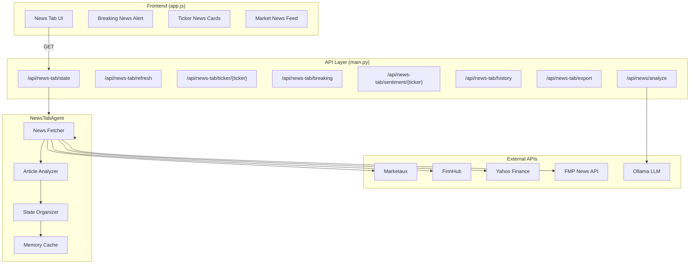
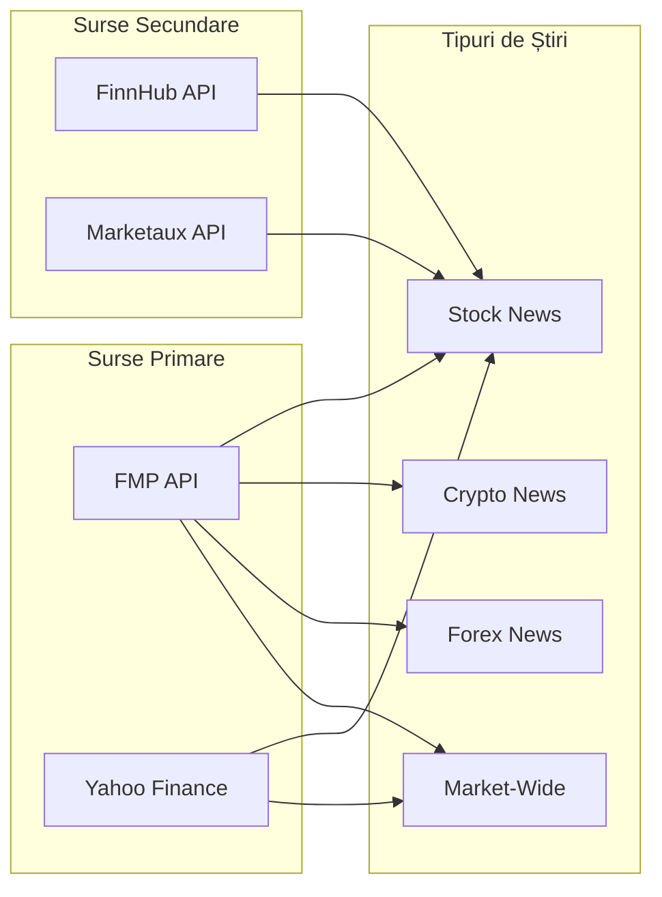
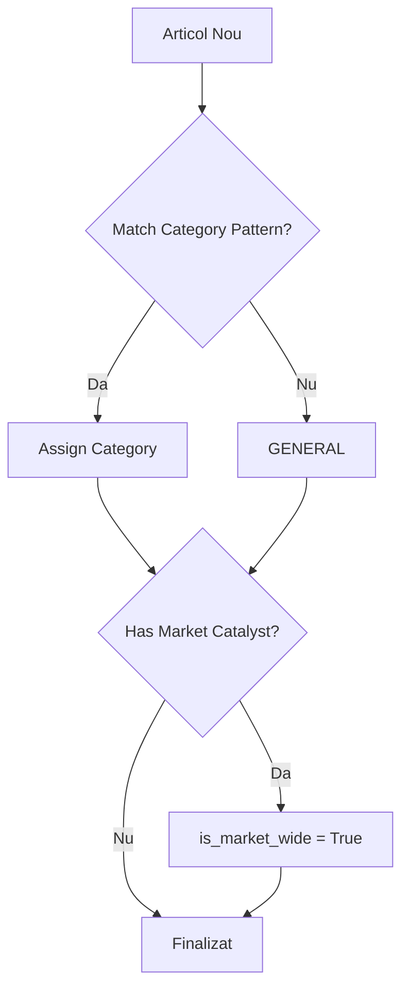
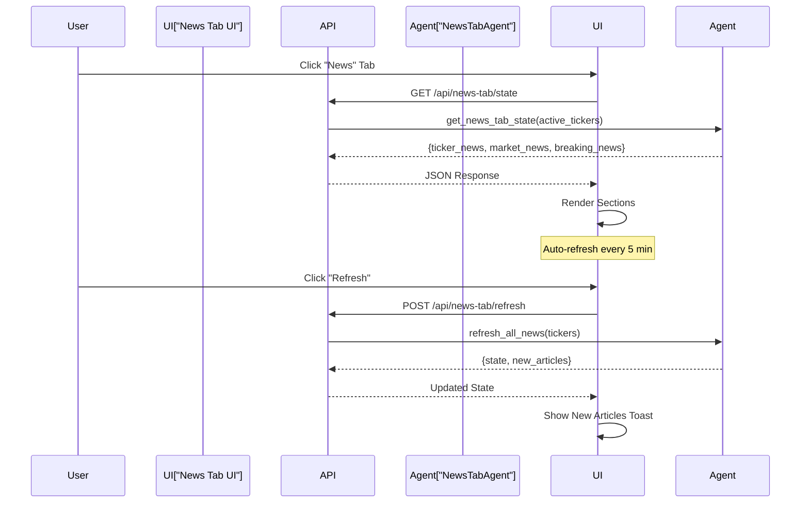
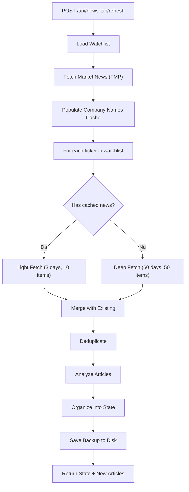

# Market Signals V7 - Sistemul News Tab

Acest document descrie în detaliu funcționalitatea completă a sistemului **News Tab**, incluzând:
- Arhitectura și fluxul de date
- Sursele de știri (FMP, Yahoo, FinnHub, Marketaux)
- Clasificarea știrilor și categoriile
- Sistemul de Impact Scoring V2
- Analiza AI a știrilor cu Ollama
- Endpointurile API
- Cache și optimizări

---

## Cuprins

1. [Arhitectura News Tab](#arhitectura-news-tab)
2. [Data Classes și Enums](#data-classes-și-enums)
3. [Sursele de Știri](#sursele-de-știri)
4. [Clasificarea Știrilor](#clasificarea-știrilor)
5. [Impact Scoring V2](#impact-scoring-v2)
6. [Analiza Sentimentului](#analiza-sentimentului)
7. [Detectarea Breaking News](#detectarea-breaking-news)
8. [Validarea Relevanței](#validarea-relevanței)
9. [Endpointuri API](#endpointuri-api)
10. [Analiza AI cu Ollama](#analiza-ai-cu-ollama)
11. [Cache și Persistență](#cache-și-persistență)
12. [Structura UI Frontend](#structura-ui-frontend)

---

## Arhitectura News Tab



---

## Data Classes și Enums

### NewsImpact (Enum)

```python
class NewsImpact(Enum):
    """Impact level for news on market/ticker"""
    CRITICAL = "critical"   # Fed rate decisions, major earnings misses
    HIGH = "high"           # Earnings, FDA approvals, M&A
    MEDIUM = "medium"       # Analyst upgrades/downgrades
    LOW = "low"             # General news
```

### NewsCategory (Enum)

```python
class NewsCategory(Enum):
    """News categories for filtering"""
    EARNINGS = "earnings"
    FED = "fed"
    FDA = "fda"
    MERGER = "merger"
    IPO = "ipo"
    DIVIDEND = "dividend"
    ANALYST = "analyst"
    MACRO = "macro"
    SECTOR = "sector"
    COMMODITY = "commodity"
    BREAKING = "breaking"
    GENERAL = "general"
```

### NewsSentiment (Enum)

```python
class NewsSentiment(Enum):
    """Sentiment classification"""
    VERY_BULLISH = "very_bullish"
    BULLISH = "bullish"
    NEUTRAL = "neutral"
    BEARISH = "bearish"
    VERY_BEARISH = "very_bearish"
```

### NewsArticle (DataClass)

```python
@dataclass
class NewsArticle:
    """Enhanced news article with full metadata"""
    id: str                                    # MD5 hash din URL + Title
    title: str                                 # Titlul articolului
    url: str                                   # Link către articol
    source: str                                # Sursa (FMP, Yahoo, FinnHub)
    published_at: datetime                     # Data publicării
    ticker: Optional[str] = None               # Ticker asociat (dacă există)
    category: NewsCategory = NewsCategory.GENERAL
    sentiment: NewsSentiment = NewsSentiment.NEUTRAL
    sentiment_score: float = 0.0               # Scor sentiment (-2 la +2)
    sentiment_confidence: float = 0.0          # Încredere (0-1)
    impact: NewsImpact = NewsImpact.LOW
    impact_score: int = 0                      # Scor numeric 0-100
    article_type: str = "general_news"         # ticker_news sau general_news
    is_duplicate: bool = False                 # Flag duplicat
    summary: str = ""                          # Rezumat articol
    related_tickers: List[str] = []            # Tickere menționate
    is_breaking: bool = False                  # Flag breaking news
    is_market_wide: bool = False               # Afectează întreg piața
```

### NewsTabState (DataClass)

```python
@dataclass
class NewsTabState:
    """State for the news tab"""
    ticker_news: Dict[str, List[NewsArticle]]  # Știri per ticker
    market_news: List[NewsArticle]             # Știri generale piață
    breaking_news: List[NewsArticle]           # Știri urgente
    last_update: Optional[datetime]            # Ultima actualizare
    active_filters: List[NewsCategory]         # Filtre active
```

---

## Sursele de Știri

### Diagrama Surselor



### 1. Financial Modeling Prep (FMP)

**Locație:** `_fetch_fmp_news()`, `_fetch_fmp_crypto_news()`, `_fetch_fmp_forex_news()`

| Endpoint | Descriere | Limit | Cache TTL |
|----------|-----------|-------|-----------|
| `/stable/news/general-latest` | Știri generale piață | 100 | 2 min |
| `/stable/news/stock-latest` | Știri specifice stock | 50 | 2 min |
| `/stable/news/crypto` | Știri crypto | 5 | 2 min |
| `/stable/news/forex` | Știri forex | 5 | 2 min |

**Câmpuri extrase:**
```json
{
    "title": "...",
    "url": "...",
    "publishedDate": "2024-01-15 14:30:00",
    "site": "Reuters",
    "text": "..."
}
```

### 2. Yahoo Finance

**Locație:** `_fetch_yahoo_news()`

```python
stock = yf.Ticker(ticker)
news = stock.news  # Returnează lista de știri

# Structura nouă Yahoo API:
{
    "content": {
        "title": "...",
        "clickThroughUrl": {"url": "..."},
        "provider": {"displayName": "Yahoo Finance"},
        "pubDate": "2024-01-15T14:30:00Z"
    }
}
```

**Rate Limiting:** 
- Cache TTL: 2 minute
- Random delay: 0.5 - 1.5s între cereri
- Cooldown 30s la 429 error

### 3. FinnHub

**Locație:** `_fetch_finnhub_news()`

```python
url = "https://finnhub.io/api/v1/company-news"
params = {
    "symbol": ticker,
    "from": "2024-01-08",
    "to": "2024-01-15",
    "token": finnhub_key
}
```

**Câmpuri:**
```json
{
    "headline": "...",
    "url": "...",
    "datetime": 1705319400,
    "source": "Reuters",
    "summary": "..."
}
```

### 4. Marketaux

**Locație:** `_fetch_marketaux_news()`

```python
url = "https://api.marketaux.com/v1/news/all"
params = {
    "api_token": marketaux_key,
    "search": ticker,
    "language": "en",
    "limit": 10
}
```

---

## Clasificarea Știrilor

### Pattern-uri de Categorie

```python
CATEGORY_PATTERNS = {
    NewsCategory.FED: r"\b(fed|federal reserve|fomc|interest rate|powell|inflation|cpi|ppi|monetary|rate decision|rate hike|rate cut)\b",
    NewsCategory.EARNINGS: r"\b(earnings|revenue|profit|eps|quarter|fiscal|results|beat|miss|guidance)\b",
    NewsCategory.FDA: r"\b(fda|approval|drug|clinical|trial|pipeline|phase|efficacy)\b",
    NewsCategory.MERGER: r"\b(merger|acquisition|acquire|deal|buyout|takeover|bid|offer)\b",
    NewsCategory.IPO: r"\b(ipo|initial public|debut|listing|offering|spac)\b",
    NewsCategory.DIVIDEND: r"\b(dividend|payout|yield|distribution|special dividend)\b",
    NewsCategory.ANALYST: r"\b(analyst|upgrade|downgrade|price target|rating|outlook|coverage)\b",
    NewsCategory.MACRO: r"\b(gdp|unemployment|jobs|nonfarm|retail sales|housing|consumer)\b",
    NewsCategory.SECTOR: r"\b(sector|industry|market cap|index|etf)\b",
    NewsCategory.COMMODITY: r"\b(gold|silver|oil|commodity|futures|precious metal|crude)\b",
    NewsCategory.BREAKING: r"\b(breaking|alert|urgent|just in|developing|shock|surge|plunge|unexpected|halted|circuit breaker)\b",
}
```

### Flux Clasificare



---

## Impact Scoring V2

### Constante de Scoring

```python
# Base scores by article type
SCORE_BASE_TICKER_NEWS = 40
SCORE_BASE_GENERAL_NEWS = 15

# Score modifiers
SCORE_BREAKING = 25           # +25 pentru breaking news
SCORE_MACRO_TIER1 = 40        # +40 pentru CPI, NFP, FOMC decision
SCORE_MACRO_TIER2 = 10        # +10 pentru GDP, retail sales
SCORE_FDA_BINARY = 35         # +35 pentru FDA approval/denial
SCORE_EARNINGS_MA = 25        # +25 pentru earnings/M&A
SCORE_ANALYST = 10            # +10 pentru analyst upgrades
SCORE_SENTIMENT_EXTREME = 10  # +10 pentru very_bullish/very_bearish
SCORE_DUPLICATE_PENALTY = -20 # -20 pentru duplicate
```

### Macro Keywords

| Tier | Keywords | Score Bonus |
|------|----------|-------------|
| **Tier 1** | cpi report, nfp, fomc decision, fed rate, powell, rate hike, rate cut | +40 |
| **Tier 2** | gdp, retail sales, housing starts, pmi, jobless claims, producer price | +10 |

### Score to Severity Mapping

```python
def score_to_severity(score: int) -> NewsImpact:
    if score >= 80:
        return NewsImpact.CRITICAL
    elif score >= 50:
        return NewsImpact.HIGH
    elif score >= 25:
        return NewsImpact.MEDIUM
    else:
        return NewsImpact.LOW
```

### Exemplu Calcul Scor

| Articol | Base | Breaking | Macro | FDA | Category | Sentiment | Total | Severity |
|---------|------|----------|-------|-----|----------|-----------|-------|----------|
| "Fed Raises Rates" (ticker) | 40 | +25 | +40 | - | +40 (FED) | - | 145 → 100 | CRITICAL |
| "AAPL Earnings Beat" (ticker) | 40 | - | - | - | +25 | +10 | 75 | HIGH |
| "Market Update" (general) | 15 | - | - | - | - | - | 15 | LOW |
| "FDA Approves Drug" (ticker) | 40 | +25 | - | +35 | - | - | 100 | CRITICAL |

### Gating Rule

GENERAL_NEWS poate ajunge la HIGH/CRITICAL **doar** dacă conține catalyst de piață:

```python
# Dacă general_news ajunge la 50+ fără catalyst, capăm la 49
if article.article_type == "general_news" and score >= 50:
    if not self._has_market_catalyst(text):
        score = 49  # Cap la MEDIUM
```

---

## Analiza Sentimentului

### SentimentEngine

**Locație:** `core/sentiment.py`

```python
def _analyze_sentiment(self, text: str) -> Tuple[NewsSentiment, float, float]:
    """
    Analyze sentiment of text using Advanced SentimentEngine.
    
    Returns:
        Tuple of (sentiment, score, confidence)
    """
    return SentimentEngine.analyze(text)
```

### Maparea Scorurilor

| Scor | Sentiment | Descriere |
|------|-----------|-----------|
| > 1.0 | VERY_BULLISH | Foarte pozitiv |
| 0.3 - 1.0 | BULLISH | Pozitiv |
| -0.3 - 0.3 | NEUTRAL | Neutru |
| -1.0 - -0.3 | BEARISH | Negativ |
| < -1.0 | VERY_BEARISH | Foarte negativ |

---

## Detectarea Breaking News

### Criterii Breaking

1. **Recență:** Articol publicat în ultimele 72 ore (4320 minute)
2. **Keywords explicit breaking:**
   - "breaking", "alert", "urgent", "just in", "developing"
   - "shock", "surge", "plunge", "unexpected", "halted"
   - "circuit breaker", "emergency", "fed", "powell", "fomc"

3. **Macro Tier-1:** Orice știre cu keyword macro tier-1
4. **FDA Binary:** Approval/denial/hold
5. **FED/FDA Category + Action Words:** "announces", "decision", "approval"

```python
def _is_breaking(self, article: NewsArticle) -> bool:
    # Limite recență
    if article._get_age_minutes() >= 4320:  # 72h
        return False
    
    # Keywords breaking
    breaking_kws = [
        "breaking", "alert", "urgent", "fed", "powell", "fomc"
    ]
    if any(kw in text for kw in breaking_kws):
        return True
    
    # Macro tier-1
    if self._detect_macro_tier(text) == 1:
        return True
    
    # FDA binary
    if self._is_fda_binary(text):
        return True
    
    return False
```

---

## Validarea Relevanței

### Problema

Știrile generale pot fi asociate greșit cu tickere (ex: știre despre "Meta Platforms" apare sub ticker "F" - Ford).

### Soluție: Multi-Layer Validation

```python
def _is_article_relevant_to_ticker(self, article, requested_ticker, watchlist):
    # 1. Direct ticker mention
    if _token_match(requested_ticker, search_text):
        return True
    
    # 2. Normalized ticker (BTC-USD -> BTC, JASMYUSDT -> JASMY)
    if _token_match(normalized_ticker, search_text):
        return True
    
    # 3. Config mappings (SI=F -> "SILVER")
    mapped_ticker = symbol_map.get(requested_ticker)
    search_term = search_terms.get(requested_ticker)
    
    # 4. Crypto name mapping (BTC -> BITCOIN, ETH -> ETHEREUM)
    crypto_map = {
        "BTC": ["BITCOIN"],
        "ETH": ["ETHEREUM"],
        "DOGE": ["DOGECOIN"],
        "SOL": ["SOLANA"]
    }
    
    # 5. Company name cache (AAPL -> APPLE INC)
    if requested_ticker in self._company_names_cache:
        company_name = self._company_names_cache[requested_ticker]
    
    # Default: reject if not confirmed
    return False
```

### Strict Filtering pentru Tickere Scurte

```python
# Pentru tickere de 1-2 caractere (F, GM), filtrare strictă
if len(ticker) <= 2:
    logger.debug(f"Discarding non-relevant article for short ticker {ticker}")
    continue
```

---

## Endpointuri API

### 1. Get News Tab State

**Endpoint:** `GET /api/news-tab/state`

**Descriere:** Returnează starea completă a tab-ului de știri.

**Response:**
```json
{
    "ticker_news": {
        "AAPL": [...],
        "NVDA": [...]
    },
    "market_news": [...],
    "breaking_news": [...],
    "last_update": "2024-01-15T14:30:00+00:00",
    "active_filters": [],
    "total_articles": 150
}
```

---

### 2. Refresh News

**Endpoint:** `POST /api/news-tab/refresh`

**Descriere:** Forțează refresh pentru toate știrile din watchlist.

**Response:**
```json
{
    "state": {...},
    "new_articles": [
        {"title": "...", "url": "...", "impact": "high", ...}
    ]
}
```

---

### 3. Get Ticker News

**Endpoint:** `GET /api/news-tab/ticker/{ticker}?max_items=10`

**Descriere:** Returnează știrile specifice pentru un ticker.

**Response:**
```json
{
    "news": [
        {
            "id": "abc123",
            "title": "AAPL Earnings Beat Expectations",
            "url": "https://...",
            "source": "Reuters",
            "published_at": "2024-01-15T14:30:00Z",
            "sentiment": "bullish",
            "impact": "high"
        }
    ]
}
```

---

### 4. Get Breaking News

**Endpoint:** `GET /api/news-tab/breaking?max_age_minutes=60`

**Descriere:** Returnează știrile breaking din ultimele N minute.

**Response:**
```json
{
    "breaking": [
        {
            "title": "Fed Announces Rate Decision",
            "impact": "critical",
            "is_breaking": true
        }
    ]
}
```

---

### 5. Get Sentiment Summary

**Endpoint:** `GET /api/news-tab/sentiment/{ticker}`

**Descriere:** Returnează rezumatul sentimentului pentru ticker/piață.

**Response:**
```json
{
    "sentiment": "bullish",
    "score": 0.65,
    "confidence": 0.78,
    "article_count": 15
}
```

---

### 6. Fetch Historical News

**Endpoint:** `POST /api/news-tab/history`

**Request Body:**
```json
{
    "ticker": "AAPL",           // Single ticker
    "tickers": ["AAPL", "NVDA"], // Multiple tickers
    "days": 90,                  // Max 90 days
    "all_watchlist": false       // Fetch pentru tot watchlist-ul
}
```

**Response:**
```json
{
    "status": "ok",
    "tickers_processed": 10,
    "total_articles_added": 250,
    "per_ticker": {
        "AAPL": {"status": "ok", "articles_added": 45},
        "NVDA": {"status": "ok", "articles_added": 32}
    }
}
```

---

### 7. Export News

**Endpoint:** `GET /api/news-tab/export?days=7&tickers=AAPL,NVDA&impact=high,critical`

**Descriere:** Exportă știrile ca fișier TXT descărcabil.

**Format Output:**
```
============================================================
MARKET SIGNALS - NEWS EXPORT
Generated: 2024-01-15 14:30:00
Days: 7 | Tickers: AAPL, NVDA | Impact: high, critical
Total Articles: 25
============================================================

[2024-01-15 14:30] [AAPL] [HIGH]
Apple Reports Record Q4 Earnings
https://reuters.com/...

[2024-01-15 10:15] [NVDA] [CRITICAL]
NVIDIA Announces AI Breakthrough
https://bloomberg.com/...
```

---

## Analiza AI cu Ollama

### Endpoint Analyze

**Endpoint:** `POST /api/news/analyze`

**Request Body:**
```json
{
    "url": "https://article-url.com/...",
    "prompt_type": "summary"  // sau "deep"
}
```

### Promptul Summary (Default)

```python
user_prompt = """
You are a financial/crypto news analyzer for a News Feed UI.

MANDATORY RULES:
- Use ONLY the information explicitly present in the provided article text.
- output MUST be ONLY a valid JSON object (no markdown, no backticks).
- key_takeaways MUST contain EXACTLY 3 items.
- Each key_takeaway must be <= 18 words.
- overall_sentiment MUST be exactly one of: "bullish", "bearish", "neutral".

OUTPUT JSON SCHEMA:
{
  "key_takeaways": ["...", "...", "..."],
  "overall_sentiment": "bullish|bearish|neutral",
  "confidence": 0-100,
  "overall_sentiment_text": "...",
  "summary": "..."
}

INPUT:
Asset/Ticker: {asset}
Title: {title}
Source: {source}
Published: {published}

Article text:
{context}
"""
```

### Promptul Deep Analysis

```python
user_prompt = """
You are a senior crypto/markets analyst generating a structured report.

OUTPUT JSON SCHEMA:
{
  "asset": "string",
  "overall_sentiment": "bullish|bearish|neutral",
  "confidence": 0-100,
  "impact_level": "low|medium|high",
  "time_horizon": "intraday|1-7d|1-4w|long-term|unknown",
  "price_drivers": [
    {
      "label": "string",
      "direction": "bullish|bearish|mixed|unclear",
      "details": "string"
    }
  ],
  "risks": [
    {
      "label": "string",
      "details": "string"
    }
  ],
  "key_takeaways": ["...", "...", "..."],
  "trading_ideas": [
    {
      "bias": "long|short|avoid|observe-only",
      "rationale": "string"
    }
  ],
  "summary": "string",
  "overall_summary": "string"
}

TASK:
1) Determine overall_sentiment and confidence (0-100)
2) Classify impact_level based on actionability
3) Set time_horizon based on catalyst nature
4) Extract 2-5 price_drivers with direction
5) Extract 1-4 key risks
6) Provide exactly 3 key_takeaways
7) Optionally suggest 0-2 trading_ideas
8) Provide summary (max 2 sentences)
"""
```

### Response Exemplu

```json
{
    "key_takeaways": [
        "Fed raised rates by 25bps as expected",
        "Inflation remains above 3% target",
        "Markets expect pause in next meeting"
    ],
    "overall_sentiment": "neutral",
    "confidence": 72,
    "overall_sentiment_text": "The rate decision was priced in, limiting immediate market impact.",
    "summary": "The Federal Reserve raised interest rates by 25 basis points to 5.5%, meeting market expectations. Chair Powell signaled a data-dependent approach for future decisions.",
    "analysis_model": "gpt-oss:120b-cloud"
}
```

---

## Cache și Persistență

### Cache în Memorie

```python
# FMP news cache
_fmp_news_cache: Dict[str, Tuple[List[Dict], float]] = {}
_fmp_news_cache_ttl = 120  # 2 minute

# Yahoo news cache  
_yahoo_news_cache: Dict[str, Tuple[List, float]] = {}
# TTL: 2 minute (120s)

# Seen IDs (pentru deduplicare)
_seen_ids: set = set()
```

### Persistență pe Disk

**Fișiere:**
- `news_backup.json` - Backup complet al stării
- `news_quarantine.json` - Articole corupte/invalide

```python
def _save_backup(self):
    """Save current state to disk."""
    with open(NEWS_BACKUP_PATH, 'w') as f:
        json.dump(self._state.to_dict(), f)

def _load_backup(self):
    """Load state from disk on startup."""
    if os.path.exists(NEWS_BACKUP_PATH):
        with open(NEWS_BACKUP_PATH, 'r') as f:
            data = json.load(f)
            self.hydrate_state(data)
```

### Deduplication

```python
# Threshold pentru duplicate (Jaccard similarity)
DUPLICATE_SIMILARITY_THRESHOLD = 0.95

# Window pentru verificare duplicate
DUPLICATE_WINDOW_MINUTES = 60

def _check_duplicate(self, article, recent_articles) -> bool:
    """
    Check if article is near-duplicate using Jaccard similarity.
    """
    article_tokens = set(article.title.lower().split())
    
    for recent in recent_articles:
        recent_tokens = set(recent.title.lower().split())
        
        intersection = len(article_tokens & recent_tokens)
        union = len(article_tokens | recent_tokens)
        
        similarity = intersection / union
        if similarity >= 0.95:
            return True
    
    return False
```

---

## Structura UI Frontend

### Flow de Date în Frontend



### Structura Secțiunilor News Tab

| Secțiune | Descriere | Sortare |
|----------|-----------|---------|
| **Breaking News** | Știri urgente (< 72h) | By impact_score DESC |
| **Ticker News** | Per ticker din watchlist | By published_at DESC |
| **Market News** | Știri generale piață | By published_at DESC |

### Card Article Structure

```html
<div class="news-card" data-impact="high">
    <div class="news-header">
        <span class="news-ticker">AAPL</span>
        <span class="news-source">Reuters</span>
        <span class="news-time">2h ago</span>
    </div>
    <h3 class="news-title">Apple Reports Q4 Earnings...</h3>
    <div class="news-meta">
        <span class="sentiment bullish">Bullish</span>
        <span class="impact high">HIGH</span>
        <span class="category earnings">Earnings</span>
    </div>
    <button class="analyze-btn">🔍 AI Analyze</button>
</div>
```

---

## Diagrame Suplimentare

### Flow Complet Refresh



### Smart Fetch Logic

```python
# Dacă ticker-ul are deja știri în cache:
if existing_count > 0:
    limit_val = 10      # Light update
    days_val = 3
else:
    limit_val = 50      # Deep history fetch
    days_val = 60       # NEWS_HISTORY_WINDOW_DAYS
```

---

## Fișiere Cheie

| Fișier | Rol |
|--------|-----|
| `agents/news_tab_agent.py` | Agent principal (~2140 linii) |
| `core/sentiment.py` | SentimentEngine pentru analiză |
| `api/main.py` | Endpointuri API (linii 755-1090) |
| `core/ollama_client.py` | Client Ollama pentru AI analysis |
| `core/content_fetcher.py` | Extrage conținut text din URL |
| `core/analysis_store.py` | Stochează analizele AI |
| `core/background_worker.py` | Worker pentru analiză automată |
| `frontend/app.js` | Render UI News Tab |
| `frontend/news.css` | Stiluri News Tab |

---

## Rezumat

Sistemul News Tab este un agent complex care:

1. **Agregă știri din 4 surse**: FMP (primary), Yahoo Finance, FinnHub, Marketaux
2. **Clasifică în 12 categorii**: Earnings, Fed, FDA, M&A, IPO, etc.
3. **Calculează Impact Score 0-100** cu sistem V2 (base + modifiers)
4. **Analizează sentiment** cu SentimentEngine avansat
5. **Detectează Breaking News** cu multiple criterii
6. **Validează relevanța** cu multi-layer validation
7. **Oferă AI Analysis** via Ollama cu prompt structurat JSON
8. **Persistă starea** pe disk cu backup/restore
9. **Exportă știri** ca fișier TXT descărcabil
10. **Suportă istoric** până la 90 zile cu pagination
