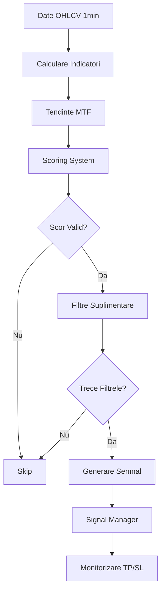
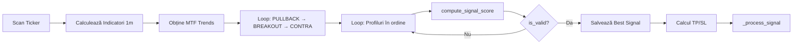
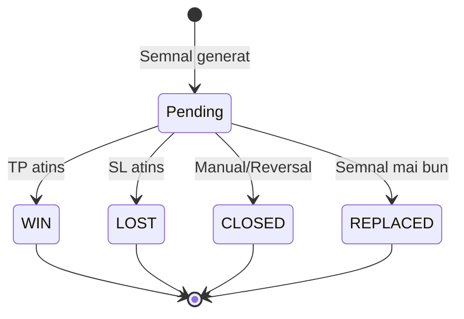

# Market Signals V7 - Strategii de Trading

Acest document descrie în detaliu strategiile de trading implementate în proiect, sistemul de scoring, și logica de generare a semnalelor.

---

## Cuprins

1. [Arhitectura Generală](#arhitectura-generală)
2. [Sistemul de Scoring (0-100)](#sistemul-de-scoring-0-100)
3. [Modurile de Trading](#modurile-de-trading)
4. [Profilurile de Risc](#profilurile-de-risc)
5. [Generarea Semnalelor](#generarea-semnalelor)
6. [Managementul Semnalelor](#managementul-semnalelor)
7. [Strategia de Exit](#strategia-de-exit)
8. [Filtre și Validări](#filtre-și-validări)
9. [Backtesting](#backtesting)

---

## Arhitectura Generală



Sistemul funcționează pe **timeframe-ul de 1 minut** pentru execuție, folosind timeframe-uri superioare (5m, 30m, 1h, 4h, 1d) doar pentru **context și filtrare MTF (Multi-Timeframe)**.

---

## Sistemul de Scoring (0-100)

Fiecare semnal primeste un scor intre 0-100 folosind un model logistic (nu suma liniara):

1) Gating hard: daca MTF alignment < prag_min => respinge semnalul (score=0).
2) probability_score = sigmoid(a0 + a1*mtf_norm + a2*macd_norm + a3*rsi_norm + a4*vwap_norm + a5*ema_norm)
3) score = round(probability_score * 100)

Configurare (config.json -> signal_settings.scoring):
- mtf_alignment_min
- logistic_coeffs (bias, mtf, macd, rsi, vwap, ema)
- macd_norm_scale
- distance_atr_max (per trade mode)

## Modurile de Trading

Sistemul suportă **3 moduri de trading**, fiecare cu logică specifică:

### 1. PULLBACK (Prioritate Maximă)

> **Concept**: Intrare în direcția trendului după un retracement temporar.

**Caracteristici:**
- Trendul principal trebuie sa fie puternic aliniat (MTF)
- RSI în zona moderată (40-65 pentru LONG, 40-55 pentru SHORT)
- Preferă intrări aproape de VWAP și EMA20 (≤0.5 ATR)
- MACD trebuie să confirme direcția

**Parametri Exit:**
- SL Multiplier: **2.0 × ATR**
- TP Multiplier: **4.0 × ATR**
- Time Stop: 120 bare (dacă progresul < 0.2R)
- Trailing Stop: Activ (3.5 × ATR de peak)

---

### 2. BREAKOUT

> **Concept**: Intrare la ruperea unui nivel de consolidare sau rezistență.

**Caracteristici:**
- Tolerează RSI mai ridicat (50-80 pentru LONG)
- Permite distanțe mai mari de VWAP (până la 1-1.5 ATR)
- Prețul trebuie să fie deasupra/sub VWAP în direcția trade-ului
- ADX > 20 pentru confirmarea trendului puternic

**Parametri Exit:**
- SL Multiplier: **1.5 × ATR** (mai strâns)
- TP Multiplier: **6.0 × ATR** (target mai mare)
- Time Stop: 60 bare (dacă progresul < 0.5R)
- Trailing Stop: Activ (3.0 × ATR de peak)

---

### 3. CONTRA (Contrarian/Reversal)

> **Concept**: Scalp contra-trend pentru reversări din extreme.

**Caracteristici:**
- Necesită RSI extrem (≤25 pentru LONG, ≥75 pentru SHORT)
- Vrem distanță mare de VWAP (≥2.0 ATR = extrem)
- Trendul pe TF-uri mari trebuie să fie OPUS direcției trade-ului
- 5m și 1m trebuie să fie deja în direcția noii reversări

**Parametri Exit:**
- SL Multiplier: **1.0 × ATR** (foarte strâns)
- TP Multiplier: **3.0 × ATR**
- Time Stop: 30 bare (dacă progresul < 0.1R)
- Trailing Stop: **Dezactivat** (scalp rapid)

---

## Profilurile de Risc

Există **4 profiluri de risc** cu praguri diferite de validare:

| Profil | Prag Minim | Descriere | MTF Necesar |
|--------|-----------|-----------|-------------|
| **PRO** | 65 pts | Relaxat pentru semnale frecvente | ≥3/6 TF |
| **STRONG** | 88 pts | Foarte restrictiv | ≥5/6 TF |
| **MEDIUM** | 72 pts | Echilibrat (default) | ≥4/6 TF |
| **RELAX** | 60 pts | Permisiv | ≥2/6 TF |

### Reguli Speciale PRO

Profilul PRO are filtre suplimentare obligatorii:
1. **Volume Filter**: Volum ≥ 80% din media SMA
2. **ADX Filter**: ADX ≥ 20 (pentru PULLBACK/BREAKOUT, nu CONTRA)

---

## Generarea Semnalelor

### Fluxul de Generare



### Calculul TP/SL

### Calculul TP/SL

Implicit foloseste ATR (configurabil):

```python
exit_mode = config.signal.get("exit_mode", "ATR")

if exit_mode == "ATR":
    tp = entry +/- ATR * tp_mult
    sl = entry -/+ ATR * sl_mult
else:
    tp = entry * (1 + tp_pct/100)
    sl = entry * (1 - sl_pct/100)
```

### Variante (A, B, C)

Semnalele sunt clasificate în **variante** bazate pe scor:

| Scor | Variant | Descriere | Risk Mode Asociat |
|------|---------|-----------|-------------------|
| ≥85 | **A** | Trend Puternic | STRONG |
| 70-84 | **B** | Trend Moderat | MEDIUM |
| <70 | **C** | Trend Relaxat Intraday | RELAX |

---

### Varianta de Condiții (STRICT / CUSTOM)

Pe lângă variantele A/B/C, engine-ul rulează **două seturi de condiții**:

- **STRICT** (default): condiții stricte pentru win-rate bun.
- **CUSTOM**: condiții mai permisive, ajustabile de user.

**Prioritate STRICT:**
- dacă există un semnal **CUSTOM** și apare un semnal **STRICT** în **aceeași direcție** (LONG/LONG sau SHORT/SHORT), semnalul rămâne dar este marcat **Backed by STRICT**.
- dacă apare **STRICT** în **direcție opusă**, semnalul CUSTOM este **înlocuit** cu STRICT.

Config relevant:
```json
signal_settings.variant_mode_default = "STRICT"
signal_settings.variant_strict = { ... }
signal_settings.variant_custom = { ... }
```

Semnalele includ câmpuri noi în `signals_state.json`:
`variant_mode`, `strict_backed`, `strict_variant`, `strict_signal_score`, etc.

---

## Managementul Semnalelor

### Ciclul de Viață al unui Semnal



### Reguli de Duplicare

**Același Ticker cu Semnal Existent:**

1. **Aceeași Direcție:**
   - Înlocuire doar dacă noul scor este ≥ `scor_existent + 10`
   - Trebuie să fie același mod (PULLBACK nu înlocuiește BREAKOUT)

2. **Direcție Opusă (Reversal):**
   - Modul trebuie să fie PULLBACK sau BREAKOUT (nu CONTRA)
   - MTF alignment 3/3 în noua direcție
   - Scor nou ≥ `scor_existent + 15`

### Cooldown per Ticker

După închiderea unui semnal, există un **cooldown configurabil**:
```python
signal_cooldown_minutes = 15  # Default
```

---

## Strategia de Exit

### Mod ATR (Default Live + Backtest)
TP/SL sunt calculate din ATR:

```
# LONG
TP = entry + ATR * tp_mult
SL = entry - ATR * sl_mult

# SHORT
TP = entry - ATR * tp_mult
SL = entry + ATR * sl_mult
```

ATR timeframe este configurabil via `signal_settings.atr_timeframe` (default 5m).
Multiplicatorii ATR pot fi diferiti per trade_mode (PULLBACK/BREAKOUT/CONTRA).

### Mod FIXED_PCT (Optional)
TP/SL bazate pe procente fixe (profit_target_pct / stop_loss_pct). Folosit doar cand:
- `exit_mode = FIXED_PCT` in config, sau
- exista override per ticker (tp_pct / sl_pct).


## Filtre si Validari

### 0.5 Market Regime Gating
- TREND: allow PULLBACK/BREAKOUT
- RANGE: allow CONTRA
- LOW_VOL: block / reduce frequency

 și Validări

Înainte de a adăuga un semnal, acesta trece prin **multiple filtre**:

### 1. US Market Hours (Stocks Only)
```python
# 9:30 AM - 4:00 PM Eastern Time
if asset_type == "stock" and not is_us_market_open():
    return  # Skip
```

### 2. Suppressed Ticker Filter
```python
# Ticker + direcție ștearsă manual recent
if is_ticker_suppressed(ticker, action):
    return  # Block pentru N minute
```

### 3. Direction Filter
```python
# Verifică dacă există semnal deschis
if existing_signal:
    if not should_accept_new_signal(...):
        return  # Block
```

### 4. Per-Ticker Cooldown
```python
if not can_open_new_signal_for_ticker(ticker, cooldown_minutes):
    return  # Block
```

### 5. Min Win Rate Filter
```python
if min_win_rate > 0:
    # Rulează backtest rapid pentru strategie
    if actual_win_rate < min_win_rate:
        return  # Block
```

### 6. Win-Rate Variant Filter
```python
# Blocează variante cu performance slabă istoric
if variant_win_rate < 30% and score < threshold + 10:
    return  # Block
```

### 7. Backtest Gating
```python
if backtest_enabled:
    if no_trades_in_30d and score < 85:
        return  # Block
```

---

## Backtesting

### Quick Backtest (7-30 zile)

Rulat automat la generarea fiecărui semnal pentru a valida strategia:

```python
results = quick_backtester.quick_backtest(
    ticker=ticker,
    risk_mode="MEDIUM",
    trade_mode="PULLBACK",
    days=30
)
# Returns: wins, losses, win_rate, profit_factor, etc.
```

### Best Strategy Finder

Compară toate combinațiile și returnează cea mai bună:

```python
# Iterează prin toate combinațiile:
for risk_mode in ["PRO", "STRONG", "MEDIUM", "RELAX"]:
    for trade_mode in ["PULLBACK", "BREAKOUT", "CONTRA"]:
        result = quick_backtest(...)
        # Salvează cel mai bun win_rate
```

### Metrici Calculate

| Metrică | Descriere |
|---------|-----------|
| **Win Rate** | % trade-uri câștigătoare |
| **Profit Factor** | sum(wins) / sum(losses) |
| **Max Drawdown** | Pierderea maximă de la peak |
| **Sharpe Ratio** | Risk-adjusted return |
| **Expectancy R** | Return mediu per trade în R |

---

## Configurație

### Fișiere Relevante

| Fișier | Scop |
|--------|------|
| `config.json` | Setări generale (TP/SL %, risk mode, etc.) |
| `watchlist.json` | Tickere monitorizate |
| `signals_state.json` | Semnale active și istorice |

### Exemplu config.json

```json
{
  "signal": {
    "risk_mode": "MEDIUM",
    "profit_target_pct": 4.0,
    "stop_loss_pct": 2.0,
    "min_candles_between_signals": 20,
    "signal_cooldown_minutes": 15
  },
  "backtest": {
    "enabled": true,
    "days": 30
  }
}
```

---

## Rezumat

| Aspect | Implementare |
|--------|--------------|
| **Timeframe Execuție** | 1 minut |
| **MTF Context** | 5m, 30m, 1h, 4h, 1d |
| **Scor Max** | 100 puncte |
| **Moduri Trading** | PULLBACK, BREAKOUT, CONTRA |
| **Profiluri Risc** | PRO (65), STRONG (88), MEDIUM (72), RELAX (60) |
| | **Exit Default** | ATR-based (configurabil, default 5m TF) |
| **Cooldown** | 15 minute per ticker (configurabil) |

---

*Document generat automat din analiza codului sursă Market Signals V7*
