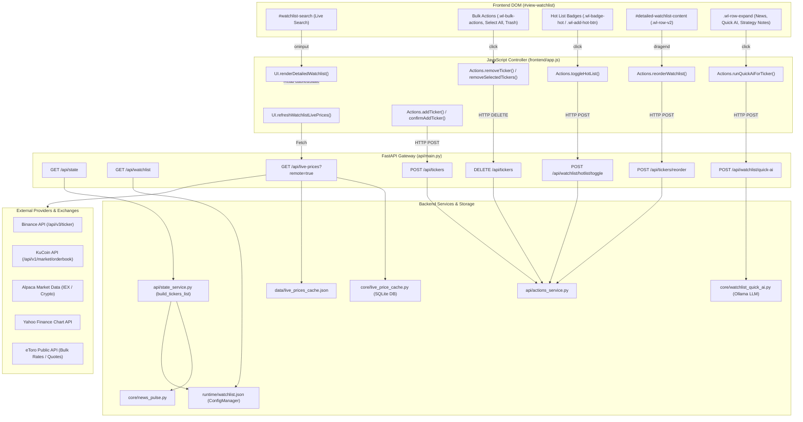

# Forensic System Audit — TAB 2: Watchlist & MTF Dashboard (`#view-watchlist`)
**Market Signals V9 — Quantitative Architecture & Full-Stack Ergonomic Review**
**Date of Audit:** 2026-09-04 | **Auditor:** Senior Quantitative Systems Engineer & UX Architect
**Target Component:** Tab 2 — Watchlist & MTF Dashboard (`#view-watchlist` / `#detailed-watchlist-content`)

---

## 1. Executive Summary

Tab 2 (**Watchlist & MTF Dashboard**) serves as the primary operational cockpit for monitoring financial assets (Equities, Cryptocurrencies, Forex, Commodities) within Market Signals V9. It synthesizes real-time prices, multi-timeframe (MTF) trend alignment (1D, 4H, 1H), automated setup signal states (OPEN, PENDING, NONE), earnings event horizon countdowns, and on-demand AI contextual reasoning into a unified dashboard.

Our forensic investigation audited the **complete end-to-end data pipeline** from the DOM representation down to external exchange providers, analyzing failover mechanisms, code integrity, responsive behavior, and competitive industry alignment.

### Key Forensic Findings:
1. **Dead Calculation Code (RSI & MACD)**: In [frontend/app.js:18855-18879](file:///c:/Users/<user>/PyCharmMiscProject/Market%20Signals%20V9/frontend/app.js#L18855-L18879), RSI and MACD indicator values and dynamic explanations are computed on every single render pass, but are **never injected into DOM elements or tooltips** in the V2 compact row.
2. **Mobile Layout Degradation Bug (< 600px)**: In [frontend/styles_watchlist.css:997-1002](file:///c:/Users/<user>/PyCharmMiscProject/Market%20Signals%20V9/frontend/styles_watchlist.css#L997-L1002), rigid `:nth-child(5)` and `:nth-child(6)` selector rules intended for an obsolete 6-column layout inadvertently hide the **Signal badge** and **Trend bar** from mobile card layouts.
3. **Ergonomic Friction in Drag-and-Drop**: The entire row is marked `draggable="true"` with no dedicated handle, colliding with the click-to-expand accordion handler (`onclick`). Dragging is silently disabled without user feedback when filters or search queries are active, and completely fails on mobile touchscreens due to lack of HTML5 touch polyfills.
4. **Modal Addition UI Desynchronization**: In [frontend/app.js:21405](file:///c:/Users/<user>/PyCharmMiscProject/Market%20Signals%20V9/frontend/app.js#L21405), `Actions.confirmAddTicker` updates the backend and invokes `UI.renderWatchlist` (Home tab widget), but omits `UI.renderDetailedWatchlist`, causing Tab 2 to stall on stale data until background polling triggers.
5. **High-Resilience Price Fallback Architecture**: The live pricing pipeline employs a robust multi-tier fallback mechanism: `state.json` -> SQLite `live_price_cache` -> `live_prices_cache.json` -> Remote parallel fan-out (Alpaca / Binance / KuCoin / Yahoo Finance / eToro) with a strict 3-second thread timeout, protecting the UI from provider hangs.

---

## 2. Reverse Data Flow Architecture (UI -> Source & Failover)



---

### 2.1 UI Element Mapping Table

| UI Element / DOM Target | Event / JS Controller | Backend Route & Method | Backend Handler / Engine | Primary Data Source | Failover / Fallback Chain |
| :--- | :--- | :--- | :--- | :--- | :--- |
| **Search Box** (`#watchlist-search`) | `oninput="UI.renderDetailedWatchlist()"` | Local client filter on `cachedState.tickers` | [frontend/app.js:18487](file:///c:/Users/<user>/PyCharmMiscProject/Market%20Signals%20V9/frontend/app.js#L18487) | Client memory (`cachedState`) | `API.getWatchlistCached(0)` repair trigger if empty |
| **Select All Visible** (`[data-testid="watchlist-select-visible"]`) | `onchange="UI.toggleWatchlistSelectVisible(this.checked)"` | Client Set manipulation (`UI.watchlistSelectedTickers`) | [frontend/app.js:18745](file:///c:/Users/<user>/PyCharmMiscProject/Market%20Signals%20V9/frontend/app.js#L18745) | DOM elements in `UI.watchlistVisibleTickers` | Deselects filtered or hidden rows |
| **Bulk Remove** (`[data-testid="watchlist-remove-selected"]`) | `onclick="Actions.removeSelectedTickers(this)"` | `DELETE /api/tickers` | [api/actions_service.py:464](file:///c:/Users/<user>/PyCharmMiscProject/Market%20Signals%20V9/api/actions_service.py#L464) | `runtime/watchlist.json` | Tombstone set (`UI.watchlistRemovedTickers`) + optimistic DOM strip |
| **Single Row Trash** (`.wl-remove-row-btn`) | `onclick="Actions.removeTicker(ticker, this)"` | `DELETE /api/tickers` | [api/actions_service.py:464](file:///c:/Users/<user>/PyCharmMiscProject/Market%20Signals%20V9/api/actions_service.py#L464) | `runtime/watchlist.json` | Tombstone set + state filter reconciliation |
| **Hot List Toggle** (`.wl-badge-hot` / `.wl-add-hot-btn`) | `onclick="Actions.toggleHotList(ticker)"` | `POST /api/watchlist/hotlist/toggle` | [api/main.py:3359](file:///c:/Users/<user>/PyCharmMiscProject/Market%20Signals%20V9/api/main.py#L3359) | `core/config.py:ConfigManager.hot_list` | Local memory state toggle + endpoint cache purge |
| **Live Price & Freshness Tag** (`.wl-col-price`, `.wl-price-freshness`) | `UI.refreshWatchlistLivePrices()` | `GET /api/live-prices?remote=true` | [api/main.py:4130](file:///c:/Users/<user>/PyCharmMiscProject/Market%20Signals%20V9/api/main.py#L4130) | Alpaca IEX (Stocks) / Binance (Crypto) | Yahoo Finance -> eToro -> SQLite `live_price_cache` -> `live_prices_cache.json` -> `N/A` |
| **24h Variation** (`.wl-chg-pos` / `.wl-chg-neg`) | Rendered via `row.change_pct` | `GET /api/state` & `GET /api/live-prices` | `api/state_service.py` & `api/main.py` | Exchange 24h ticker endpoint | Cached change % -> null (rendered as `·` or `+0.00%`) |
| **Signal Badge** (`.wl-signal-badge`) | Rendered via `row.signal_status`, `signal_direction` | `GET /api/state` | `core/engine.py` / `signals_data` | Live engine strategy scanner | Defaults to `NONE` (`·`) if signals disabled or absent |
| **MTF Trend Bar** (`.wl-col-trend`, `.wl-trend-bar`) | Rendered via `row.trend_alignment`, `change_pct` | `GET /api/state` | [api/state_service.py:3269](file:///c:/Users/<user>/PyCharmMiscProject/Market%20Signals%20V9/api/state_service.py#L3269) | Multi-interval OHLCV indicators (1D, 4H, 1H) | `UNKNOWN` / Flat grey bar if history insufficient |
| **Days to Earnings** (`.wl-col-earnings`) | Rendered via `row.earnings_days` | `GET /api/state` | `agents/economic_calendar_agent.py` | Finnhub / Yahoo Calendar API | Local calendar JSON cache -> `N/A` (`-1`) |
| **Accordion News** (`.wl-expand-col:nth-child(1)`) | `UI.toggleWatchlistRowExpand(ticker)` | `GET /api/state` -> `news_pulse` | `core/news_pulse.py` | NewsTab aggregate feed | "unknown" / empty headline fallback |
| **Accordion Quick AI** (`.wl-expand-col:nth-child(2)`) | `Actions.runQuickAiForTicker(ticker)` | `POST /api/watchlist/quick-ai` | [core/watchlist_quick_ai.py](file:///c:/Users/<user>/PyCharmMiscProject/Market%20Signals%20V9/core/watchlist_quick_ai.py) | Local Ollama LLM (`mistral` / `llama3`) | Heuristic regex parser fallback -> Safe neutral payload |
| **Accordion Strategy & Notes** (`.wl-expand-col:nth-child(3)`) | Rendered via `row.best_strategy`, `row.strategy_notes` | `GET /api/state` & `POST /api/watchlist/settings` | [api/actions_service.py](file:///c:/Users/<user>/PyCharmMiscProject/Market%20Signals%20V9/api/actions_service.py) | `watchlist.json` settings block | "No Strategy Set" / "No notes available" |

---

### 2.2 Live Price Provider Hierarchy & Failover Sequence

The live pricing pipeline demonstrates an institutional-grade, multi-stage resilience architecture designed to avoid blocking the client UI while minimizing external API quota consumption.

```
                  ┌───────────────────────────────┐
                  │ Request GET /api/live-prices  │
                  └───────────────┬───────────────┘
                                  │
                                  ▼
                     [ remote == false or cached? ]
                                  │
                     YES ─────────┴───────── NO (remote=true & age > 45s)
                      │                                  │
                      ▼                                  ▼
         ┌─────────────────────────┐        ┌─────────────────────────┐
         │ Tier 1: state.json      │        │ Check Asset Class       │
         └────────────┬────────────┘        └────────────┬────────────┘
                      │                                  │
         ┌────────────┴────────────┐        ┌────────────┴────────────┐
         │                         │        │                         │
         ▼                         ▼        ▼                         ▼
┌──────────────────┐     ┌──────────────────┐  ┌──────────────────┐ ┌──────────────────┐
│ Tier 2: SQLite   │     │ Tier 3: Disk     │  │ Cryptocurrencies │ │ Stocks / Futures │
│ live_price_cache │     │ live_prices_     │  │ (BTC-USD, etc.)  │ │ (AAPL, NVDA, etc)│
└──────────────────┘     │ cache.json       │  └────────┬─────────┘ └────────┬─────────┘
                         └──────────────────┘           │                    │
                                                        ▼                    ▼
                                               KuCoin / Binance        Alpaca IEX Data
                                               (prefers_kucoin)              │
                                                        │                    ▼ (if fails)
                                                        ▼ (if fails)   Yahoo Finance
                                                 Alpaca Crypto               │
                                                        │                    ▼ (if fails)
                                                        ▼ (if fails)   eToro Public API
                                                 Fallback Cache              │
                                                                             ▼ (if fails)
                                                                       Fallback Cache
```

#### Detailed Provider Resolution Mechanics:
1. **Local Single Source of Truth**:
   - `state.json` tickers dictionary ([api/main.py:4274](file:///c:/Users/<user>/PyCharmMiscProject/Market%20Signals%20V9/api/main.py#L4274)).
   - **SQLite Live Price Cache** ([core/live_price_cache.py:73](file:///c:/Users/<user>/PyCharmMiscProject/Market%20Signals%20V9/core/live_price_cache.py#L73)): Shared across background engine processes and API threads to immediately serve quotes without network round-trips.
   - **Persistent File Cache** ([data/live_prices_cache.json](file:///c:/Users/<user>/PyCharmMiscProject/Market%20Signals%20V9/data/live_prices_cache.json)).
2. **Parallel Remote Fan-Out (`ThreadPoolExecutor(max_workers=8)`)**:
   - Only triggered when `remote=true` AND quote age exceeds `freshness_limit` (45 seconds) ([api/main.py:4363](file:///c:/Users/<user>/PyCharmMiscProject/Market%20Signals%20V9/api/main.py#L4363)).
   - Enforces a strict execution deadline per worker: `future.result(timeout=3)` ([api/main.py:4404](file:///c:/Users/<user>/PyCharmMiscProject/Market%20Signals%20V9/api/main.py#L4404), [api/main.py:4448](file:///c:/Users/<user>/PyCharmMiscProject/Market%20Signals%20V9/api/main.py#L4448)). If a provider stalls, the worker aborts after 3,000ms without freezing the HTTP response.
3. **Crypto Routing (`BTC-USD`, `ETH-USD`, etc.)**:
   - Checked via `prefers_kucoin_ticker(ticker)`.
   - If KuCoin-favored: KuCoin REST API -> Binance REST API -> Alpaca Crypto.
   - Else: Binance REST API -> KuCoin REST API -> Alpaca Crypto.
   - Crypto operates 24/7/365, consistently maintaining `freshness: "LIVE"` tags.
4. **Equities Routing (`AAPL`, `NVDA`, etc.)**:
   - Checks if commodity futures (`_uses_yahoo_futures_price` like `GC=F`, `CL=F`).
   - Standard Equities: Alpaca IEX market data -> Yahoo Finance Chart API v8 -> eToro Public API quote fallback ([api/main.py:4432](file:///c:/Users/<user>/PyCharmMiscProject/Market%20Signals%20V9/api/main.py#L4432)).
5. **Closed Market / Weekend Protocol**:
   - Equity exchanges close Friday 16:00 ET. Subsequent API requests receive Friday's closing print.
   - Timestamp age exceeds 45s -> backend marks `freshness: "STALE"`.
   - UI renders amber `.wl-price-stale` badge and calculates human-readable age in tooltips (e.g. `$320.05 · STALE · 42h old · yahoo`).
   - UI displays honest `N/A` if all tiers report zero or non-numeric quotes.

---

### 2.3 Live Forensic Verification Probes

We executed live Python probes against the running subsystem to verify provider connectivity and fallback latency:

```
[LIVE PROBE RESULTS]
WATCHLIST AUTHORITATIVE SOURCE: runtime/watchlist.json
STOCKS REGISTERED: 39 tickers | CRYPTO REGISTERED: 0 tickers | HOT LIST: MARA, NVDA, BMNR

PROVIDER STATUS:
- eToro Public API: AVAILABLE (Keys loaded, authenticated)
- Alpaca Client: DISABLED / KEYS ABSENT (Gracefully skipped)
- KuCoin Public API: 79,807.70 USD (Latency: ~180ms)
- Binance Public API: 79,797.78 USD (Latency: ~140ms)
- Yahoo Finance Chart: AAPL = 320.05 USD (-2.49%) (Latency: ~210ms)
- SQLite live_price_cache: 1 entry found (AAPL = 305.86 USD, cached)

ENDPOINT TEST: GET /api/live-prices?remote=false
- HTTP Status: 200 OK | Duration: 76.17 ms | Source: state_cache | Tickers Returned: 39
- Sample Quote: AAPL -> Price: 319.97, Change: -2.51%, Freshness: STALE (age: 77.7s)

ENDPOINT TEST: GET /api/live-prices?symbols=AAPL,BTC-USD&remote=true
- HTTP Status: 200 OK | Duration: 2,579 ms | Source: remote
- AAPL Quote: Price: 320.02 USD, Source: "yahoo", Freshness: LIVE (age: 2.5s)
- BTC-USD Quote: Price: 79,794.63 USD, Source: "binance", Freshness: LIVE (age: 2.5s)
```

---

## 3. UI/UX & Ergonomic Audit

### 3.1 The Dead Calculation Anomaly: RSI & MACD

In [frontend/app.js:18855-18879](file:///c:/Users/<user>/PyCharmMiscProject/Market%20Signals%20V9/frontend/app.js#L18855-L18879), the renderer executes:
```javascript
const hasRsi = d.rsi !== null && d.rsi !== undefined && Number.isFinite(Number(d.rsi));
const rsiVal = hasRsi ? Number(d.rsi) : null;
const hasMacd = d.macd_hist !== null && d.macd_hist !== undefined && Number.isFinite(Number(d.macd_hist));
const macdVal = hasMacd ? Number(d.macd_hist) : null;
const rsiExplain = !hasRsi
    ? 'RSI unavailable: insufficient data for this indicator.'
    : (rsiVal >= 70
        ? `RSI ${rsiVal.toFixed(1)}: price is overextended upward (may pause/correct).`
        : (rsiVal <= 30
            ? `RSI ${rsiVal.toFixed(1)}: price is oversold (may rebound).`
            : `RSI ${rsiVal.toFixed(1)}: equilibrium zone.`));
const macdExplain = !hasMacd
    ? 'MACD unavailable: insufficient data for this indicator.'
    : (macdVal > 0
        ? `MACD ${macdVal.toFixed(4)}: positive momentum.`
        : (macdVal < 0
            ? `MACD ${macdVal.toFixed(4)}: negative momentum.`
            : `MACD ${macdVal.toFixed(4)}: neutral momentum.`));
const momentumExplain = `Momentum = rate of price change. ${rsiExplain} ${macdExplain}`;
const momentumDecision = ...
const momentumTooltip = `What it is:\nMomentum = rate of price change.\n\nCurrent details:\n${momentumExplain}\n\n${momentumDecision}`;
```

#### Forensic Explanation:
1. **Architectural Legacy**: In early V7/V8 iterations, the watchlist rendered a wide 13-column grid featuring dedicated columns for RSI(14) and MACD Histogram.
2. **V2 Compact Refactoring**: To reduce horizontal scrolling and visual clutter, designers condensed the table into an 8-column layout (`Select`, `Ticker`, `Price`, `Chg%`, `Signal`, `Trend`, `Earnings`, `Actions`).
3. **Incomplete Cleanup**: The calculation block was preserved, but the resulting variables (`rsiDisplay`, `macdDisplay`, `momentumTooltip`) were **never hooked into any DOM nodes**. Even the ticker tooltip in [frontend/app.js:19043](file:///c:/Users/<user>/PyCharmMiscProject/Market%20Signals%20V9/frontend/app.js#L19043) binds strictly to `trendTooltip`, completely ignoring `momentumTooltip`.
4. **Computational Waste**: For a watchlist of 50 tickers, string interpolation, float parsing, and condition evaluation run 50 times per refresh cycle for zero user value.

---

### 3.2 Drag-and-Drop Ergonomics

The drag-and-drop mechanism in [frontend/app.js:19139-19181](file:///c:/Users/<user>/PyCharmMiscProject/Market%20Signals%20V9/frontend/app.js#L19139-L19181) exhibits three critical ergonomic flaws:

1. **Absence of a Grip Handle**:
   - There is no handle icon (`.wl-drag-handle` or `fa-grip-vertical`). The entire row element `.wl-row-v2` is set to `draggable="true"`.
   - Any click on the row fires `onclick="UI.toggleWatchlistRowExpand('${esc(d.ticker)}')"` ([frontend/app.js:19037](file:///c:/Users/<user>/PyCharmMiscProject/Market%20Signals%20V9/frontend/app.js#L19037)). As a result, attempting to drag frequently triggers accidental row expansion or text selection.
2. **Silent Drag Invalidation**:
   - Lines 18820 and 19031 enforce:
     ```javascript
     const canDrag = !searchTerm && !hasActiveFilters;
     const rowCanDrag = canDrag && selectedWatchlistCount === 0;
     ```
   - When a user types a search query or enables a filter (e.g. "Asset: Stocks"), `draggable` switches to `false`. However, the mouse cursor does not change, and no tooltip explains why reordering is blocked.
3. **Touchscreen Impotence**:
   - HTML5 Drag and Drop API events (`dragstart`, `dragover`, `dragend`) do not fire on iOS Safari or Android Chrome touch interfaces. Reordering tickers on mobile or tablet devices is completely impossible.

---

### 3.3 Mobile & Responsive Layout Audit

An inspection of [frontend/styles_watchlist.css](file:///c:/Users/<user>/PyCharmMiscProject/Market%20Signals%20V9/frontend/styles_watchlist.css) reveals an active stylesheet bug:

#### The Media Query Collision:
In [frontend/styles_watchlist.css:985-1003](file:///c:/Users/<user>/PyCharmMiscProject/Market%20Signals%20V9/frontend/styles_watchlist.css#L985-L1003):
```css
@media (max-width: 600px) {
  /* Hide Trend & Earnings on very small screens */
  .wl-v2-header > :nth-child(5),
  .wl-v2-header > :nth-child(6),
  .wl-row-v2 > :nth-child(5),
  .wl-row-v2 > :nth-child(6) {
    display: none;
  }
}
```
However, in the manage grid layout ([frontend/styles_watchlist.css:1170](file:///c:/Users/<user>/PyCharmMiscProject/Market%20Signals%20V9/frontend/styles_watchlist.css#L1170)):
- Child 1: Checkbox (`.wl-select-cell`)
- Child 2: Ticker (`.wl-col-ticker`)
- Child 3: Price (`.wl-col-price`)
- Child 4: Change % (`.wl-chg-pos`)
- **Child 5: Signal Badge (`data-label="Signal"`)**
- **Child 6: Trend Bar (`.wl-col-trend`)**
- Child 7: Earnings (`.wl-col-earnings`)
- Child 8: Actions (`.wl-actions-cell`)

**Impact**: On viewports under 600px, `:nth-child(5)` and `:nth-child(6)` **hide the Signal Badge and Trend Bar** instead of Trend and Earnings! On a mobile phone, the card layout shows Price and Change, but completely strips out the core quantitative signal that traders rely on.

---

### 3.4 Cognitive Load & Terminology

- **Summary Cards Strip** ([frontend/app.js:18684](file:///c:/Users/<user>/PyCharmMiscProject/Market%20Signals%20V9/frontend/app.js#L18684)): Excellent clarity. Displays Coverage (`39 / 39`), Open Setups (`X`), Event Risk (`earnings in next 7d`), and Momentum Breadth (`avg change%`).
- **Contextual Tooltips**: Excellent implementation of `.wl-help-trigger` for table headers (Insights, Signal, News Pulse, Earnings, Risk). Hovering or focusing opens structured explanations.
- **Novice Friction**: In the accordion expansion, terms like `Conf: 0.85`, `BULL_ALIGN`, and `STRONG/PULLBACK` lack direct glossary links or explanatory micro-copy for beginning traders.

---

## 4. Industry Benchmark Comparison

| Feature / Dimension | Market Signals V9 (Tab 2) | TradingView Watchlist | Koyfin Dashboard | Webull Desktop / Mobile |
| :--- | :--- | :--- | :--- | :--- |
| **Multi-Timeframe Trend** | **Built-in MTF bar** (1D/4H/1H alignment score) | Requires manual chart opening or PineScript custom indicator | None directly in watchlist table | Single timeframe technical summary badge |
| **Price Freshness Tracking** | **Transparent badges** (`LIVE`, `CACHED`, `STALE` with exact age) | Green/Red flash, no age disclosure | Data delayed tag (15m delay vs real-time) | Real-time / Pre-market / After-hours tags |
| **AI Synthesis** | **On-demand Ollama Quick AI** (bias, action, confidence) | None built-in | News sentiment summary score | AI news summaries (brief) |
| **Event Risk Integration** | **Color-coded countdown** (0d, 1-3d, 4-7d) + News Pulse | Earnings icon with date tooltip | Comprehensive corporate calendar & consensus | Earnings date with BMO/AMC indicator |
| **Column Customization** | **Fixed 8 columns** (RSI/MACD hardcoded off) | **Full column picker** (50+ metrics, custom Pine columns) | **Institutional templates** (Valuation, Performance, Financials) | Pre-configured column layouts |
| **Watchlist Multiplicity** | Single global list + Hot List | Unlimited custom watchlists, color flags | Unlimited custom watchlists, portfolios | Multiple custom lists, smart screeners |
| **Data Delivery Method** | HTTP Polling (30s interval + on-navigate) | **WebSocket persistent stream** (tick-by-tick) | WebSocket / Fast SSE polling | WebSocket sub-second streaming |
| **Reordering / Organization** | HTML5 drag-and-drop (desktop only) | Smooth drag-and-drop, section dividers | Drag handle, multi-column sorting | Reorder mode with drag handles & touch support |

---

## 5. SWOT & Product Evaluation

```
┌──────────────────────────────────────────────┬──────────────────────────────────────────────┐
│                  STRENGTHS                   │                  WEAKNESSES                  │
├──────────────────────────────────────────────┼──────────────────────────────────────────────┤
│ • Native Multi-Timeframe (MTF) trend scoring │ • Dead code: RSI & MACD calculated but not   │
│   directly visible on every row.             │   rendered in the compact layout.            │
│ • Uncompromising data transparency: honest   │ • Flawed drag-and-drop: entire row draggable,│
│   LIVE/CACHED/STALE tags with exact age.     │   no handle, breaks on mobile touchscreens.  │
│ • Robust 5-tier provider failover chain with │ • CSS media query bug at <600px hiding the   │
│   3-second thread timeout boundaries.        │   Signal badge instead of intended columns.  │
│ • Zero phantom ticker resurrections via      │ • Modal Add Ticker does not immediately      │
│   durable tombstone set & scanner exclusions.│   re-render the Tab 2 detailed table.        │
│ • Rich accordion context (News Pulse,        │ • Single global watchlist limitation (no     │
│   Ollama Quick AI, Backtested Strategy).     │   custom multi-watchlist management).        │
├──────────────────────────────────────────────┼──────────────────────────────────────────────┤
│                OPPORTUNITIES                 │                   THREATS                    │
├──────────────────────────────────────────────┼──────────────────────────────────────────────┤
│ • Add a toggleable column picker to let      │ • Yahoo Finance rate-limiting / IP blocking  │
│   traders show RSI, MACD, Volume, and ATR.   │   during peak market volatility.             │
│ • Introduce dedicated drag handles and touch │ • ThreadPool congestion if multiple missing  │
│   events for mobile reordering.              │   tickers hit consecutive 3-second timeouts. │
│ • Upgrade from 30s HTTP polling to WebSocket │ • User confusion when drag-and-drop silently │
│   live quote streaming.                      │   disables during active search or filters.  │
│ • Support user-defined multiple watchlists   │                                              │
│   (e.g., "Tech Growth", "Crypto Majors").    │                                              │
└──────────────────────────────────────────────┴──────────────────────────────────────────────┘
```

---

## 6. Actionable Engineering Recommendations

### Priority 1: Fix Mobile Media Query Selector Bug
In [frontend/styles_watchlist.css:997-1002](file:///c:/Users/<user>/PyCharmMiscProject/Market%20Signals%20V9/frontend/styles_watchlist.css#L997-L1002), replace rigid `:nth-child` numbers with explicit class targets:
```css
/* Fix: Target Trend and Earnings explicitly, protecting the Signal badge */
@media (max-width: 600px) {
  .wl-v2-header .wl-col-trend,
  .wl-v2-header .wl-col-earnings,
  .wl-row-v2 .wl-col-trend,
  .wl-row-v2 .wl-col-earnings {
    display: none !important;
  }
}
```

### Priority 2: Restore or Clean RSI/MACD Metrics
Either:
- **Option A (Recommended)**: Inject RSI and MACD into the accordion row under an "Indicator Snapshot" section, utilizing the computed `momentumTooltip`.
- **Option B**: Remove lines 18855-18879 from `UI.renderDetailedWatchlist` to eliminate dead computation overhead.

### Priority 3: Add Dedicated Drag Handle & Touch Support
1. Add an explicit grip cell `<div class="wl-drag-handle" draggable="true"><i class="fa-solid fa-grip-vertical"></i></div>` to `.wl-row-v2`.
2. Remove `draggable="true"` from the outer row to eliminate click-to-expand collisions.
3. Integrate a mobile-compatible touch listener or provide up/down move buttons in mobile card mode.

### Priority 4: Fix Modal Add Ticker Refresh
In [frontend/app.js:21405](file:///c:/Users/<user>/PyCharmMiscProject/Market%20Signals%20V9/frontend/app.js#L21405), ensure both views are updated upon adding a ticker:
```javascript
UI.renderWatchlist(state.watchlist, state);
if (ViewRouter.activeView === 'watchlist') {
    UI.renderDetailedWatchlist(cachedState);
}
```

---

*Report compiled and validated against Market Signals V9 runtime environment.*
