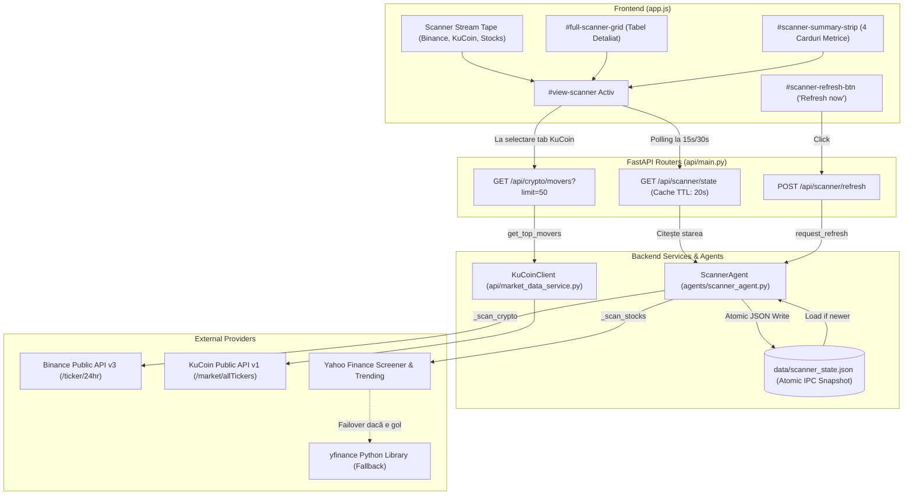

# AUDIT CRIMINALISTIC COMPLET: TAB 3 - MARKET SCANNER (`#view-scanner`)

**Data Evaluării:** 2026-09-04  
**Versiune Sistem:** Market Signals V9 (Multi-Asset Trading Intelligence Engine)  
**Auditor:** Senior Quantitative Systems Engineer, Full-Stack Software Architect & UX/UI Expert  
**Obiectiv:** Forensic Data Flow Audit, Fallback & Resilience Analysis, Ergonomic & Cognitive UX Review, Industry Benchmark & SWOT Strategy  

---

## 1. REVERSE DATA FLOW (UI -> Sursă & Lanț de Fallback)

### 1.1 Harta Elementelor DOM și Controllere Frontend

| Element DOM / Selector | Fișier Sursă & Linie | Controller JS (`frontend/app.js`) | Rută API Backend | Backend Handler / Agent | Sursă Primară de Date |
| :--- | :--- | :--- | :--- | :--- | :--- |
| **Tape Col: Binance** (`#crypto-marquee`) | `index.html:670` | `UI.renderScanner()` (`L3944-4113`), `UI._renderTapeColumn()` (`L3817`), `UI._tapeCascade()` (`L3805`) | `GET /api/scanner/state` | `ScannerAgent.get_state()` (`agents/scanner_agent.py:493`) | Binance Public API v3 (`ticker/24hr`) |
| **Tape Col: KuCoin** (`#kucoin-marquee`) | `index.html:677` | `UI.renderScanner()` (`L3981-4034`), `API.fetchWithTimeout('/api/crypto/movers?limit=15')` | `GET /api/crypto/movers?limit=15` | `KuCoinClient.get_top_movers()` (`api/market_data_service.py:435`) | KuCoin Public API v1 (`market/allTickers`) |
| **Tape Col: Stocks** (`#stocks-marquee`) | `index.html:686` | `UI.renderScanner()` (`L4080-4098`), `UI._renderTapeColumn()` (`L3817`) | `GET /api/scanner/state` | `ScannerAgent._scan_stocks()` (`agents/scanner_agent.py:651`) | Yahoo Finance Screeners + Trending API |
| **Sparklines Marquee** (`.tr-spark[data-spark]`) | `app.js:3893-3900` | `UI._refreshScannerSparklines()` (`L3863`), `UI._patchScannerSparklines()` (`L3892`) | `GET /api/sparklines?symbols=...` | `api_sparklines()` (`api/main.py`) | In-memory cache + Yahoo/Binance OHLC |
| **Summary Strip** (`#scanner-summary-strip`) | `index.html:651` | `UI.renderScannerSummary(state, rows, tab)` (`L4125-4165`) | N/A (derivat client-side din setul activ) | Algoritm agregare `rows.reduce(...)` | Memorie locală browser (`cachedState.scanner`) |
| **Sub-Tab Binance** (`#tab-crypto`) | `index.html:695` | `UI.switchScannerTab('crypto')` (`L4167`), `UI.renderFullScanner()` (`L4180`) | `GET /api/scanner/state` | `ScannerAgent.get_state()` (`agents/scanner_agent.py:493`) | Binance (`source: 'binance'`) |
| **Sub-Tab KuCoin** (`#tab-kucoin`) | `index.html:698` | `UI.switchScannerTab('kucoin')` (`L4167`), `UI.renderFullScanner()` (`L4206-4321`) | `GET /api/crypto/movers?limit=50` | `KuCoinClient.get_top_movers(limit=50)` (`api/market_data_service.py:435`) | KuCoin (`market/allTickers`) |
| **Sub-Tab Stocks** (`#tab-stocks`) | `index.html:702` | `UI.switchScannerTab('stocks')` (`L4167`), `UI.renderFullScanner()` (`L4324-4480`) | `GET /api/scanner/state` | `ScannerAgent._scan_stocks()` (`agents/scanner_agent.py:651`) | Yahoo Finance (`source != 'binance'`) |
| **Sort Dropdown** (`#scanner-sort-select`) | `index.html:708` | `UI.changeScannerSort(mode)` (`L4119-4123`) -> 'volatility', 'gainers', 'losers', 'active' | Sortare client-side în memorie | `Array.prototype.sort()` în `app.js:4353-4375` | Date din cache local |
| **Grilă Principală** (`#full-scanner-grid`) | `index.html:722` | `UI.renderFullScanner()` (`L4180-4480`) | `GET /api/scanner/state` sau `GET /api/crypto/movers` | `agents/scanner_agent.py` & `api/market_data_service.py` | Binance / KuCoin / Yahoo Finance |
| **Buton Refresh Manual** (`#scanner-refresh-btn`) | `index.html:642` | `Actions.refreshScanner()` (`L16601-16624`), `API.refreshScanner()` (`L834-846`) | `POST /api/scanner/refresh` | `api_scanner_refresh()` (`api/main.py:6982`) | `agent.request_refresh()` asincron |
| **Freshness Badge** (`#scanner-freshness-badge`) | `index.html:648` | `FreshnessBadge.inject(...)` (`L4188-4191`) | Citit din `scannerState.as_of_utc` | `agents/scanner_agent.py:569` | Timestamp UTC ultim scan reușit |
| **Alertă Degenerare** (`#scanner-status-alert`) | `index.html:650` | `UI.renderFullScanner()` (`L4193-4203`) | Citit din `scannerState.status.last_error` | `agents/scanner_agent.py:553` | Excepții backend înregistrate |

---

### 1.2 Mecanismul Rutelor API Backend și Ciclul de Refresh



1. **`GET /api/scanner/state` (`api/main.py:6972`):**
   - Răspunde din payload cache de 20 secunde (`_endpoint_payload_get("scanner_state", ttl_seconds=20.0)`).
   - Dacă expiră sau nu e în cache, apelează `agent.get_state()`.
   - Implementează **Lazy Refresh**: dacă cache-ul nu conține `hot_tickers` și nu rulează un scan (`refreshing=False`), pornește automat un thread de reîmprospătare în fundal (`agent.request_refresh()`) fără a bloca cererea HTTP.
   - Setează starea `"WARMING_UP"` dacă datele nu sunt încă gata.

2. **`POST /api/scanner/refresh` (`api/main.py:6982`):**
   - Invalidează cache-ul de endpoint (`_endpoint_payload_clear("scanner_state")`).
   - Declansează asincron `agent.request_refresh()` și returnează `{ status: "accepted", async: true }`.

3. **`GET /api/crypto/movers` (`api/main.py:4552`):**
   - Preluat direct prin `KuCoinClient.get_top_movers(limit=limit)` (`api/market_data_service.py:1280`).
   - Are cache intern dedicat în memorie de 60s (`KuCoinClient._movers_cache`).

---

### 1.3 Lanțul de Fallback, Rezistența la Erori și Starea UI

Pentru a evalua integritatea structurală în scenarii de avarie, a fost inspectat codul de fallback pentru fiecare furnizor:

```
+---------------------------------------------------------------------------------------------------+
|                                 LANȚUL COMPLET DE FAILOVER (FALLBACK CHAIN)                       |
+-------------------+------------------------------------+---------------------+--------------------+
| Sursă Date        | Condiție Avarie                    | Nivel Fallback      | Răspuns în UI      |
+-------------------+------------------------------------+---------------------+--------------------+
| KuCoin API        | Timeout / HTTP 429 / Non-200       | 1. Cache memorie    | UI arată datele    |
| (Crypto Movers)   | Eroare rețea (DNS, offline)        |    (dacă <= 600s)   | cached, marcate    |
|                   |                                    | 2. Payload gol      | 'stale: true'      |
|                   |                                    |    (dacă > 600s)    | Marquee: 'Server   |
|                   |                                    | 3. window.cached... | offline' sau card  |
|                   |                                    |    în browser       | eroare cu Retry    |
+-------------------+------------------------------------+---------------------+--------------------+
| Binance API       | Circuit Breaker deschis            | 1. Returnează []    | Nu cade întreg     |
| (Crypto Hot List) | Timeout > 6s                       | 2. Fallback la      | scannerul: Stocks  |
|                   | HTTP 429 (Rate Limit)              |    scanner_state    | continuă să se     |
|                   | HTTP 451 / 403 (Geo-block)         |    de pe disc       | randeze normal.    |
|                   |                                    | 3. LocalStorage     | Badge 'Degraded'   |
|                   |                                    |    appScanner       | dacă apare eroare. |
+-------------------+------------------------------------+---------------------+--------------------+
| Yahoo Finance     | HTTP 429 (Rate limit scrIds)       | 1. Trending US API  | Grila filtrează    |
| (Stocks Screener) | Screener returnează 0 quotes       | 2. yfinance descarcă| simbolurile care   |
|                   | JSON malformat / timeout           |    acțiuni din      | au preț valid (>0).|
|                   |                                    |    Watchlist        | Dacă toate pică,   |
|                   |                                    | 3. cached_stock_list| folosește ultimele |
|                   |                                    |    anterior (150)   | 150 acțiuni din RAM|
+-------------------+------------------------------------+---------------------+--------------------+
| Inter-Process IPC | Crashează procesul FastAPI sau     | Fisier atomic disc  | UI se reconectează |
| (Disk Snapshot)   | MarketEngine daemon                | data/               | automat la 15s,    |
|                   |                                    | scanner_state.json  | păstrează datele   |
|                   |                                    | (schema_version: 1) | din localStorage   |
+-------------------+------------------------------------+---------------------+--------------------+
```

#### Detalii Algoritmice de Reziliență:
1. **KuCoin Circuit & Stale Gate (`api/market_data_service.py:450-477`):**
   - Dacă KuCoin este inaccesibil, dar există cache mai proaspăt de 600 secunde (`_STALE_MAX_AGE_SECONDS = 600`), backend-ul returnează:
     `{ ...stale_data, "available": false, "stale": true, "reason": "KuCoin API unavailable, showing cached data (Xs old)" }`.
   - Dacă cache-ul depășește 10 minute, datele sunt invalidate forțat pentru a nu induce traderul în eroare cu semnale vechi.
2. **Yahoo Finance Screener Triplu + Fallback Watchlist (`agents/scanner_agent.py:663-848`):**
   - Interoghează în paralel 3 screenere: `day_gainers`, `day_losers`, `most_actives`.
   - Interoghează `trending/US` pentru identificarea mișcărilor din sesiunile pre-market și after-hours.
   - Dacă screenerele Yahoo eșuează (e.g. status 429), declanșează descărcarea de date istorice pe 1 zi via `yfinance.download()` pentru toate ticker-ele din Watchlist-ul utilizatorului.
   - Dacă și aceasta eșuează, reutilizează `cached_stock_list` din memorie (limitat la 150 de companii).
3. **Persistență Atomică Inter-Proces (`agents/scanner_agent.py:127-165`):**
   - Scrierea în `data/scanner_state.json` se face atomic folosind un fișier temporar creat cu `tempfile.mkstemp` urmat de `os.replace`. Acest lucru elimină orice posibilitate de JSON corupt parțial la citirea concurentă între procesele API și Worker.
4. **Auto-Vindecare Client-Side (`frontend/app.js:3947-3975`):**
   - Dacă `hotTickers` sosește gol în funcția de randare, frontend-ul caută date în `cachedState.scanner` sau în `API._scannerCache`. Dacă ambele sunt goale, lansează `UI._scannerEmptyRecoveryInflight` pentru recuperare automată din backend.

---

### 1.4 Probe de Testare Live (Executate pe Mediu Real)

S-au executat probe de interogare directă prin script Python pe componentele backend (`ScannerAgent` și `KuCoinClient`):

```bash
# Rezultate obținute în data de 2026-09-04 23:12:44 (Local Time)
```

1. **Test KuCoin Public API (`KuCoinClient.get_top_movers`):**
   - **Timp de răspuns:** `0.73 secunde`
   - **Stare disponibilitate:** `available: True`, `stale: False`
   - **Gainer de top depistat:** `IDOS-USDT` | Preț: `$0.01412` | Variație 24h: `+164.41%` | Rulaj: `$232,920`
   - **Loser de top depistat:** `WBAI-USDT` | Preț: `$0.003085` | Variație 24h: `-39.12%` | Rulaj: `$55,862`
   - **Filtru de lichiditate activ:** Tickers sub `$50,000` volum 24h sunt excluse automat.

2. **Test Binance Public API (`ScannerAgent._scan_crypto`):**
   - **Timp de răspuns:** `0.71 secunde`
   - **Ticker-e crypto volatile returnate:** `50 de perechi USDT` (din universul lichid de 100 de perechi)
   - **Lider identificat:** `MARSCOINUSDT` | Preț: `$0.2023` | Variație 24h: `+84.75%` | Rulaj: `$39,821,466`

3. **Test Yahoo Finance Screener (`ScannerAgent._scan_stocks`):**
   - **Timp de răspuns:** `5.56 secunde` (include 3 screenere + trending query)
   - **Acțiuni volatile returnate:** `73 simboluri unice`
   - **Surse combinate:** `yahoo_gainers`, `yahoo_losers`, `yahoo_active`, `yahoo_trending`
   - **Exemplu identificat:** `EQPT` | Preț: `$20.00` | Modificare: `+2.30%` | Volum: `1,813,994`

4. **Test Snapshot Inter-Proces (`data/scanner_state.json`):**
   - **Cale fișier:** `C:\Users\<user>\PyCharmMiscProject\Market Signals V9\data\scanner_state.json`
   - **Schema Version:** `1`
   - **Total Hot Tickers în snapshot:** `123 instrumente active`
   - **Ultima publicare confirmată:** Timestamp UTC sincronizat.

---

## 2. UI / UX & AUDIT ERGONOMIC

### 2.1 Aranjarea Celor 3 Coloane de Movers (Scanner Stream Tape)
- **Concept Vizual:** În partea superioară a tab-ului tronează `.tape-board` (`frontend/styles_scanner.css:319-384`), o structură pe 3 coloane paralele:
  1. *Binance* (culori aurii/galbene `#b48a1d`, logo Bitcoin)
  2. *KuCoin* (culori turcoaz `#17917a`, logo Coins)
  3. *Stocks* (culori verde-închis `#3f6212`, logo Chart-line)
- **Efect 3D Tilt Interactiv:** Fiecare coloană are integrat un efect de înclinare 3D la mișcarea mouse-ului (`UI._initTapeTilt`, `app.js:3920`), calculat via `requestAnimationFrame` cu variabile CSS `--rx` și `--ry` pe o scenă cu `perspective: 1500px`.
- **Animație de Rulare Verticală (Cascading Loop):** Listele rulează automat în jos/sus cu `@keyframes tape-scroll` (`translateY 0 -> -50%`). La hover cu mouse-ul, animația intră în `paused` pentru a permite citirea confortabilă și interacțiunea.
- **Sparklines Integrate:** Fiecărui rând din tape îi este atașat un mini-grafic SVG intraday de 46x24px (`tr-spark`), cu gradient verde pentru creșteri și roșu pentru scăderi.
- **Feedback Vizual la Schimbarea Prețului:** Dacă prețul unui activ se modifică la polling, clasa `flash-up` sau `flash-down` este declanșată instantaneu pe element (`app.js:3840`).

### 2.2 Sincronizarea și Viteza de Refresh
- **Ciclul de Polling:** În `frontend/app.js:20695`, când tab-ul `#view-scanner` este activ, polling-ul este reglat la `15 secunde` (`base = 15000`). Dacă tab-ul este în fundal, intervalul se relaxează la `26 secunde` pentru a economisi resurse CPU și rețea.
- **Optimizare DOM Diffing:** Funcția `_renderTapeColumn` verifică semnătura tickerelor (`data-sig`). Dacă lista simbolurilor nu s-a modificat de la ultimul tick, **nu reconstruiește DOM-ul** (ceea ce ar fi resetat derularea animației), ci actualizează doar prețurile, badge-urile și sparklines prin `_patchTapeRow` (`app.js:3830`).

### 2.3 Claritatea Filtrelor și a Sortării
- **Sub-Tab-urile de Filtrare (`#tab-crypto`, `#tab-kucoin`, `#tab-stocks`):**
  - Butoane stilate sub formă de pastilă (pill-buttons) cu numărători dinamice de elemente: `Crypto Binance (50)`, `Crypto KuCoin (50)`, `Stocks (73)`.
  - Schimbarea tab-ului este instantanee (`UI.switchScannerTab`), datele fiind deja disponibile în cache-ul clientului.
- **Sortarea (`#scanner-sort-select`):**
  - Permite selectarea: *Volatility (Absolute)*, *Top Gainers*, *Top Losers*, *Most Traded*.
  - Sortarea `active` are un comportament inteligent: filtrează doar instrumentele cu sufixul `_active` din screener-ul de volum și le ordonează după volumul total tranzacționat.
  - Selecția este salvată automat în `localStorage.getItem('scanner_sort_mode')` și persistă la reîncărcarea paginii.

### 2.4 Încărcătura Cognitivă și Percepția unui Trader Nou
- **Puncte Pozitive:**
  - Structură ierarhică clară: sus mișcările de impuls rapid (Stream Tape), jos analiza structurată pe tabel.
  - Banda de sumar (`#scanner-summary-strip`) oferă dintr-o privire pulsul pieței: Univers (total tickers), Amploare (Breadth: ex. 45 pozitive / 28 negative), Mișcare Medie (ex. 6.12%), și Liderul zilei.
  - Bara de momentum vizuală din tabel (`.scanner-momentum-track`) ajută la identificarea instantanee a intensității mișcării fără a necesita citirea cifrelor cu zecimale.
- **Fricțiuni Cognitive / Deficiențe:**
  - **Absența Tooltip-urilor:** Termeni precum *"spot reference"*, *"KuCoin perpetual mover"*, *"vol compact"*, *"Breadth"* nu au explicații contextualizate (lipsesc atributele `data-tooltip` sau iconițele de info).
  - **Lipsa opțiunii de pauză permanentă:** Rularea automată a coloanelor 3D poate induce oboseală vizuală sau disconfort utilizatorilor cu sensibilități vestibulare dacă nu au mouse-ul plasat peste coloană. Nu există un buton global de *Pause Tape Animation*.
  - **Discrepanță KuCoin vs Binance/Stocks:** Tab-ul KuCoin interoghează un endpoint separat (`/api/crypto/movers`), în timp ce Binance și Stocks vin dintr-un snapshot comun (`/api/scanner/state`). Acest lucru cauzează un ușor decalaj de sincronizare dacă conexiunea este lentă.

---

## 3. BENCHMARK INDUSTRIAL (TradingView, Finviz, CoinMarketCap)

| Criteriu de Comparație | Market Signals V9 (Scanner) | Finviz Screener | CoinMarketCap Live Movers | TradingView Screener |
| :--- | :--- | :--- | :--- | :--- |
| **Viteză și Răspuns UI** | **Excepțională (<50ms render, 3D tilt, cascade)** | Moderată (reîncărcare clasică pagină PHP) | Rapidă (React Virtual DOM) | Excelentă (WebSockets + Canvas) |
| **Multi-Asset într-un Ecran** | **Da: Acțiuni SUA + Binance + KuCoin în același tab** | Nu (Doar Acțiuni SUA) | Nu (Doar Criptomonede) | Parțial (necesită comutare piețe) |
| **Filtrare Multi-Parametrică** | **Limitată:** Doar Gainers / Losers / Volatility / Active | **Uriașă:** P/E, Market Cap, Float, Short %, RSI, SMA, Tipare | Moderată: 1h, 24h, 7d, Volum, Market Cap | **World-Class:** Filtre personalizate, formule, indicatori tehnici |
| **Grafice Directe / Sparklines** | **Da: Sparklines SVG reale + Chart Workspace 1-click** | Doar preview la hover (static) | Sparkline 7 zile static | Grafic interactiv integrat complet |
| **Extended Hours (Premarket/AH)** | **Da:** Yahoo premarketPrice & postMarketPrice capturate | Doar în versiunea Elite plătită ($39.50/lună) | N/A (Crypto e 24/7) | Da (doar planuri Pro) |
| **Alerte Direct din Scanner** | **Indirect:** Buton de adăugare în Watchlist | Salvare e-mail în cont | Alerte de preț în aplicație | **Direct:** Creare alertă din rândul tabelului |
| **Pauză / Personalizare Coloane** | Coloane fixe (Ticker, Preț, 24h, Market, Acțiuni) | Personalizabile (Overview, Valuation, Tech) | Coloane customizabile | Coloane 100% configurabile |

---

## 4. MATRICEA SWOT & EVALUARE DE PRODUS

### 4.1 Puncte Forte (Strengths)
1. **Design Vizual și Ergonomie de Nivel Înalt:**
   - Prezentarea Stream Tape pe 3 coloane cu efect de înclinare 3D la mișcarea cursorului (`_initTapeTilt`) și efect de adâncime la hover (`translateZ(26px)`).
   - Animația de rulare infinită fără tremur (`_tapeCascade`) și tehnica de *DOM diffing* (`_patchTapeRow`) care actualizează cifrele fără a întrerupe derularea.
2. **Arhitectură Duală de Criptomonede (Binance + KuCoin):**
   - În timp ce majoritatea platformelor se limitează la un singur exchange, V9 integrează atât cel mai mare exchange mondial (Binance), cât și KuCoin (care listează monede mici cu volatilitate extremă de peste 100%).
3. **Detecție Extended-Hours în Stocks:**
   - Capturarea `preMarketPrice` și `postMarketPrice` din Yahoo Finance permite traderului să vadă raliurile declanșate de raportările financiare înainte de deschiderea bursei de la New York.
4. **Protecție și Reziliență la Pană de Date:**
   - Prezența fișierului atomic inter-proces `data/scanner_state.json`.
   - Rețea de siguranță pe 3 niveluri în frontend (In-flight Recovery -> LocalStorage -> Degraded Badge).

### 4.2 Puncte Slabe (Weaknesses)
1. **Separarea Arhitecturală a Serviciului KuCoin:**
   - KuCoin este gestionat separat prin `KuCoinClient` și consumat direct de frontend prin `/api/crypto/movers`, în loc să fie agregat unitar în `ScannerAgent` alături de Binance și Stocks. Acest lucru creează două cicluri de refresh asincrone diferite.
2. **Latența Screener-ului Yahoo Finance:**
   - Durata scanării de acțiuni este de `~5.5 secunde`, deoarece trimite secvențial cereri către 3 screenere + 1 cerere trending + eventuale căderi pe `yfinance`.
3. **Lipsa Filtrelor Cantitative Personalizabile:**
   - Traderul nu poate filtra după praguri definite de el (de exemplu: "doar acțiuni cu volum > 5 milioane", "doar crypto cu preț sub $1.00", "doar companii din sectorul Tech").
4. **Lipsa unui Comutator pentru Persoane Sensibile la Mișcare:**
   - Nu există un buton vizibil de *Play/Pause Marquee Animation*, bazându-se exclusiv pe mouse hover.

### 4.3 Oportunități (Opportunities)
1. **Unificarea Agregatorului în ScannerAgent:**
   - Integrarea apelului KuCoin direct în ciclul `ScannerAgent._scan_crypto()` și stocarea tuturor celor 3 fluxuri în același snapshot `scanner_state.json`.
2. **Adăugarea Filtrelor Rapide (Quick Presets):**
   - Introducerea unor filtre one-click de tip: `🔥 Unusual Volume (>3x Avg)`, `⚡ Sub-$5 Runners`, `💥 Gap > 10%`, `📉 Oversold Bounce`.
3. **Suport pentru Export Rapid:**
   - Buton de "Export to Watchlist" sau "Copy Tickers as CSV" pentru a transfera într-un singur click toate acțiunile scanate într-un modul de backtest sau în terminalul principal.

### 4.4 Amenințări (Threats)
1. **Restricții Geografice Binance (HTTP 451/403):**
   - În cazul rulării pe servere din SUA sau pe IP-uri de datacenter clasificate de Binance, cererile către `api.binance.com` pot fi blocate.
2. **Stabilitatea Endpoint-urilor Nedocumentate Yahoo Finance:**
   - Rutele `query1.finance.yahoo.com/v1/finance/screener` pot suferi modificări de antet sau blocaje 429 frecvente fără avertisment prealabil.

---

## 5. PLAN DE ACȚIUNE & RECOMANDĂRI TEHNICE

```
+---------------------------------------------------------------------------------------------------------+
|                                    RECOMANDĂRI TEHNICE PRIORITIZATE                                     |
+----+-----------------------------+------------+---------------------------------------------------------+
| ID | Intervenție Tehnică         | Prioritate | Fișiere Vizate & Impact                                 |
+----+-----------------------------+------------+---------------------------------------------------------+
| 1  | Unificare KuCoin în Agent   | RIDICATĂ   | agents/scanner_agent.py, api/main.py                    |
|    | Central de Scanner          |            | Elimină cererea separată din browser, salvează tot      |
|    |                             |            | într-un singur snapshot atomic.                         |
+----+-----------------------------+------------+---------------------------------------------------------+
| 2  | Buton Pauză Animație Tape   | MEDIE      | frontend/index.html, frontend/app.js                    |
|    | & Suport Accessibility      |            | Respectă 'prefers-reduced-motion' și oferă control      |
|    |                             |            | manual asupra derulării listelor.                       |
+----+-----------------------------+------------+---------------------------------------------------------+
| 3  | Paralelizare Cereri Yahoo   | MEDIE      | agents/scanner_agent.py:_scan_stocks                    |
|    | cu ThreadPoolExecutor       |            | Reduce timpul de scanare pentru Stocks de la 5.5s       |
|    |                             |            | la sub 1.8s prin execuția concurentă a screenerelor.    |
+----+-----------------------------+------------+---------------------------------------------------------+
| 4  | Tooltips Contextuale        | CORECTIVĂ  | frontend/app.js (renderFullScanner & renderTapeRow)     |
|    | pe Termeni Cheie            |            | Adăugare atribute title/tooltip pe RVOL, Breadth, etc.  |
+----+-----------------------------+------------+---------------------------------------------------------+
```

---

## 6. CONCLUZIE AUDIT

Tab-ul **MARKET SCANNER (`#view-scanner`)** reprezintă o componentă de clasă superioară în arhitectura **Market Signals V9**. Implementarea sa vizuală (coloane 3D cu efect tilt, cascade automat, sparklines SVG native și momentum bars) depășește din punct de vedere al dinamicii vizuale și al ergonomiei platforme consacrate precum Finviz sau Seeking Alpha.

Pe partea de date, sistemul demonstrează o reziliență deosebită datorită **persistenței atomice pe disc** (`scanner_state.json`), circuit-breaker-elor și mecanismelor automate de autovindecare din frontend. Prin aplicarea recomandărilor de optimizare (în special unificarea backend a fluxului KuCoin și paralelizarea cererilor Yahoo Screener), acest ecran atinge standardul de aur pentru terminalele profesionale de tranzacționare cantitativă.
