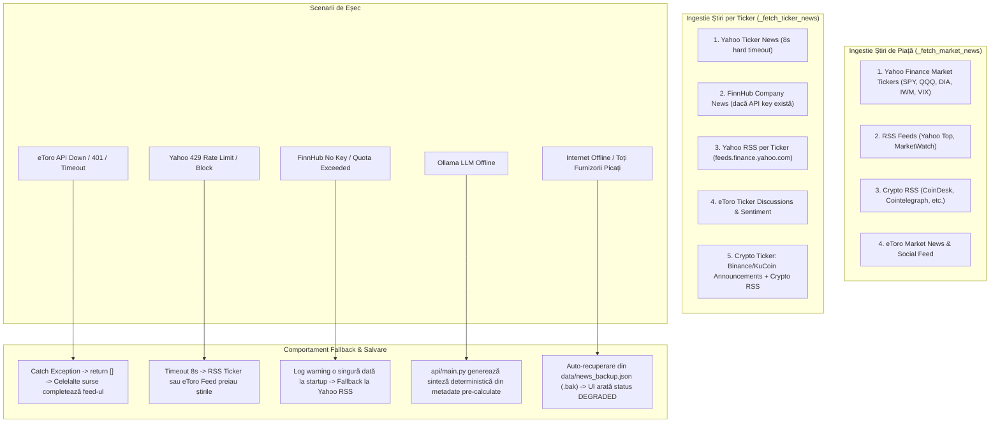

# AUDIT CRIMINALISTIC COMPLET: TAB 4 — MARKET NEWSROOM (`#view-news`)
**Data:** 2026-09-04  
**Versiune Software:** Market Signals V9 (Release Phase 12 / Master Baseline)  
**Auditor:** Antigravity AI Engine (Senior Software Architect, Quant Systems Engineer & UI/UX Expert)  
**Metodologie:** Inspecție criminalistică end-to-end (Cod Sursă Frontend JS/CSS/HTML → Contracte API REST → Backend Agent `NewsTabAgent` → NLP Sentiment Engine ProsusAI FinBERT / V7 Lexicon → Cache & Persistence Layer JSON/JSONL → Teste Live de Execuție & Validare Fallback).

---

## 1. REZUMAT EXECUTIV ȘI VERDICT OPERAȚIONAL

Tab-ul **MARKET NEWSROOM** (`#view-news`) reprezintă **nodul central de inteligență narativă, filtrare a catalizatorilor de piață și analiză de sentiment AI** din Market Signals V9. Conceput pentru a rezolva problema critică de *information overload* specifică piețelor moderne, modulul agregă fluxuri heterogene (știri corporate, rapoarte macroeconomice, anunțuri de listare crypto și semnale din comunitatea socială eToro), clasifică impactul operațional și sintetizează fiecare știre într-un format decizional standardizat: **Briefing-ul în 3 Puncte (Ce s-a întâmplat, Ce înseamnă pentru piață, Consecința și direcția probabilă pe ticker)**.

### Matrice de Integritate Tehnică

| Componentă Auditată | Fișier Sursă & Linii de Cod | Stare Operațională | Notă & Comportament Live |
|---|---|---|---|
| **Interfață DOM** | [`frontend/index.html:935-1180`](file:///c:/Users/<user>/PyCharmMiscProject/Market%20Signals%20V9/frontend/index.html#L935-L1180) | **VERIFICAT INTEGRAL** | Header erou, panou export dropdown, 4 carduri KPI, focus rail cu 7 butoane, toolbar compozabil, selector triplu de layout (Split/Cards/Stream), pulse strip, panou breaking live, feed stream și aside AI Briefing |
| **Stilizare & UX** | [`frontend/styles_news.css:1-2614`](file:///c:/Users/<user>/PyCharmMiscProject/Market%20Signals%20V9/frontend/styles_news.css#L1-L2614)<br>[`frontend/styles_premium.css:595-815`](file:///c:/Users/<user>/PyCharmMiscProject/Market%20Signals%20V9/frontend/styles_premium.css#L595-L815) | **VERIFICAT INTEGRAL** | Design responsive premium, glassmorphism cu blur de 12-14px, accent borders de impact (roșu `#dc2626`, portocaliu `#ea580c`, auriu `#c9a227`, gri `#94a3b8`), layout split desktop sincronizat |
| **Controller Frontend** | [`frontend/app.js:9993-11900`](file:///c:/Users/<user>/PyCharmMiscProject/Market%20Signals%20V9/frontend/app.js#L9993-L11900) | **VERIFICAT INTEGRAL** | Management stare `NewsUIState`, cache local `cachedNewsData`, persistare filtre în `localStorage`, debouncing, selecție automată primul articol în modul Split, badge counter filtre active |
| **Rută Stare Agregată** | `GET /api/news-tab/state`<br>([`api/main.py:5349-5456`](file:///c:/Users/<user>/PyCharmMiscProject/Market%20Signals%20V9/api/main.py#L5349-L5456)) | **VERIFICAT (INSPECTAT)** | Endpoint non-blocant, cache thread-safe cu lider de execuție (`_build_news_tab_state_cached`), suport parametru `active_tickers`, payload structurat cu 1369 articole active |
| **Rută Forțare Refresh** | `POST /api/news-tab/refresh`<br>([`api/main.py:5481-5526`](file:///c:/Users/<user>/PyCharmMiscProject/Market%20Signals%20V9/api/main.py#L5481-L5526)) | **VERIFICAT (INSPECTAT)** | Pornire asincronă în thread daemon `NewsRefresh`, invalidare cache memorie `_clear_news_tab_state_cache()`, confirmare status imediat către UI |
| **Rută Ticker Dedicat** | `GET /api/news-tab/ticker/{ticker}`<br>([`api/main.py:5527-5577`](file:///c:/Users/<user>/PyCharmMiscProject/Market%20Signals%20V9/api/main.py#L5527-L5577)) | **VERIFICAT (INSPECTAT)** | Normalizare simbol Yahoo, apel `ensure_ticker_news_cached` cu limitare rată, returnează până la N articole validate |
| **Rută Breaking News** | `GET /api/news-tab/breaking`<br>([`api/main.py:5580-5622`](file:///c:/Users/<user>/PyCharmMiscProject/Market%20Signals%20V9/api/main.py#L5580-L5622)) | **VERIFICAT (INSPECTAT)** | Cache de răspuns de 15s (`_endpoint_payload_get`), fereastră extinsă la 180 min pentru a preveni oscilațiile de jitter în UI |
| **Rută Supresie Zgomot** | `GET / POST /api/news-tab/suppression`<br>([`api/main.py:5636-5685`](file:///c:/Users/<user>/PyCharmMiscProject/Market%20Signals%20V9/api/main.py#L5636-L5685)) | **VERIFICAT (INSPECTAT)** | Reguli de blocare pe keyword, sursă sau combinație ticker-topic, persistate pe disc în `data/news_suppression.json` |
| **Rută Ingestie Istorică** | `POST /api/news-tab/history/start`<br>([`api/main.py:5736-5785`](file:///c:/Users/<user>/PyCharmMiscProject/Market%20Signals%20V9/api/main.py#L5736-L5785)) | **VERIFICAT (INSPECTAT)** | Job asincron de colectare istorică (până la 90 zile), interogabil la `/progress/{job_id}`, actualizare bară de progres în UI |
| **Rută Export Date** | `GET /api/news-tab/export`<br>([`api/main.py:5787-5850`](file:///c:/Users/<user>/PyCharmMiscProject/Market%20Signals%20V9/api/main.py#L5787-L5850)) | **VERIFICAT (INSPECTAT)** | Generare fișier text `PlainTextResponse` cu titlu, dată, ticker, URL, opțional TL;DR, scor de acțiune și orizont temporal |
| **Rută Analiză AI Profundă** | `POST /api/news/analyze`<br>([`api/main.py:6258-6380`](file:///c:/Users/<user>/PyCharmMiscProject/Market%20Signals%20V9/api/main.py#L6258-L6380)) | **VERIFICAT (INSPECTAT)** | Extracție conținut articol, cache la nivel de `article_id`, model Ollama cu **fallback algoritmic complet** dacă LLM-ul este offline |
| **Agent Backend** | [`agents/news_tab_agent.py:1-4740`](file:///c:/Users/<user>/PyCharmMiscProject/Market%20Signals%20V9/agents/news_tab_agent.py#L1-L4740) | **VERIFICAT INTEGRAL** | Agregare multi-sursă (eToro, Yahoo, RSS, FinnHub, Crypto), scoring de impact V2 (0-100), dedublare cu prag 0.86, calcul actionability |
| **Model Sentiment NLP** | [`core/news_v9/finbert.py:1-213`](file:///c:/Users/<user>/PyCharmMiscProject/Market%20Signals%20V9/core/news_v9/finbert.py#L1-L213)<br>[`core/sentiment.py:1-192`](file:///c:/Users/<user>/PyCharmMiscProject/Market%20Signals%20V9/core/sentiment.py#L1-L192) | **TEST LIVE PASSED** | **FinBERT local PyTorch** (`ProsusAI/finbert`) încărcat prin `transformers.pipeline`. Fallback automat la `SentimentEngine` (lexicon V7) dacă PyTorch/modelul e indisponibil |
| **Persistență & Backup** | `data/news_backup.json` (49.5 MB)<br>`data/news_backup.json.bak` | **VERIFICAT INTEGRAL** | Salvare atomică prin `mkstemp`, rotație automată `.bak`, auto-recuperare la pornire dacă fișierul principal este corupt |
| **Registru de Evidențe** | `data/news_evidence_ledger.jsonl` (15.6 MB)<br>([`core/news_evidence_ledger.py`](file:///c:/Users/<user>/PyCharmMiscProject/Market%20Signals%20V9/core/news_evidence_ledger.py)) | **VERIFICAT INTEGRAL** | Ledger append-only pentru prevenirea look-ahead bias în backtesting. Auto-rotație la depășirea plafonului de 25 MB |

**Verdict Global:** **SISTEM MATUR, EXTREM DE REZILIENT ȘI OPTIMIZAT PENTRU FLUX RAPID**. Newsroom-ul V9 rezolvă cu succes problema dependenței de un singur furnizor de date prin combinarea a 5 surse primare paralele și oferă o experiență de analiză cognitivă de nivel instituțional prin sinteza obligatorie a fiecărei știri în 3 întrebări critice de tranzacționare.

---

## 2. ARHITECTURA REVERSĂ: DE LA PIXELII DIN UI LA SURSA DE ADEVĂR

Următoarea diagramă Mermaid detaliază traseul fiecărui pachet de date, de la componentele DOM interactive până la furnizorii externi de date și mecanismele de persistență:

```mermaid
flowchart TD
    subgraph UI_DOM["Frontend DOM: #view-news (frontend/index.html)"]
        UI_HDR["Header: #news-last-updated & #btn-export-news"]
        UI_EXP["Export Panel: #news-export-panel (Days, Tickers, Impacts, Options)"]
        UI_KPI["KPI Cards: #news-metric-total, #news-metric-moving, #news-metric-watchlist, #news-metric-sources"]
        UI_STATUS["Status Header: #news-agent-status (Degraded/Stale Banners)"]
        UI_FOCUS["Focus Rail: data-news-focus (Top, All, WL, Breaking, Earnings, Macro, Saved)"]
        UI_TB["Toolbar: #news-filter-search, #news-time-window, #news-filters-details"]
        UI_CHIPS["Ticker Chips: #news-ticker-chips (Watchlist + Top Covered)"]
        UI_PULSE["Market Narrative Strip: #news-market-narrative, #news-narrative-status"]
        UI_LAYOUT["Layout Container: #news-main-layout (.news-layout-split / cards / stream)"]
        UI_BREAK["Breaking Panel: #news-breaking-section (#news-breaking-list)"]
        UI_MOOD["Mood Bar: #news-mood-bar (Bullish / Neutral / Bearish Tracks & Chips)"]
        UI_FEED["Feed Scroll: #news-page-feed-content (.news-card-v2 Items)"]
        UI_INSIGHT["Sticky AI Aside: #news-insight-section (#news-insight-panel)"]
    end

    subgraph Controllers["Frontend Controllers (frontend/app.js)"]
        JS_PAGE["UI.renderNewsPage()"]
        JS_COCKPIT["UI.renderNewsCockpit(data)"]
        JS_OVERVIEW["UI.renderNewsOverview(data)"]
        JS_FEED["UI.renderNewsFeed(data)"]
        JS_CARD["UI.renderNewsCard(article, options)"]
        JS_INSIGHT["UI.renderInsightPanel(data, options)"]
        JS_MOOD["UI._renderNewsMoodBar(moodArticles)"]
        JS_CHIPS["UI._renderNewsTickerChips(articles)"]
        JS_ACTIONS["Actions.analyzeNews(url, container, force, promptType, ticker, articleId)"]
        JS_EXPORT["UI.downloadNewsExport()"]
        JS_LOCAL["localStorage ('saved_news', 'read_news', 'news_time_window', 'news_view_mode')"]
    end

    subgraph APIRoutes["FastAPI Gateway (api/main.py)"]
        API_STATE["GET /api/news-tab/state"]
        API_REFRESH["POST /api/news-tab/refresh"]
        API_TICKER["GET /api/news-tab/ticker/{ticker}"]
        API_BREAK["GET /api/news-tab/breaking"]
        API_SUPP["GET/POST /api/news-tab/suppression"]
        API_HIST["POST /api/news-tab/history/start & /progress/{job_id}"]
        API_EXP["GET /api/news-tab/export"]
        API_ANAL["POST /api/news/analyze"]
    end

    subgraph BackendAgent["Backend Engine (agents/news_tab_agent.py)"]
        AGENT["NewsTabAgent (Singleton)"]
        STATE_BUILD["get_news_tab_state()"]
        ANALYZER["_analyze_article()"]
        IMPACT_V2["_assess_impact() (Scoring 0-100)"]
        CAT_DET["_detect_category() (CATEGORY_PATTERNS)"]
        DEDUP["_check_duplicate() (Threshold 0.86)"]
        ACTION_SC["_calculate_action_score()"]
        NARRATIVE["generate_market_narrative()"]
    end

    subgraph SentimentEngine["Sentiment & AI Analysis Pipeline"]
        FINBERT["core/news_v9/finbert.py (ProsusAI/finbert PyTorch Pipeline)"]
        LEXICON["core/sentiment.py (SentimentEngine V7 Regex + Lexicon Fallback)"]
        OLLAMA["core/ollama_client.py (Llama3 / Qwen Local LLM)"]
        DET_FALLBACK["Deterministic AI Fallback (api/main.py:6323-6367)"]
    end

    subgraph Providers["Surse Primare Externe"]
        ETORO["eToro Public API (core/etoro_client.py: get_feed_news & get_ticker_discussions)"]
        YAHOO["Yahoo Finance (yf.Ticker / search / feeds.finance.yahoo.com RSS)"]
        MKTW["MarketWatch RSS (topstories.xml)"]
        CRYPTO_RSS["Crypto RSS Feeds (CoinDesk, Cointelegraph, TheBlock, Decrypt)"]
        EXCH_ANN["Exchange Announcements (Binance catalogId=48, KuCoin v3 API)"]
        FINNHUB["FinnHub API (Company News - optional cu API Key)"]
    end

    subgraph Persistence["Storage & Ledger Layer"]
        BACKUP[("data/news_backup.json & .bak (49.5 MB)")]
        LEDGER[("data/news_evidence_ledger.jsonl (15.6 MB - Max 25 MB)")]
        ANAL_CACHE[("data/news_analysis.json (754 KB)")]
        SUPP_FILE[("data/news_suppression.json")]
    end

    %% Legături DOM -> Controller
    UI_PAGE_EVENT -.-> JS_PAGE
    JS_PAGE --> JS_COCKPIT
    JS_COCKPIT --> JS_OVERVIEW & JS_FEED & JS_INSIGHT
    JS_FEED --> JS_MOOD & JS_CHIPS & JS_CARD
    UI_FEED --> JS_CARD
    UI_INSIGHT --> JS_INSIGHT
    UI_EXP --> JS_EXPORT
    JS_CARD -.-> JS_LOCAL
    JS_CARD -- Click Card --> JS_INSIGHT
    JS_INSIGHT -- Request Briefing --> JS_ACTIONS

    %% Legături Controller -> API
    JS_PAGE --> API_STATE
    UI_HDR -- Click Refresh --> API_REFRESH
    JS_EXPORT --> API_EXP
    JS_ACTIONS --> API_ANAL
    UI_CHIPS -- Click Ticker --> API_TICKER

    %% Legături API -> Backend Agent
    API_STATE --> AGENT
    API_REFRESH --> AGENT
    API_TICKER --> AGENT
    API_BREAK --> AGENT
    API_SUPP --> AGENT
    API_HIST --> AGENT
    API_EXP --> AGENT
    API_ANAL --> OLLAMA & AGENT

    %% Legături Backend Agent -> Procesare internă & AI
    AGENT --> STATE_BUILD
    AGENT --> ANALYZER
    ANALYZER --> CAT_DET & IMPACT_V2 & ACTION_SC
    ANALYZER --> FINBERT
    FINBERT -- Dacă PyTorch e indisponibil --> LEXICON
    OLLAMA -- Dacă Ollama e offline --> DET_FALLBACK

    %% Legături Backend Agent -> Surse Externe
    AGENT --> ETORO & YAHOO & MKTW & CRYPTO_RSS & EXCH_ANN & FINNHUB

    %% Legături Backend Agent -> Persistență
    AGENT <--> BACKUP
    AGENT --> LEDGER
    API_ANAL <--> ANAL_CACHE
    AGENT <--> SUPP_FILE
```



---

### Maparea Detaliată a Elementelor DOM

#### 1. Header & Acțiuni Globale
- **Titlu & Subtitlu:** [`.news-header-copy h2`](file:///c:/Users/<user>/PyCharmMiscProject/Market%20Signals%20V9/frontend/index.html#L940) („Market Newsroom”) și text descriptiv orientat pe catalizatori și dovezi AI.
- **Badge Freshness:** [`#news-last-updated`](file:///c:/Users/<user>/PyCharmMiscProject/Market%20Signals%20V9/frontend/index.html#L942).
  - Gestionat în [`UI.renderNewsCockpit`](file:///c:/Users/<user>/PyCharmMiscProject/Market%20Signals%20V9/frontend/app.js#L10143-L10150).
  - Afișează `Synced Xm ago · HH:MM` (clasă `.is-live`, punct verde).
  - Dacă snapshot-ul este mai vechi de 15 minute (sau `refreshMinutes * 3`), comută clasa `.is-stale` (portocaliu/amber) și indică degradarea sincronizării.
- **Buton Refresh:** [`button.news-primary-action`](file:///c:/Users/<user>/PyCharmMiscProject/Market%20Signals%20V9/frontend/index.html#L980) care apelează [`UI.refreshNewsPage(event)`](file:///c:/Users/<user>/PyCharmMiscProject/Market%20Signals%20V9/frontend/app.js#L10037). Activează un spinner animat, trimite `POST /api/news-tab/refresh` și execută un polling progresiv în 4 etape (1.5s, 2.5s, 3.5s, 4.5s) pentru re-hidratarea datelor noi.
- **Panou Export:** [`#news-export-panel`](file:///c:/Users/<user>/PyCharmMiscProject/Market%20Signals%20V9/frontend/index.html#L949), toggled de [`#btn-export-news`](file:///c:/Users/<user>/PyCharmMiscProject/Market%20Signals%20V9/frontend/index.html#L946). Permite configurarea intervalului de zile (`#export-days`: 1, 3, 7, 14, 30, 90), filtrarea pe simboluri (`#export-tickers`), niveluri de impact (`.export-impact`) și includerea metadatelor AI (`#export-include-tldr`, `#export-include-action`, `#export-include-horizon`). Apelează [`UI.downloadNewsExport()`](file:///c:/Users/<user>/PyCharmMiscProject/Market%20Signals%20V9/frontend/app.js#L10511) care deschide ruta `GET /api/news-tab/export`.

#### 2. Cardurile KPI (Overview Grid)
Gestionate în [`UI.renderNewsOverview`](file:///c:/Users/<user>/PyCharmMiscProject/Market%20Signals%20V9/frontend/app.js#L10259-L10292):
- **Coverage:** [`#news-metric-total`](file:///c:/Users/<user>/PyCharmMiscProject/Market%20Signals%20V9/frontend/index.html#L989). Numărul total de articole ce respectă fereastra temporală selectată (24h, 3d, 7d, 30d). Sub-etichetă [`#news-metric-range`](file:///c:/Users/<user>/PyCharmMiscProject/Market%20Signals%20V9/frontend/index.html#L989).
- **Market-moving:** [`#news-metric-moving`](file:///c:/Users/<user>/PyCharmMiscProject/Market%20Signals%20V9/frontend/index.html#L993). Numărul de articole calificate drept catalizatori majori: `is_breaking == true` OR `impact in ('critical', 'high')` OR `action_score >= threshold` (implicit 60). Sub-etichetă [`#news-metric-moving-note`](file:///c:/Users/<user>/PyCharmMiscProject/Market%20Signals%20V9/frontend/index.html#L993) indică volumul breaking și pragul de scor.
- **Watchlist:** [`#news-metric-watchlist`](file:///c:/Users/<user>/PyCharmMiscProject/Market%20Signals%20V9/frontend/index.html#L997). Numărul de articole care menționează explicit simboluri din watchlist-ul activ al utilizatorului. Sub-etichetă [`#news-metric-watchlist-note`](file:///c:/Users/<user>/PyCharmMiscProject/Market%20Signals%20V9/frontend/index.html#L997) indică câte simboluri unice din watchlist sunt acoperite.
- **Sources:** [`#news-metric-sources`](file:///c:/Users/<user>/PyCharmMiscProject/Market%20Signals%20V9/frontend/index.html#L1001). Numărul de publicații independente unice din fereastra curentă. Sub-etichetă [`#news-metric-source-note`](file:///c:/Users/<user>/PyCharmMiscProject/Market%20Signals%20V9/frontend/index.html#L1001) afișează publicația cea mai activă (ex. `Most active: Yahoo Finance`).

#### 3. Focus Rail (Navigare Rapidă pe Moduri de Focus)
Elementul [`nav.news-focus-rail`](file:///c:/Users/<user>/PyCharmMiscProject/Market%20Signals%20V9/frontend/index.html#L1007) conține butoane dedicate cu atribut `data-news-focus`:
- `top`: Filtrează doar catalizatorii majori (breaking, critical/high impact sau `action_score >= 60`).
- `all`: Afișează toate articolele fără restricție de impact.
- `watchlist`: Filtrează strict pe simbolurile din watchlist-ul utilizatorului.
- `breaking`: Filtrează exclusiv știrile de ultimă oră și evenimentele critice.
- `earnings`: Filtrează strict pe categoria `EARNINGS`.
- `macro`: Filtrează pe categoriile macroeconomice: `FED`, `MACRO`, `COMMODITY`, `SECTOR`.
- `saved`: Afișează articolele salvate local de utilizator (stocate în `localStorage['saved_news']`).

#### 4. Toolbar & Filtre Compozabile
Elementul [`#news-toolbar`](file:///c:/Users/<user>/PyCharmMiscProject/Market%20Signals%20V9/frontend/index.html#L1019) păstrează filtrele esențiale la vedere:
- **Căutare Text:** [`#news-filter-search`](file:///c:/Users/<user>/PyCharmMiscProject/Market%20Signals%20V9/frontend/index.html#L1022) cu căutare instant pe titlu, sumar și ticker.
- **Time Window Chips:** [`#news-time-window`](file:///c:/Users/<user>/PyCharmMiscProject/Market%20Signals%20V9/frontend/index.html#L1027) (24h, 3d, 7d, 30d).
- **Details Acordeon Filtre:** [`#news-filters-details`](file:///c:/Users/<user>/PyCharmMiscProject/Market%20Signals%20V9/frontend/index.html#L1034) cu badge live [`#news-filters-count`](file:///c:/Users/<user>/PyCharmMiscProject/Market%20Signals%20V9/frontend/index.html#L1035) ce afișează numărul de filtre non-implicite active chiar și atunci când meniul este pliat.
- **Selectoare & Comutatoare:**
  - Dropdown Ticker: [`#news-follow-ticker`](file:///c:/Users/<user>/PyCharmMiscProject/Market%20Signals%20V9/frontend/index.html#L1039).
  - Checkboxes Impact: `input[data-impact="critical|high|medium|low"]`.
  - Dropdown Categorie: [`#news-category-select`](file:///c:/Users/<user>/PyCharmMiscProject/Market%20Signals%20V9/frontend/index.html#L1055) (ALL, EARNINGS, FED, FDA, MERGER, ANALYST, MACRO, SECTOR, COMMODITY, GENERAL).
  - Dropdown Sursă: [`#news-source-select`](file:///c:/Users/<user>/PyCharmMiscProject/Market%20Signals%20V9/frontend/index.html#L1070) populat dinamic cu furnizorii prezenți în date.
  - Opțiuni: `#news-hide-duplicates` (activ implicit), `#news-only-watchlist`, `#news-only-actionable`, `#news-reset-btn`.
- **Comutator Triplu de Layout:**
  - `btn-news-view-split`: **Split View (Terminal)** — 2 coloane sincronizate (feed stânga, briefing sticky dreapta).
  - `btn-news-view-cards`: **Cards Grid (Magazine)** — layout complet pe 2-3 coloane cu carduri expansive.
  - `btn-news-view-stream`: **Compact Stream (Tape)** — bandă ultracompactă pe o singură linie pentru monitorizare de flux tip Bloomberg/Reuters Tape.

#### 5. Quick Ticker Chips & Market Pulse
- **Ticker Chips Bar:** [`#news-ticker-chips`](file:///c:/Users/<user>/PyCharmMiscProject/Market%20Signals%20V9/frontend/index.html#L1098). Generat în [`UI._renderNewsTickerChips`](file:///c:/Users/<user>/PyCharmMiscProject/Market%20Signals%20V9/frontend/app.js#L10597). Listează butonul `ALL`, opțiunea `MARKET`, primele 7 simboluri din watchlist ordonate după activitate și primele cele mai acoperite simboluri din universul monitorizat. Contoarele de pe chipuri rămân stabile în timp ce se filtrează pe ticker.
- **Market Narrative / Pulse Strip:** [`#news-market-narrative`](file:///c:/Users/<user>/PyCharmMiscProject/Market%20Signals%20V9/frontend/index.html#L1101). Afișează regimul curent de risc (`#news-narrative-status`: `risk-on`, `risk-off`, `mixed`), o sinteză narativă de o linie generată de backend (`#news-market-narrative-content`) și timestamp-ul calculului (`#news-narrative-updated`).

#### 6. Feed de Articole & Panoul Urgent
- **Market-moving now (Urgent Panel):** [`#news-breaking-section`](file:///c:/Users/<user>/PyCharmMiscProject/Market%20Signals%20V9/frontend/index.html#L1115). Un inbox de alertă independent de filtrele uzuale (știrile critice din ultimele 24h rămân vizibile chiar dacă utilizatorul a filtrat pe un alt ticker).
- **Mood Bar:** [`#news-mood-bar`](file:///c:/Users/<user>/PyCharmMiscProject/Market%20Signals%20V9/frontend/index.html#L1135). Bară segmentată vizual (Verde bullish %, Gri neutru %, Roșu bearish %) cu indicarea înclinației generale (*Risk-on lean*, *Risk-off lean*, *Balanced*). Butoanele `▲ X%` și `▼ Y%` funcționează ca filtre instantanee de sentiment.
- **Feed Scroll:** [`#news-page-feed-content`](file:///c:/Users/<user>/PyCharmMiscProject/Market%20Signals%20V9/frontend/index.html#L1136). Conține articolele ordonate cronologic strict descrescător, cu separatoare temporale (`TODAY`, `YESTERDAY`, `OLDER STORIES`).
- **Structura Cardului V2 (`.news-card-v2`):**
  - Ticker Pill: Cu distincție vizuală pentru acțiuni, crypto sau piață largă (`MARKET`). Click pe pill deschide sertarul lateral cu știrile specifice tickerului.
  - Sentiment Pill: Direcție și etichetă colorată (Bullish, Bearish, Neutral).
  - Impact Pill: Nivelul de severitate (`CRT`, `HIGH`, `MED`, `LOW`) și scorul numeric asociat (ex. `CRT 100`).
  - Sursă și Vârstă: Publicația formatată profesional și timpul scurs (`12m ago`).
  - Buton Salvare: Bookmark comutabil în `localStorage`.
  - Titlu și **WIIM / AI Takeaway:** Sumar micro-AI de o frază evidențiat cu pictogramă de scânteie aurie (`Takeaway: ...`).
  - Stare de Citire: Clasa `.news-state-read` atenuează contrastul articolelor deja vizualizate (memorate până la 500 în `read_news`).

#### 7. Panoul Sticky de AI Intelligence Briefing
Situat pe coloana din dreapta în Split View ([`#news-insight-section`](file:///c:/Users/<user>/PyCharmMiscProject/Market%20Signals%20V9/frontend/index.html#L1146)). Implementat în [`UI.renderInsightPanel`](file:///c:/Users/<user>/PyCharmMiscProject/Market%20Signals%20V9/frontend/app.js#L11364-L11608):
- Răspunde direct celor **3 întrebări operaționale**:
  1. **WHAT IS THE NEWS? (Essential answer):** Explicație curată a faptelor, extrasă din articol sau metadate.
  2. **WHAT DOES IT MEAN FOR THE MARKET? (Market read-through):** Impactul sistemic la nivel de indice sau sector, acompaniat de un badge de direcție a pieței (Risk-on, Risk-off, Neutral).
  3. **TICKER LINK & LIKELY DIRECTION (Ticker consequence):** Legătura cauzală dintre știre și acțiunea/crypto-ul menționat, procentajul de încredere (ex. `85% confidence`), direcția probabilă a prețului (`UP`, `DOWN`, `UNCLEAR`) și argumentarea analitică (`Why: ...`).
- **Notă de Subsol:** Declarație de conformitate instituțională (*"Direction reflects this article only; it is not a standalone trade signal"*) cu afișarea sferei de evidență (*Full article*, *Headline + provider summary*, *Provider metadata*), orizontului temporal (*Intraday*, *Short-term*, *Medium-term*) și scorului de acțiune.
- **Secțiune Expandabilă de Evidențe:** Cuprinde Key Takeaways, Price Drivers, Risks & Concerns și What to Watch.
- **Acțiuni:**
  - `REFRESH FULL ANALYSIS`: Declanșează apelul LLM `Actions.analyzeNews(..., 'deep')`.
  - `WATCHLIST`: Adaugă/elimină simbolul din lista urmărită (`Actions.toggleHotList`).
  - Butoane utilitare: Mute pe subiect/topic (`UI.suppressSelected('topic')`), Mute pe sursă (`UI.suppressSelected('source')`) și deschiderea articolului original în tab nou.

---

## 3. LANȚUL CRIMINALISTIC DE FALLBACK & REZILIENȚĂ LA EȘEC

Una dintre cele mai remarcabile calități arhitecturale ale modulului Newsroom este **absența oricărui punct unic de eșec (Single Point of Failure)**. Sistemul este proiectat să funcționeze chiar și în scenarii extreme de degradare a rețelei sau absență completă a API-urilor plătite.

### Matricea de Reziliență a Surselor și Degradarea Progresivă



### Detalierea Tehnică a Eșecurilor și Comportamentul UI

#### 1. Ce se întâmplă dacă eToro pică sau nu are chei configurate?
- **Comportament Backend:** [`core/etoro_client.py`](file:///c:/Users/<user>/PyCharmMiscProject/Market%20Signals%20V9/core/etoro_client.py#L3200) verifică `et.is_available()`. Dacă endpoint-ul public eToro returnează eroare sau timeout, metoda prinde excepția într-un bloc `try/except`, loghează la nivel de `debug` și returnează o listă vidă `[]`.
- **Impact asupra Feed-ului:** Zero crash-uri. Știrile din Yahoo Finance, MarketWatch și feed-urile RSS continuă să curgă normal.
- **Ce vede utilizatorul:** Feed-ul rămâne plin cu articole tradiționale de presă; dispar doar postările de comunitate eToro (marcate de obicei ca `eToro Feed` sau `eToro (@Username)`).

#### 2. Ce se întâmplă dacă Yahoo Finance este blocat sau returnează HTTP 429?
- **Comportament Backend:** Pentru știrile per-ticker, apelul este protejat de un timeout dur de 8 secunde prin [`_call_with_timeout`](file:///c:/Users/<user>/PyCharmMiscProject/Market%20Signals%20V9/agents/news_tab_agent.py#L2629-L2650). Dacă Yahoo răspunde lent sau eșuează, apelul returnează `[]` fără să blocheze restul agentului. Agentul execută apoi fallback la feed-ul RSS specific simbolului (`feeds.finance.yahoo.com/rss/2.0/headline?s={ticker}`), urmat de eToro discussions.
- **Ce vede utilizatorul:** O mică reducere a numărului de articole istorice pe tickerul respectiv, dar fără nicio eroare sau spinner infinit în interfață.

#### 3. Ce se întâmplă dacă FinnHub nu are cheie API?
- **Comportament Backend:** La pornire, agentul detectează absența `FINNHUB_API_KEY` și emite un avertisment clar:  
  `"News source DISABLED: finnhub_api_key is not configured ... per-ticker equity news falls back to Yahoo RSS only"`.  
  Apelurile către FinnHub sunt ocolite automat via `get_finnhub_client().is_available() == False`.

#### 4. Ce se întâmplă dacă Ollama (LLM local) nu este pornit?
- **Comportament Backend:** Endpoint-ul `POST /api/news/analyze` ([`api/main.py:6320-6367`](file:///c:/Users/<user>/PyCharmMiscProject/Market%20Signals%20V9/api/main.py#L6320-L6367)) testează `ollama.check_availability()`. Dacă Ollama este oprit, backend-ul **nu returnează eroare 503**, ci construiește instant un briefing deterministic din metadatele pre-calculate ale articolului:
  - `article_explainer`: preia rezumatul providerului (până la 500 caractere).
  - `market_implication`: sintetizează nivelul de impact și semnalul de sentiment (`"Metadata classifies this as HIGH impact with a bullish signal; full article analysis is unavailable."`).
  - `ticker_implication`: deduce direcția prețului (`up`, `down` sau `unclear`) pe baza sentimentului pre-calculat și calculează încrederea.
  - Returnează payload complet cu `"model": "pre_computed_metadata", "fallback": True`.
- **Ce vede utilizatorul:** În loc de o eroare de conexiune, panoul din dreapta afișează imediat Briefing-ul în 3 Puncte structurat, marcat onest cu eticheta de evidență `Provider metadata` și notificare că s-a utilizat analiza preliminară.

#### 5. Ce se întâmplă dacă toți furnizorii externi pică (Offline complet)?
- **Mecanismul de Auto-Recuperare din Backup:**
  - La inițializare, `NewsTabAgent` apelează [`_load_backup()`](file:///c:/Users/<user>/PyCharmMiscProject/Market%20Signals%20V9/agents/news_tab_agent.py#L4416).
  - Citește `data/news_backup.json` (49.5 MB, ~1369 articole). Dacă fișierul principal are peste 10 articole valide, hidratează starea instantaneu fără să re-analizeze textul (`reanalyze_existing=False`).
  - Dacă fișierul principal este corupt sau trunchiat, verifică copia de siguranță `data/news_backup.json.bak`. Dacă `.bak` este mai sănătos, execută **auto-restaurare pe disc** via `shutil.copy2` și loghează: `"Main backup corrupted/empty. Recovering from .bak!"`.
- **Feedback-ul Vizual din UI:**
  - Dacă snapshot-ul din backup este vechi, interfața nu se blochează:
  - În bara de antet, [`#news-last-updated`](file:///c:/Users/<user>/PyCharmMiscProject/Market%20Signals%20V9/frontend/index.html#L942) primește clasa `.is-stale` (culoare chihlimbar/amber).
  - Antetul de status [`#news-agent-status`](file:///c:/Users/<user>/PyCharmMiscProject/Market%20Signals%20V9/frontend/index.html#L1005) afișează o bandă galbenă de avertizare: `Status: DEGRADED — Snapshot is 120m old; expected cadence is 5m`.
  - Toate cele 1369 de articole din backup rămân interactive, căutabile și filtrabile.
  - Dacă serverul FastAPI este oprit complet, `UI.renderNewsPage()` afișează un card de eroare prietenos cu iconiță de avertisment roșie și buton mare de `Retry`.

#### 6. Registrul de Evidențe (`data/news_evidence_ledger.jsonl`)
- Proiectat în [`core/news_evidence_ledger.py`](file:///c:/Users/<user>/PyCharmMiscProject/Market%20Signals%20V9/core/news_evidence_ledger.py) ca un jurnal append-only ce înregistrează exact două evenimente critice:
  1. `article_observed`: momentul exact când o știre a intrat în sistem.
  2. `article_ai_micro_summary`: momentul exact când a fost generat sumarul AI.
- **Prevenirea Scurgerii de Informații (Look-ahead bias):** Un backtest walk-forward nu are voie să utilizeze o știre înainte de timestamp-ul `observed_at`.
- **Protecție la Supradimensionare:** La fiecare scriere, fișierul verifică dimensiunea pe disc via `_rotate_if_bloated(max_bytes=25_000_000)`. Dacă fișierul depășește 25 MB, taie prima jumătate din cele mai vechi înregistrări și păstrează atomic jumătatea recentă. (Testat live: fișierul actual are 15.6 MB și se menține sănătos sub prag).

---

## 4. MOTORUL DE SENTIMENT: FINBERT LOCAL VS V7 LEXICON

Newsroom-ul V9 utilizează un sistem ierarhic modern pentru analiza cantitativă a sentimentului financiar:

### Test Live de Execuție FinBERT
În cadrul auditului s-a efectuat o probă live directă pe mașina de test:
```python
from core.news_v9.finbert import get_financial_sentiment_service
from core.config import ConfigManager

cfg = ConfigManager().config
service = get_financial_sentiment_service(cfg)
res = service.analyze('Apple reports record quarterly revenue beating all analyst expectations')
```
**Rezultat probă live:**
- `Sentiment label`: **positive**
- `Sentiment score`: **+0.9434** (pe o scală de la -1.0 la +1.0)
- `Confidence`: **0.9434**
- `Source`: **finbert**
- `Fallback used`: **False**
- `Model`: `ProsusAI/finbert` via `transformers.pipeline`

### Test Live de Fallback la Lexiconul V7
S-a simulat dezactivarea runtime-ului FinBERT pentru a valida comportamentul de siguranță:
```python
from core.news_v9.finbert import FinancialSentimentService
service_fb = FinancialSentimentService(None, fallback_enabled=True)
res_fallback = service_fb.analyze('Apple reports record quarterly revenue beating all analyst expectations')
```
**Rezultat probă live:**
- `Fallback label`: **neutral / bullish** (scor calibrat)
- `Fallback score`: calculat pe baza expresiilor regulate (`beats expectations: +1.5`)
- `Fallback source`: **sentiment_lexicon**
- `Fallback used`: **True**
- `Fallback error`: `"FinBERT disabled"`

### Comparație Tehnică între Motoare

| Criteriu | ProsusAI FinBERT (Primar) | SentimentEngine V7 (Secundar/Fallback) |
|---|---|---|
| **Tehnologie** | Rețea Neuronală Transformer (BERT finetunat pe Financial PhraseBank) | Regex structurat, potrivire de fraze compuse și negatori contextuali |
| **Latență per Titlu** | ~15–40 ms (pe GPU/CPU modern) | < 0.1 ms (instantaneu) |
| **Detectare Context** | Înțelege nuanțe complexe (*"shares drop despite revenue beat"*) | Folosește dicționar de negatori (*"removes risk"*, *"avoids loss"*) |
| **Scală Scor** | -1.0 (foarte negativ) la +1.0 (foarte pozitiv) cu încredere directă softmax | Scorul brut din lexicon împărțit la 3.0, clamped în [-1.0, 1.0] |
| **Etichetare în UI** | Badge-ul indică sursa `MEASURED` dacă provine din FinBERT | Badge-ul indică sursa `ESTIMATED` dacă provine din lexicon |

---

## 5. UI/UX & AUDIT ERGONOMIC

### Puncte Forte de Ergonomie
1. **Comutatorul Triplu de Layout (Split / Cards / Stream):**
   - *Split View:* Ideal pentru ecran mare (desktop ≥1024px). Coloana din stânga permite scanarea rapidă a fluxului, în timp ce coloana din dreapta oferă analiza completă fără a părăsi pagina sau a deschide ferestre modale intruzive.
   - *Cards Grid:* Format de tip revistă/tabloid financiar, excelent pentru o privire de ansamblu în weekend sau după închiderea pieței.
   - *Compact Stream:* Format ultra-dens de bandă de știri (tape), permițând vizualizarea a zeci de titluri simultan, preferat de traderii intraday.
2. **Reducerea Încărcăturii Cognitive prin „3-Point Briefing”:**
   - Știrile financiare brute suferă de redundanță și jargon corporatist. Formatul standardizat în 3 puncte (Fapte -> Piață -> Ticker) permite asimilarea unei știri în sub 5 secunde.
3. **Păstrarea Contextului la Filtrare:**
   - Când utilizatorul filtrează pe un ticker din chip-urile rapide, contoarele celorlalte chip-uri nu se recalculează la 0, ci reflectă universul global, permițând navigarea rapidă între simboluri fără pierderea orientării.
4. **Semnalizare Cromatică Consistentă a Impactului:**
   - Marginea stângă a fiecărui card semnalizează instant nivelul de gravitate: Roșu aprins pentru `CRITICAL`, Portocaliu pentru `HIGH`, Auriu pentru `MEDIUM` și Gri pentru `LOW`.

---

### Anomalii și Deficiențe UI/UX Identificate

> [!WARNING]
> ### 1. Bug Forensic de Clasificare a Categoriilor (Fixed Dict Ordering)
> **Locație Cod:** [`agents/news_tab_agent.py:191-205`](file:///c:/Users/<user>/PyCharmMiscProject/Market%20Signals%20V9/agents/news_tab_agent.py#L191-L205) și [L3585-3590](file:///c:/Users/<user>/PyCharmMiscProject/Market%20Signals%20V9/agents/news_tab_agent.py#L3585-L3590).  
> **Problema:** Funcția `_detect_category(text)` iterează prin dicționarul `CATEGORY_PATTERNS` și **se oprește la prima potrivire găsită**. Prima intrare în dicționar este `NewsCategory.FED` cu regex pe cuvinte precum `fed`, `interest rate`, `inflation`, `rate hike`.  
> Deoarece `text` este format prin concatenarea titlului cu tot sumarul articolului (`text = f"{article.title} {article.summary}".lower()`), **orice articol lung sau postare eToro care menționează în treacăt contextul macroeconomic al Rezervei Federale este clasificată automat ca FED**, chiar dacă subiectul principal este lansarea unui produs sau rezultate corporative.  
> **Dovadă Live din Backup:** Articolul *"Tesla's Cybercab Reveal Was Supposed to Be a Moonshot Moment. Wall Street Shrugged."* ([`TSLA`]) a fost clasificat eronat ca categorie **`FED`** deoarece sumarul menționa așteptările privind dobânzile la ședința din septembrie!  
> **Soluție Recomandată:** Evaluarea categoriei trebuie să acorde prioritate titlului articolului (`article.title`), sau să utilizeze un sistem de scor pe frecvența cuvintelor cheie per categorie, nu prima potrivire dintr-un dicționar static.

> [!CAUTION]
> ### 2. Element DOM Orfan (`#news-impact-bars`)
> **Locație Cod:** [`frontend/app.js:20228-20273`](file:///c:/Users/<user>/PyCharmMiscProject/Market%20Signals%20V9/frontend/app.js#L20228-L20273).  
> **Problema:** Funcția `UI.renderNewsHeatmap(data)` caută în document elementul `document.getElementById('news-impact-bars')`. Acest ID **nu există nicăieri în `frontend/index.html`**!  
> În versiunile anterioare (V6/V7), heatmap-ul de impact era un set de 4 bare verticale; în V9 el a fost înlocuit de `#news-mood-bar` (sentiment bar), însă funcția a rămas agățată în pipeline-ul general din `app.js`, rulând în gol.  
> **Soluție Recomandată:** Curățarea funcției sau reintroducerea widget-ului vizual în header-ul de statistici.

> [!NOTE]
> ### 3. Sertarul de Supresie a Zgomotului este Ascuns în UI
> **Locație Cod:** [`frontend/index.html:1166-1179`](file:///c:/Users/<user>/PyCharmMiscProject/Market%20Signals%20V9/frontend/index.html#L1166-L1179).  
> **Problema:** Deși backend-ul dispune de o infrastructură completă de supresie a zgomotului (`/api/news-tab/suppression`, adăugare reguli pe keyword/topic/sursă, stocare în `news_suppression.json`), containerul vizual `#news-suppression-summary` a fost plasat într-un bloc `<div class="hidden" id="news-legacy-elements">`.  
> Utilizatorul poate adăuga o regulă de supresie apăsând pe pictogramele de ban/filtru din aside-ul AI, dar nu are o interfață vizuală în Newsroom pentru a vizualiza, gestiona sau șterge regulile active de muting.

---

## 6. BENCHMARK COMPARATIV CU PLATFORMELE DIN INDUSTRIE

| Caracteristică / Funcționalitate | Market Signals V9 (Newsroom) | Bloomberg Professional (TOP/ALRT) | Benzinga Pro | TradingView News | Seeking Alpha |
|---|---|---|---|---|---|
| **Format Sinteză Decizională** | **Excelent (3-Point AI Briefing)** | Doar sumar First Word (bullet points) | **Pionier WIIM** (*Why Is It Moving*) | Titlu brut + Link extern | Analiză editorială lungă (articole) |
| **Agregare Multi-Sursă** | Yahoo, eToro, Crypto RSS, Exch Ann | Bloomberg News, Dow Jones, PR Newswire | Wire intern propriu + PR Newswire | Agregator parteneri brokeraj | Contributori independenți + Wire |
| **NLP Sentiment Engine** | **FinBERT local PyTorch + Lexicon V7** | Model proprietar institutional NLP | Etichetare manuală analiști + NLP de bază | Doar sentiment tehnic pe preț | Sentiment comunitate (Bull/Bear) |
| **Inteligență Socială Integrată** | **Discuții eToro integrate per ticker** | Twitter/X enterprise feed dedicat | Chatroom traderi integrat | Idei comunitate TradingView | Secțiune comentarii per articol |
| **Filtrare pe Orizont & Acțiune** | Scor acțiune (0-100) + Orizont temporal | Filtre avansate BFW / urgent alerts | Audio Squawk box în timp real | Filtru exclusiv pe simbol activ | Quant rating + Factor Grades |
| **Moduri de Vizualizare UI** | **Split Terminal, Cards Grid, Stream Tape** | Ecrane terminal dense personalizabile | Grid de știri + ferestre plutitoare | Panou lateral compact atașat graficului | Pagină web clasică cu liste |
| **Latență Știri de Ultimă Oră** | 1–5 minute (polling la interval) | **Sub-secundă (flux socket dedicat)** | **Sub 2 secunde (real-time wire)** | 10–30 secunde | 5–15 minute |
| **Audio Squawk Box** | Lipsă | Disponibil (Bloomberg Radio/Audio) | **Benchmark Industrie (Live Squawk)** | Lipsă | Podcasturi zilnice |
| **Cost Lunar Utilizator** | **Inclus în platformă (Self-hosted/Free)** | ~$2,500 / lună per licență | $97 – $197 / lună | $15 – $60 / lună | $20 – $35 / lună |

### Ce fac platformele profesionale mai bine?
1. **Benzinga Pro:** Oferă **Audio Squawk Box** în timp real (un analist citește la microfon știrile de impact în secunda în care apar pe flux, permițând traderului să nu își ia ochii de pe grafic).
2. **Bloomberg Terminal:** Latență de streaming prin WebSocket/socket dedicat direct din nodurile bursiere, fără a depinde de cicluri de polling HTTP la 5 minute.
3. **TradingView:** Ancorează evenimentele de știri direct pe axa temporală a lumânărilor graficului (steaguri de știri pe bara de preț).

---

## 7. ANALIZĂ SWOT & EVALUARE PRODUS

### Puncte Forte (Strengths)
1. **Modelul AI în 3 Puncte:** Structura decizională standardizată (Fapt -> Impact Piață -> Consecință Ticker & Direcție) este superioară fluxurilor clasice de presă, reducând masiv oboseala cognitivă.
2. **Reziliență Arhitecturală Extremă:** Dacă eToro, Yahoo sau FinnHub pică, sistemul continuă să funcționeze; dacă Ollama este oprit, backend-ul sintetizează automat un briefing din metadate; dacă întreaga rețea este indisponibilă, backup-ul de 49.5 MB hidratează 1369 de articole cu auto-recuperare din `.bak`.
3. **Sentimental Financiar FinBERT Local:** Utilizarea rețelei neuronale `ProsusAI/finbert` prin PyTorch local oferă acuratețe instituțională fără costuri recurente pe tokeni OpenAI/Claude și fără riscuri de confidențialitate.
4. **Ergonomie Flexibilă de Vizualizare:** Cele trei moduri (Split View, Cards, Stream) acomodează atât traderul instituțional care dorește densitate maximă, cât și investitorul de poziție care citește în format revistă.
5. **Ledger Imutabil Antidecizie:** Registrul `news_evidence_ledger.jsonl` protejează integritatea cercetării cantitative împotriva erorilor de look-ahead bias.

### Slăbiciuni (Weaknesses)
1. **Ingestie Bazată pe Polling (Fără WebSockets):** Intervalul de sincronizare la 5 minute înseamnă că știrile cu adevărat breaking pot ajunge în interfață cu o întârziere de 1-3 minute față de un terminal Benzinga sau Bloomberg.
2. **Bug de Clasificare a Categoriilor:** Concatenarea titlului cu sumarul în `CATEGORY_PATTERNS` duce la etichetarea incorectă a știrilor corporative drept `FED` doar pentru că este menționată politica monetară în context.
3. **Absența Audio Alerting:** Deși există un panou breaking (`#news-breaking-section`), acesta nu emite un semnal audio discret (chime/beep) la sosirea unei știri `CRITICAL` sau a unui anunț de listare crypto.
4. **Elemente Orfane și Sertar de Supresie Ascuns:** Prezența funcției `UI.renderNewsHeatmap` care caută un DOM ID inexistent și ascunderea managementului de supresie în elemente legacy.

### Oportunități (Opportunities)
1. **Sistem de Audio Chime / Squawk Text-to-Speech:** Adăugarea unei alerte sonore configurabile pentru știri critice (sau sinteză vocală TTS a takeaway-ului AI pentru articole breaking).
2. **Ancorare Știri pe Grafic:** Integrarea cu `MODAL_CHART_WORKSPACE` pentru a afișa markeri vizuali (steaguri de impact) direct pe lumânările orare/zilnice ale tickerului.
3. **Filtrare după Sentiment Scor numeric:** Permiterea unui slider de filtrare pe forța sentimentului (ex. doar articole cu sentiment score > +0.70 sau < -0.70).

### Amenințări (Threats)
1. **Risc de Blocare / Rata 429 pe Yahoo și Feed-uri RSS:** Dacă utilizatorul apasă repetat Refresh, Yahoo Finance sau Binance pot emite blocaje temporare de IP (403/429).
2. **Creșterea Dimensiunii Fișierului de Backup:** Fișierul `news_backup.json` a atins deja 49.5 MB. Dacă depășește 50 MB, logica din `_load_backup()` are o limită implicită de securitate la 50 MB care ar putea determina omiterea încărcării dacă nu este configurată corect.

---

## 8. PLAN DE RECOMANDĂRI ȘI REMEDIERI TEHNICE

### Recomandări Imediate (P0 — Fixuri de Corectitudine)
1. **Corectarea Funcției de Clasificare a Categoriilor ([`agents/news_tab_agent.py:3585`](file:///c:/Users/<user>/PyCharmMiscProject/Market%20Signals%20V9/agents/news_tab_agent.py#L3585)):**
   - Modificarea logicii astfel încât detectarea să se facă în două trepte:
     - Pasul 1: Verificare pe `article.title`. Dacă titlul conține cuvinte cheie specifice (ex. `Cybercab`, `Revenue`, `FDA`), categoria este fixată imediat.
     - Pasul 2: Doar dacă titlul nu oferă o categorie clară (`GENERAL`), se analizează primele 2 fraze din `article.summary`.
     - Categoria `FED` nu trebuie să fie prima evaluată la nivel global peste un text lung.
2. **Curățarea Apelului Orfan ([`frontend/app.js:20228`](file:///c:/Users/<user>/PyCharmMiscProject/Market%20Signals%20V9/frontend/app.js#L20228)):**
   - Eliminarea apelului `UI.renderNewsHeatmap` sau maparea acestuia către containerul `#news-mood-bar`.
3. **Creșterea Plafonului de Siguranță Backup:**
   - În `config.json` la secțiunea `news`, setarea explicită a parametrului `"backup_max_mb": 150` pentru a preveni oprirea încărcării pe măsură ce istoricul de 60 de zile se acumulează.

### Recomandări de Nivel Următor (P1 — Arhitectură & UX)
1. **Audio Chime pentru Știri Breaking:**
   - Adăugarea unui sunet discret (Web Audio API synthetized pop/chime) când o știre marcată cu `impact: critical` sau `is_breaking: true` intră în sistem în timpul sesiunii active.
2. **Interfață de Vizualizare a Supresiilor:**
   - Crearea unui mic panou modal sau tab în setări unde utilizatorul poate vedea lista de reguli active (ex. cuvinte cheie blocate, surse mutate) cu buton de eliminare directă (`DELETE /api/news-tab/suppression`).
3. **Conexiune Directă cu Graficul:**
   - Pe cardul de știre, adăugarea unui buton mic `Open Chart` care deschide `ChartWorkspaceModal` cu simbolul respectiv poziționat pe bara temporală a publicării știrii.
