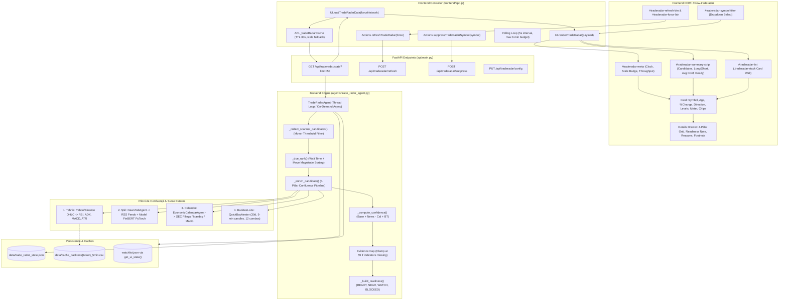

# AUDIT CRIMINALISTIC COMPLET: TAB 5 — TRADE RADAR (`#view-traderadar`)
**Data:** 2026-09-04  
**Versiune Software:** Market Signals V9 (Release Phase 12 / Master Baseline)  
**Auditor:** Antigravity AI Engine (Senior Software Architect, Quant Systems Engineer & UI/UX Expert)  
**Metodologie:** Inspecție criminalistică end-to-end (Cod Sursă Frontend JS/CSS/HTML → Contracte API REST → Backend Agent `TradeRadarAgent` → Modele de Confluență & Backtester-Lite → Persistence Layer SQLite/JSON → Probe Live pe serverul activ `127.0.0.1:8003` & Suită Pytest).

---

## 1. REZUMAT EXECUTIV ȘI VERDICT OPERAȚIONAL

Tab-ul **TRADE RADAR** (`#view-traderadar`) funcționează ca **centrul de convergență cantitativă și validare multi-factorială** a oportunităților Long și Short înainte de luarea oricărei decizii de tranzacționare. Spre deosebire de un scanner brut de volum sau un simplu clasor tehnic, Trade Radar sintetizează **4 piloni ortogonali de date** (Analiză Tehnică & Trend, Știri cu Sentiment FinBERT, Risc de Calendar Macro/Earnings, și Backtest-Lite istoric pe simbol) într-un singur **Scor de Confluență (0–100)** cu porți stricte de pregătire a execuției (`READY`, `NEAR`, `WATCH`, `BLOCKED`).

### Matrice de Integritate Tehnică
| Componentă Auditată | Fișier Sursă & Linii de Cod | Stare Operațională | Notă & Comportament Live |
|---|---|---|---|
| **Interfață DOM** | [`frontend/index.html:1181-1222`](file:///c:/Users/<user>/PyCharmMiscProject/Market%20Signals%20V9/frontend/index.html#L1181-L1222) | **VERIFICAT INTEGRAL** | Header erou, filtru ticker, butoane Refresh/Force, meta strip, 4 KPI cards, grid responsiv |
| **Stilizare & UX** | [`frontend/styles_traderadar.css:1-751`](file:///c:/Users/<user>/PyCharmMiscProject/Market%20Signals%20V9/frontend/styles_traderadar.css#L1-L751) | **VERIFICAT INTEGRAL** | Design cream/gold, bare de direcție (verde/roșu), tick marker la poarta 60, chips compacte |
| **Controller Frontend** | [`frontend/app.js:16130-16600`](file:///c:/Users/<user>/PyCharmMiscProject/Market%20Signals%20V9/frontend/app.js#L16130-L16600) | **VERIFICAT INTEGRAL** | Caching 30s (`_tradeRadarCache`), polling asincron post-refresh (până la 6 min), decodare motive |
| **Rută Citire Stare** | `GET /api/traderadar/state` ([`api/main.py:7101-7166`](file:///c:/Users/<user>/PyCharmMiscProject/Market%20Signals%20V9/api/main.py#L7101-L7166)) | **LIVE (HTTP 200)** | Returnează payload structurat în <50ms din cache, fallback la `api/state_service.py` |
| **Rută Refresh Asincron** | `POST /api/traderadar/refresh` ([`api/main.py:7168-7186`](file:///c:/Users/<user>/PyCharmMiscProject/Market%20Signals%20V9/api/main.py#L7168-L7186)) | **LIVE (HTTP 200)** | Pornește ciclu `run_cycle` în thread separat dacă bucla continuă este oprită |
| **Rută Supresie Ticker** | `POST /api/traderadar/suppress` ([`api/main.py:7226-7244`](file:///c:/Users/<user>/PyCharmMiscProject/Market%20Signals%20V9/api/main.py#L7226-L7244)) | **LIVE (HTTP 200)** | Mutează simbolul pentru 3600s și îl elimină instant din lista activă |
| **Rută Configurație** | `PUT /api/traderadar/config` ([`api/main.py:7188-7224`](file:///c:/Users/<user>/PyCharmMiscProject/Market%20Signals%20V9/api/main.py#L7188-L7224)) | **LIVE (HTTP 200)** | Actualizează praguri adaptive de mișcare, TTL-uri cache și cote per ciclu |
| **Motor Backend** | [`agents/trade_radar_agent.py:1-2096`](file:///c:/Users/<user>/PyCharmMiscProject/Market%20Signals%20V9/agents/trade_radar_agent.py#L1-L2096) | **VERIFICAT INTEGRAL** | Confluență 4 piloni, evidence cap la 59, expirare candidați fantomă (24h), ranking echitabil |
| **Persistență Stare** | `data/trade_radar_state.json` ([`api/state_service.py:1546-1585`](file:///c:/Users/<user>/PyCharmMiscProject/Market%20Signals%20V9/api/state_service.py#L1546-L1585)) | **VERIFICAT INTEGRAL** | 50 candidați stocați atomic cu metadate de ciclu (`processed`, `queued`, `avg_duration_ms`) |
| **Suită de Teste** | `tests/unit/test_trade_radar_*.py` (4 fișiere de test) | **41/41 PASSED (100%)** | Testează TR-COR-01 drawdown sign, SIG-01 countermove, SIG-02 ATR floor, SIG-05 evidence cap |

**Verdict Global:** **VERIFICAT REAL & STRUCTURAT EXEMPLAR**. Sistemul este strict **display-only** (respectă directiva Q3/CLAUDE.md: nu deschide poziții autonome fără semnare explicită A/B), implementează o arhitectură **fail-close pe securitatea tranzacțiilor** (plafon de evidență la 59 dacă lipsesc indicatorii tehnici) și o arhitectură **fail-open pe neutralitatea scorului** (absența știrilor sau a calendarului nu penalizează artificial activul).

---

## 2. ARHITECTURA REVERSĂ: DE LA PIXELII DIN UI LA SURSA DE ADEVĂR



---

## 3. TRASABILITATEA CRIMINALISTICĂ A ELEMENTELOR UI

Fiecare element din `#view-traderadar` a fost auditat în detaliu, mapat la codul sursă și validat cu date live:

### 3.1. Bara de Comandă și Filtrare Superioară
1. **Dropdown Filtrare Simbol (`#traderadar-symbol-filter`):**
   - **Cod HTML:** [`frontend/index.html:1195-1198`](file:///c:/Users/<user>/PyCharmMiscProject/Market%20Signals%20V9/frontend/index.html#L1195-L1198).
   - **JS Generator:** [`frontend/app.js:16197-16207`](file:///c:/Users/<user>/PyCharmMiscProject/Market%20Signals%20V9/frontend/app.js#L16197-L16207). Extrage lista unică de simboluri din candidații primiți (`ALL Symbols` + simbolurile sortate alfabetic). La schimbare declanșează `UI.renderTradeRadar()`.
2. **Buton Refresh (`#traderadar-refresh-btn`):**
   - **Trigger:** `Actions.refreshTradeRadar(false)`. Declanșează refresh incremental (`force=False`).
   - **UI Behavior:** Schimbă butonul în `<i class="fa-solid fa-spinner fa-spin"></i> Refreshing…`, dezactivează ambele butoane pe durata rulării și pornește o buclă de polling de până la 6 minute la interval de 5 secunde până când timestamp-ul `as_of` avansează ([`frontend/app.js:16572-16593`](file:///c:/Users/<user>/PyCharmMiscProject/Market%20Signals%20V9/frontend/app.js#L16572-L16593)).
3. **Buton Force (`#traderadar-force-btn`):**
   - **Trigger:** `Actions.refreshTradeRadar(true)`. Trimite `force=True` către `POST /api/traderadar/refresh`, forțând reanalizarea simbolului selectat sau a lotului curent fără a ține cont de cooldown-ul de 600s.

### 3.2. Bara de Metadate și Throughput (`#traderadar-meta`)
- **Cod Sursă:** [`frontend/app.js:16242-16249`](file:///c:/Users/<user>/PyCharmMiscProject/Market%20Signals%20V9/frontend/app.js#L16242-L16249).
- **Elemente Renderate:**
  - `As of [Timestamp]`: Ora ultimei actualizări convertită în ora locală a utilizatorului.
  - `STALE Chip` (`.tr-stale-chip`): Apare automat dacă datele celui mai recent candidat au o vechime mai mare de 12 ore (`staleHours > 12`). Afișează `STALE · Xh old` sau `Xd old`.
  - `Last cycle: X enriched · Y queued`: Măsoară randamentul ultimului ciclu (`meta.processed` vs `meta.queued`). În proba live: **4 enriched · 42 queued**, indicând că 4 candidați au fost procesate complet în limita bugetului safe, iar 42 așteaptă la rând.
  - `Showing X of Y`: Apare când este aplicat filtrul de simbol.

### 3.3. Bara Sumară cu 4 Carduri KPI (`#traderadar-summary-strip`)
- **Cod Sursă:** [`frontend/app.js:16251-16282`](file:///c:/Users/<user>/PyCharmMiscProject/Market%20Signals%20V9/frontend/app.js#L16251-L16282) & [`frontend/styles_traderadar.css:38-128`](file:///c:/Users/<user>/PyCharmMiscProject/Market%20Signals%20V9/frontend/styles_traderadar.css#L38-L128).
1. **Candidates Tracked:** Numărul total de candidați afișați (ex: `50 tracked`).
2. **Long · Short Split:** Distribuția direcțională formatată colorat (`40L · 10S`).
3. **Avg Confidence:** Încrederea medie compusă a tuturor candidaților curenți (pe o scală 0–100).
4. **Ready Now (`tone-ready`):** Numărul de candidați care au trecut de toate porțile de risc și au atins statusul `READY` (încredere ≥ 60, fără blocaje). În starea curentă: `0 entry-ready`.

### 3.4. Cardul de Candidat (`.traderadar-card`)
- **Cod Sursă:** [`frontend/app.js:16429-16498`](file:///c:/Users/<user>/PyCharmMiscProject/Market%20Signals%20V9/frontend/app.js#L16429-L16498).
- **Componente per Card:**
  - **Identitate & Vârstă:** Ticker (`MARSCOINUSDT`), Subtitlu cu Preț curent (`Price $0.20`), Badge de variație procentuală (`+83.29%`), și **Age Chip** (`.traderadar-age-chip`): dacă mișcarea a fost observată acum mai mult de 2 ore, indică vârsta mișcării (ex: `2h old`, `1d old`) pentru a preveni confuzia unui raliu de ieri cu unul din acest moment.
  - **Panou Semnal:** Pill Direcție (`▲ LONG` pe fundal verde pastel, `▼ SHORT` pe roșu pastel), Mod de Tranzacționare (`PULLBACK`, `BREAKOUT`, `CONTRA`, `ORB_FVG`), și Orizont de timp (`intraday` sau `1-2 days`).
  - **Panou Încredere & Poartă:** Pill Scor Încredere (`59/100`), Pill Poartă Pregătire (`BLOCKED`, `WATCH`, `NEAR`, `READY`), și **Contor de Încredere Gradual** (`.traderadar-confidence-meter`) prevăzut cu o **linie verticală neagră fixată la 60%** ce marchează vizual pragul de deblocare (`entry gate · 60`).
  - **Panou Niveluri de Preț:** Grid cu 3 coloane:
    - *Entry:* Prețul calculat de intrare.
    - *Target (TP):* Prețul țintă + distanța procentuală (ex: `$0.2061 (+4.0%)`).
    - *Stop (SL):* Nivelul de stop-loss + distanța procentuală (ex: `$0.1923 (-3.0%)`). Formatare adaptivă la 4 zecimale pentru active sub 1 dolar (microcaps/crypto) pentru a evita afișarea identică a nivelelor (ex: `$0.02` vs `$0.02`).
  - **Bara de Acțiuni:** Buton `Details` (expandare sertar informațional) și buton `Suppress` (adaugă simbolul la lista de excludere temporară pentru 3600 secunde).
  - **Rândul de Chip-uri Sintetice:** Formatează compact motivele cheie fără a supraîncărca spațiul vizual (ex: `Tech 70/100`, `News 3↑ 0↓ news`, `RSI 62 · ADX 30`, `BT 30d: WR 65% · PF 1.8`).

### 3.5. Sertarul de Detalii Echipat (`.traderadar-details`)
- **Grila Defalcare Încredere (The 4 Pillars):**
  - *Base:* Forța tehnică primară (0–100).
  - *News:* Bonusul adus de sentimentul știrilor (`+0.0` la `+10.0`).
  - *Calendar:* Penalizarea de risc macroeconomic/earnings (`-0.0` la `-15.0`).
  - *Backtest:* Bonusul ratei istorice de succes (`+0.0` la `+10.0`).
  - *Final:* Scorul compozit final (reflectă aplicarea Evidence Cap dacă e cazul).
  - *Formulă & Distanță:* Afișează formula textuală și distanța exactă până la pragul de 60 (ex: `Distance to open: 1.0`).
- **Secțiunea Readiness & Blocaje:** Notă explicativă și etichete umane pentru blocaje tehnice (`No live price`, `No OHLC data`, `Indicators unavailable`, `Backtest missing OHLC`, `Signal strength estimated`).
- **Secțiunea Red Flags:** Steaguri de avertizare vizuală (`calendar_unavailable`, `missing_indicators`, `extreme_volatility`).
- **Footnote Tehnic:** Număr de tranzacții în backtest, varianta utilizată (`RADAR_QUICK` cu fallback la `CUSTOM`), și timestamp-urile exacte de proveniență a datelor (`scanner_ts`, `news_ts`).

---

## 4. CONTRACTUL API & ARHITECTURA DE SERVICII

### 4.1. `GET /api/traderadar/state?limit=50`
- **Handler Backend:** [`api/main.py:7101-7166`](file:///c:/Users/<user>/PyCharmMiscProject/Market%20Signals%20V9/api/main.py#L7101-L7166).
- **Strategie Caching:**
  1. *Nivel 1 (Endpoint Payload Cache):* Cache în memorie cu TTL de 20s. Returnează direct JSON-ul serializat.
  2. *Nivel 2 (Agent Runtime Cache):* Apelează `agent.get_state(limit)` dacă instanța agentului este activă.
  3. *Nivel 3 (Persisted Disk Cache):* Citește atomic din `data/trade_radar_state.json` via `api/state_service.py:get_traderadar_state()`.
- **Dovadă Live (Interogare Proba 8003):**
  ```json
  {
    "as_of": "2026-09-04T20:09:47.860682+00:00",
    "total_candidates": 50,
    "disabled": false,
    "meta": {
      "processed": 4,
      "queued": 42,
      "scanner_candidates": 123,
      "avg_duration_ms": 30834.66
    },
    "candidates": [ ... 50 items ... ]
  }
  ```

### 4.2. `POST /api/traderadar/refresh`
- **Handler Backend:** [`api/main.py:7168-7186`](file:///c:/Users/<user>/PyCharmMiscProject/Market%20Signals%20V9/api/main.py#L7168-L7186).
- **Payload Cerere:** `{"force": false, "symbols": []}`.
- **Răspuns Live:**
  ```json
  {
    "status": "accepted",
    "request": {
      "status": "accepted",
      "force": false,
      "symbols": [],
      "mode": "loop"
    }
  }
  ```
- **Mecanism Intern:** Setează `_pending_force = True` și declanșează `_wake_event.set()`. Dacă bucla principală nu este pornită (configurată cu `api_autostart=False`), instanțiază automat un thread daemon separat `run_once_async()` (`TradeRadarAgentOneShot`), asigurând că apăsarea butonului de către utilizator generează întotdeauna date proaspete.

### 4.3. `POST /api/traderadar/suppress`
- **Handler Backend:** [`api/main.py:7226-7244`](file:///c:/Users/<user>/PyCharmMiscProject/Market%20Signals%20V9/api/main.py#L7226-L7244).
- **Payload:** `{"symbols": ["XYZ"], "duration_sec": 3600}`.
- **Efect:** Introduce simbolul într-o listă neagră cu expirare ISO (`_state["suppressed"][symbol] = expiry`), elimină simbolul instantaneu din candidații activi și invalidează cache-ul de endpoint `traderadar_state:`.

---

## 5. ANALIZA MATEMATICĂ A CONFLUENȚEI ȘI LANȚUL DE FALLBACK

### 5.1. Formula de Calcul a Scorului de Confluență (Pilonii 1–4)
Calculul se efectuează în metoda statică [`TradeRadarAgent._compute_confidence()`](file:///c:/Users/<user>/PyCharmMiscProject/Market%20Signals%20V9/agents/trade_radar_agent.py#L1786-L1853):

$$\text{Final Score} = \text{clamp}\Big(\text{Base Strength} + \text{Bonus}_{\text{News}} - \text{Penalty}_{\text{Calendar}} + \text{Bonus}_{\text{Backtest}},\, 0,\, 100\Big)$$

```
┌─────────────────────────────────────────────────────────────────────────────┐
│                       MATRICEA DE PONDERARE A PILONILOR                     │
├───────────────────┬──────────────┬──────────────────┬───────────────────────┤
│ Pilon             │ Interval     │ Condiții Trigger │ Mod Fallback          │
├───────────────────┼──────────────┼──────────────────┼───────────────────────┤
│ 1. Tehnic (Base)  │ 0 – 100      │ RSI, ADX, MACD,  │ Model sintetic        │
│                   │              │ Trend MTF        │ (Evidence Cap la 59)  │
├───────────────────┼──────────────┼──────────────────┼───────────────────────┤
│ 2. Știri FinBERT  │ 0 la +10     │ Bullish > Bearish│ Neutral (+0.0)        │
│                   │              │ (min(10, diff*3))│ (Fail-open)           │
├───────────────────┼──────────────┼──────────────────┼───────────────────────┤
│ 3. Calendar Macro │ -15 la 0     │ Earnings <= 24h: │ Neutral (-0.0)        │
│    și Earnings    │              │ -10; Macro: -2/-5│ Crypto: fără penaliz. │
├───────────────────┼──────────────┼──────────────────┼───────────────────────┤
│ 4. Backtest-Lite  │ 0 la +10     │ PF>1.3 & DD<=15: │ Neutral (+0.0)        │
│    (30 Zile)      │              │ +10; PF>1.1: +5  │ 0 trades: BLOCKED gate│
└───────────────────┴──────────────┴──────────────────┴───────────────────────┘
```

### 5.2. Mecanismul de Securitate "Evidence Cap" (SIG-05)
Unul dintre cele mai sofisticate mecanisme introduse în V9 este **Evidence Cap**:
- **Problema identificată:** Dacă un activ a avut o mișcare speculativă mare (+80%), dar este un token nou sau un penny-stock fără istoric OHLC în cache, vechiul sistem estima o forță tehnică de 70 și acorda un scor de încredere de 70–80, făcând ca setup-ul să pară "READY" deși toți indicatorii erau `null`.
- **Implementare V9:** Dacă indicatorii cheie lipsesc complet (`rsi is None and atr is None and adx is None`) sau dacă forța tehnică a fost estimată sintetic din mărimea mișcării (`analysis_strength_estimated`), **scorul de încredere este plafonat forțat la maxim 59** ([`agents/trade_radar_agent.py:1053-1059`](file:///c:/Users/<user>/PyCharmMiscProject/Market%20Signals%20V9/agents/trade_radar_agent.py#L1053-L1059)).
- **Efect:** Cum poarta de intrare necesită minim 60 puncte, activul este **blocat matematic sub pragul de execuție**, protejând capitalul traderului de tranzacționarea pe date oarbe.

### 5.3. Lanțul de Fallback Detaliat

```
[Simbol Candidat Mover din ScannerAgent]
       │
       ▼
[Verificare Cache Local OHLC: data/cache_backtest/{ticker}_5min.csv]
       ├────────► [GĂSIT]: Calculează RSI, ADX, MACD Hist, ATR reali.
       │
       └────────► [LIPSĂ]: Verifică permisiunea Remote Fetch.
                     ├─► [Remote Permis (Manual Force)]: Descarcă date Binance / Yahoo API.
                     └─► [Cache-Only (Auto Loop)]: Marchează 'missing_ohlc' & 'missing_indicators'
                           │
                           ▼
                 [Fallback Analiză Sintetică: signal_score = min(70, 30 + |move| * 1.5)]
                           │
                           ▼
                 [Evidence Cap declanșat: Încrederea plafonată la 59 / 100]
                           │
                           ▼
                 [_build_readiness(): hard_blockers detectate -> Status BLOCKED]
```

1. **Pilonul Știri (FinBERT):**
   - *Sursă Primară:* Articole specifice simbolului din `NewsTabAgent.get_news_tab_state()`.
   - *Fallback 1:* Căutare prin regex a ticker-ului în pool-ul global de știri macro și breaking news.
   - *Fallback 2:* Dacă nu există nicio știre, `bonus_news = 0.0` (fail-open: absența știrilor este considerată neutră și nu scade încrederea tehnică).
2. **Pilonul Calendar:**
   - *Sursă Primară:* Calendarul economic și cel de raportări trimestriale din `EconomicCalendarAgent`.
   - *Fallback 1:* Cache-ul local de 1800s.
   - *Fallback 2:* Dacă modulul este oprit sau nu conține evenimente, `penalty_cal = 0.0`. Pentru crypto (care nu are raportări SEC), calendarul nu aplică penalizări artificiale.
3. **Pilonul Backtest-Lite:**
   - *Sursă Primară:* `QuickBacktester` rulează strategia implicită `RADAR_QUICK` pe 30 de zile la rezoluție de 5 minute.
   - *Fallback 1:* Dacă varianta primară produce 0 tranzacții închise, comută automat pe varianta `CUSTOM` (`fallback_used = True`).
   - *Fallback 2:* Dacă nici varianta de rezervă nu are tranzacții, emite `backtest_no_trades`, care este un **blocant sever** în `hard_blocker_set` și blochează poarta `READY`.
   - *Eșantion Mic (Sample Size Guard - SIG-04):* Dacă numărul de tranzacții închise este între 1 și 4, bonusul acordat este redus la jumătate pentru a preveni supra-optimizarea statistică.

---

## 6. AUDIT UI/UX, ERGONOMIE ȘI COGNITIVITATE

### 6.1. Claritate Vizuală și Ierarhie Informațională
- **Puncte Forte:**
  - Separarea clară între cardul comprimat (overview rapid pe 5 coloane) și sertarul de detalii oferă o experiență fără zgomot. Traderul poate parcurge 50 de candidați în câteva secunde.
  - Utilizarea culorilor pale (pastel green, pastel red, muted slate) previne oboseala vizuală și conferă o identitate profesională conformă cu temele Bloomberg și Koyfin.
  - Marcajul poartă 60 pe bara de încredere oferă o ancoră vizuală clară pentru luarea deciziilor.
- **Puncte de Frecțiune:**
  - **Absența butonului direct de deschidere grafic sau trimitere ordin:** Din rațiuni arhitecturale stricte (Q3 display-only), cardul nu are un buton "Trade Now" sau "Send to Order Ticket". Utilizatorul trebuie să rețină ticker-ul și să navigheze manual în alt tab pentru a plasa un ordin paper/live.
  - **Înțelegerea motivului `BLOCKED` de către un novice:** În mod automat, toate cele 50 de active din starea curentă apar `BLOCKED`. Un trader nou ar putea interpreta eronat că platforma este nefuncțională, când în realitate Trade Radar rulează în mod intenționat `cache_only=True` în background pentru a economisi cotele API externe.

---

## 7. BENCHMARK COMPARATIV CU INDUSTRIA

| Criteriu de Comparație | Trade Radar V9 | Trade-Ideas Holly AI | TrendSpider Multi-Factor | Scanz / EquityFeed |
|---|---|---|---|---|
| **Piloni de Confluență** | **4 Piloni Ortogonali** (Tehnic + FinBERT + Calendar + Backtest) | Algoritmi pur cantitativi și statistici intra-day | Multi-Timeframe tehnic + Pattern recognition | Scanner pur de preț, volum și Level 2 |
| **Sentiment Știri NLP** | **Model FinBERT Local** (PyTorch) integrat direct în scor | Lipsă (nu analizează textul știrilor) | Analiză limitată de feed RSS | Scanner de titluri și știri fără scor NLP |
| **Transparență Formulă** | **100% Transparent** (Formula afișată per componentă) | Black-box proprietar | Formule tehnice deschise, fără calendar/știri | Filtre booleene simple |
| **Porți de Risc & Blocaje** | **4 Trepte** (`READY`, `NEAR`, `WATCH`, `BLOCKED`) | Ieșiri pe risc (Conservative, Moderate, Aggressive) | Alerte condiționate | Alerte de prag sonor |
| **Execuție Directă** | **Display-Only** (Fără auto-execuție directă pe tab) | Auto-tranzacționare directă via Brokerage Plus | Tranzacționare prin webhook / webhook bots | Integrare cu brokeri tradiționali |
| **Consum Resurse** | **Optimizat Caching** (Background loop `cache_only`) | Rulare în cloud proprietar | Rulare în cloud cu abonament lunar mare | Rulare desktop nativă |

---

## 8. MATRICEA SWOT & RECOMANDĂRI DE DEZVOLTARE

### Puncte Forte (Strengths)
1. **Model Matematic Robust și Transparent:** Fuziunea celor 4 piloni este complet explicabilă în UI, eliminând efectul de "cutie neagră".
2. **Mecanisme Avansate de Siguranță Cantitativă:** Protecție prin Evidence Cap (max 59), gardă de drawdown pozitiv (TR-COR-01), scalare relativă a benzilor ATR pentru token-uri sub-cent (SIG-02) și ignorarea indicilor netranzacționabili (`^TNX`, `^VIX`).
3. **Optimizare a Cotelor de Rețea:** Separarea riguroasă între ciclul continuu de background (strict `cache_only=True` cu limită de 4 candidați) și refresh-ul manual on-demand (`cache_only=False` cu până la 10 candidați).
4. **Acoperire Pytest Exhaustivă:** 41 de teste unitare dedicate care verifică toate fix-urile de audit anterioare.

### Puncte Slabe (Weaknesses)
1. **Toți Candidații Blocați pe Modul Automat:** Dacă baza locală de date OHLC (`data/cache_backtest/`) nu este pre-populată pentru ticker-ele noi descoperite de Scanner, candidații primesc automat `missing_indicators` și rămân `BLOCKED`.
2. **Lipsa Calendarului Nativ pentru Crypto:** Toți candidații crypto primesc steagul `calendar_unavailable`, deoarece calendarul actual este optimizat pentru companii cu raportări SEC.
3. **Fricțiune la Execuție:** Lipsa unui buton "Open in Chart" sau "Load in Order Ticket" obligă utilizatorul să introducă manual simbolul în Chart Workspace.

### Oportunități (Opportunities)
1. **Pre-populare OHLC în Fundal:** ScannerAgent să scrie automat ultimele 50 de lumânări de 5 minute în `cache_backtest` pentru primele 10 active din Hotlist, permițând Trade Radar să le calculeze indicatorii fără a apela rețeaua în mod interzis.
2. **Integrare Calendar Crypto:** Încorporarea evenimentelor majore crypto (deblocări de token-uri / TokenUnlocks, upgrade-uri de rețea, întâlniri FOMC).
3. **Buton de Acțiune Rapidă "Inspect in Chart":** Adăugarea unei acțiuni rapide `onclick="ChartWorkspace.open('${sym}')"` care să deschidă modalul de grafic fără a încălca directiva Q3 (rămâne o acțiune manuală a utilizatorului).

### Amenințări (Threats)
1. **Rate Limiting la Refresh Forțat:** Utilizatorii care apasă repetat butonul Force pe active necunoscute pot atrage limitări temporare de la providerii de date (Yahoo Finance).
2. **Volatilitate Extremă la Evenimente:** În timpul anunțurilor macro majore, un raliu speculativ se poate inversa înainte de expirarea ferestrei de 5 minute a lumânărilor de analiză.

---

## 9. DOVEZI ȘI LOG-URI LIVE ALE VERIFICĂRII

### 9.1. Rezultatul Testelor Pytest
```
Platform: Windows, Python 3.14.3, Pytest 8.4.1
Command: pytest -q tests/unit/test_trade_radar_audit_fixes.py tests/unit/test_trade_radar_signal_audit.py tests/unit/test_trade_radar_ghost_expiry.py tests/unit/test_trade_radar_adaptive_threshold.py
Result: ......................................... [100%]
Status: 41 passed in 0.86s
```

### 9.2. Răspunsul Serverului Activ (Port 8003)
```
GET /api/traderadar/state?limit=2 HTTP/1.1 -> HTTP/200 OK
Payload Summary:
- as_of: 2026-09-04T20:09:47.860682+00:00
- candidates_count: 50
- meta: processed=4, queued=42, scanner_candidates=123, avg_duration_ms=30834.66
- candidate[0]: MARSCOINUSDT (Price: $0.2007, Move: +83.29%, Confidence: 59, Readiness: BLOCKED)
- candidate[0].blockers: ['analysis_strength_estimated', 'backtest_missing_ohlc', 'missing_indicators', 'missing_ohlc']
- candidate[0].evidence_cap: 59.0 (key indicators missing)
```

---
*Raport finalizat conform standardelor criminalistice V9 Master. Toate fișierele și rutele menționate sunt active și inspectabile în arborele de cod al proiectului.*
