# AUDIT CRIMINALISTIC COMPLET: TAB 13 — CAPITAL & PAPER TRADING TERMINAL (`#view-capital`)

**Data:** 2026-09-04  
**Versiune Software:** Market Signals V9 (Release Phase 12)  
**Autor:** Antigravity Quant & Systems Forensic Auditor (Senior Software Architect & Full-Stack UX Reviewer)  
**Tinta Investigata:** Interfata Executie & Portofoliu Simulat: `#view-capital`  
**Stare Server Live:** Conectat pe `http://127.0.0.1:8003` | **119 teste specifice Capital trecute (100% PASS)**

---

## 1. REZUMAT EXECUTIV SI STARE OPERATIONALA

Tab-ul **13: Capital & Paper Trading Terminal** (`#view-capital`) reprezinta motorul de simulare financiara, executie de ordine, management al riscului si evidenta contabila (ledger) din cadrul platformei Market Signals V9. Spre deosebire de simulatoarele clasice de tranzactionare care utilizeaza un model simplist de sold virtual + pret mediu, arhitectura V9 implementeaza un **broker institutional simulat cu evidenta dubla (double-entry ledger)**, blocare fizica de marja (margin reserve/release), deducere explicita a comisioanelor (entry/exit commissions conform modelelor de cost per activ), protectie impotriva anomaliilor de date (magnitude mismatch filter), si un lant de rezilienta cvadruplu pentru preturi live.

### Matricea Starii Tehnice
| Componenta Auditata | Stare Criminalistica | Sursa Primara & Rute Backend |
|---|---|---|
| **Portfolio Cockpit KPIs** | **100% RECONCILIAT** | Cash + Marja blocata + Mark-to-Market PnL (`core/capital_manager.py:2620-2635`) |
| **Equity Curve Chart** | **INTERACTIV SVG VECTORIAL** | Endpoint dedicat `GET /api/capital/equity-curve` + recalculare dinamica pe tick |
| **Jurnal Tranzactii & Export CSV** | **AUDITABIL / ANTI-INJECTION** | `capital.ledger` cu separare `CAPITAL` vs `RESEARCH`, protectie anti-formule CSV |
| **Order Terminal** | **EXECUTIE LA BID/ASK VERIFICAT** | `POST /api/capital/open-position`, marja 1x-5x, debit comision la intrare |
| **Autopilot Control & Grid** | **PORTI FAIL-CLOSED ACTIVE** | `/bot/start`, `/bot/stop`, `/agents/autonomous/run-once`, gating 4-fapte |
| **Carduri Pozitii Active** | **LIVE FLASH & DISTANTE SL/TP** | `_hydrate_capital_live_prices`, flash CSS, alerta apropiere stop (`distStop <= 1%`) |
| **Panou Full Explainability** | **TRANSPARENTA INSTITUTIONALA** | 13 dimensiuni de audit: catalizator, scor agenti, comision, model AI, motiv exit |
| **Modal Ajustare Protectie** | **BLOCARE OVERRIDE AUTONOM** | `POST /api/capital/update-position-levels`, dezactivare trailing la interventie manuala |
| **Lant Rezilienta Cotatii** | **CVADRUPLU CU TIMEOUT GUARD** | eToro bulk rates (150ms) -> Binance orderbook -> Alpaca -> Yahoo -> SQLite Cache |

---

## 2. INSPECTIA INVERSA A FLUXULUI DE DATE (UI -> SURSA DE ADEVAR & FAILOVER)

```mermaid
flowchart TD
    subgraph UI_Layer["Interfata Utilizator (#view-capital)"]
        KPI["Portfolio Cockpit (#capital-equity-value, #capital-open-pnl, #capital-exposure-value, #capital-win-rate)"]
        EQ_SVG["Equity Curve SVG (#capital-equity-curve)"]
        ORD_TERM["Order Terminal (#capital-open-ticker, #capital-open-submit)"]
        POS_CARDS["Active Positions Grid (#capital-trade-cards)"]
        EXPL_PANEL["Full Explainability Panel (#capital-explainability-panel)"]
        MOD_PROT["Level Editor Modal (#capital-risk-modal)"]
        HIST_TBL["Unified Transaction History (#capital-history-body)"]
    end

    subgraph Frontend_Controller["Frontend Client Controller (frontend/app.js)"]
        RC["UI.renderCapital()"]
        REC["UI._renderCapitalEquityCurve()"]
        RA["UI.renderCapitalAutopilot()"]
        REP["UI.renderCapitalExplainabilityPanel()"]
        ACT_OPEN["Actions.openCapitalPosition()"]
        ACT_CLOSE["Actions.closeCapitalPosition()"]
        ACT_RISK["Actions.saveCapitalRiskLevels()"]
        ACT_RESET["Actions.resetCapital()"]
        ACT_EXP["Actions.exportCapitalHistory()"]
    end

    subgraph API_Gateway["API REST Gateway (api/main.py)"]
        R_STATE["GET /api/state?lean=true & include=capital"]
        R_OPEN["POST /api/capital/open-position"]
        R_CLOSE["POST /api/capital/close-position"]
        R_RESET["POST /api/capital/reset"]
        R_LEVELS["POST /api/capital/update-position-levels"]
        R_DEC["GET /api/capital/decisions"]
        R_CURVE["GET /api/capital/equity-curve"]
    end

    subgraph Core_Services["Core Financial & Execution Engine"]
        CM["CapitalManager (core/capital_manager.py)"]
        PB["PaperBroker (core/execution/broker.py)"]
        EM["ExitManager (core/exit_manager.py)"]
        CEG["CapitalEntryGuard (core/capital_entry_guard.py)"]
        SS["StateService (api/state_service.py)"]
    end

    subgraph Market_Resilience_Chain["Lantul de Rezilienta Preturi Live"]
        ET_BULK["1. eToro Bulk Live Rates (150ms 1-shot API)"]
        BIN_DEPTH["2. Binance Depth / Orderbook v3"]
        ALP_FEED["3. Alpaca IEX / Crypto Feed"]
        YF_FALL["4. Yahoo Finance (fast_info + ATR Spread)"]
        SQL_CACHE["5. SQLite live_price_cache"]
        ZERO_FALL["6. Zero-Price Fallback (Entry Price + Cache Chip)"]
    end

    subgraph Persistence_Ledger["Stocare & Persistenta Autoritara"]
        DB_SQL[("SQLite: market_signals.db")]
        JSON_STATE[("runtime/capital.json")]
    end

    UI_Layer <--> Frontend_Controller
    Frontend_Controller <--> API_Gateway
    API_Gateway <--> Core_Services
    Core_Services <--> Market_Resilience_Chain
    Core_Services <--> Persistence_Ledger
```



---

### 2.1. Cartografierea Criminalistica a Elementelor UI

#### A. Portfolio Cockpit Grid (4 Carduri Principale)
* **DOM IDs:**
  - `#capital-equity-value`: Valoarea totala a contului.
  - `#capital-open-pnl` si `#capital-open-pnl-pct`: Profit/Pierdere nerealizata cu colorare dinamica (`text-green` / `text-red`).
  - `#capital-exposure-value`: Gradul de indatorare/expunere din capitalul total (`deployed / equity * 100`).
  - `#capital-win-rate`: Procentul tranzactiilor castigatoare calculate server-side pe pozitiile inchise.
  - `#capital-positions-count` si `#capital-research-count`: Contoare independente pentru capital alocat vs cercetare.
* **Controler Frontend:** [frontend/app.js:2529-2636](file:///c:/Users/<user>/PyCharmMiscProject/Market%20Signals%20V9/frontend/app.js#L2529-L2636).
* **Formula Matematica de Reconciliere:**
  $$\text{Portfolio Equity} = \text{Free Cash} + \sum \text{Margin Used} + \sum \text{Mark-to-Market Gross PnL}$$
  *Observatie criminalistica:* Balanta bruta `capitalData.balance` reprezinta strict **cash-ul liber**. La deschiderea fiecarei pozitii, marja este retrasa din cash; prin urmare, formula adauga marja activa inapoi pentru a nu afisa o scadere instantanee de capital la deschiderea tranzactiilor. PnL-ul deschis foloseste evaluarea mark-to-market bruta pentru capital si neta (scazand comisioanele de iesire estimate) pe cardul utilizatorului.
* **Sursa Backend:** `core/capital_manager.py` (`resolve_capital_equity`, `_snapshot_daily_equity`).

#### B. Graficul Curbei de Capital (`#capital-equity-curve`)
* **DOM ID:** `#capital-equity-curve` (`.capital-equity-card-shell`).
* **Controler Frontend:** [frontend/app.js:2864-2980](file:///c:/Users/<user>/PyCharmMiscProject/Market%20Signals%20V9/frontend/app.js#L2864-L2980) (`UI._renderCapitalEquityCurve`).
* **Ruta API:** `GET /api/capital/equity-curve?limit=90` ([api/main.py:1629-1660](file:///c:/Users/<user>/PyCharmMiscProject/Market%20Signals%20V9/api/main.py#L1629-L1660)).
* **Tehnologie Randare:** SVG vectorial interactiv fara biblioteci externe greoaie.
  - Algoritmul `_buildCapitalEquityScale` calculeaza dinamic pasi rotunzi de scalare (1, 2, 2.5, 5, 10).
  - Foloseste proiectie pe coordonate temporale (`useTimeScale` bazat pe diferenta de timestamp ms).
  - Traseaza curba prin segmente liniare directe `M x y L x y` fara curbe Bezier speculative care ar inventa minime sau maxime inexistente intre esantioane.
  - Linie de gradient dinamic: verde pentru trend ascendent (`is-positive`), rosu pentru trend descendent (`is-negative`).

#### C. Jurnalul Unificat de Tranzactii (`#capital-history-section`) & Export CSV
* **DOM IDs:** `#capital-history-section`, `#capital-history-body`.
* **Controler Frontend:** [frontend/app.js:2766-2823](file:///c:/Users/<user>/PyCharmMiscProject/Market%20Signals%20V9/frontend/app.js#L2766-L2823).
* **Structura Tabel:**
  1. `Date / Time`: Data formatata + buton toggle detaliu (`.capital-history-toggle`).
  2. `Event / Scope`: Tip eveniment (`DEPOSIT`, `ORDER_FILL`, `RESERVE_MARGIN`, `RELEASE_MARGIN`, `CLOSE_POSITION`) + tag `CAPITAL` sau `RESEARCH`.
  3. `Details`: Explicatie tranzactie (simbol, motiv, multiplicator).
  4. `Amount`: Suma neta cash debitata/creditata.
  5. `Raw Cash`: Balanta cash libera rezultata la milisecunda respectiva.
* **Securitate Export CSV (`Actions.exportCapitalHistory`):**
  - [frontend/app.js:23855-23888](file:///c:/Users/<user>/PyCharmMiscProject/Market%20Signals%20V9/frontend/app.js#L23855-L23888).
  - **Sanitizare Anti-Formula-Injection:** Orice valoare care incepe cu `=`, `+`, `-`, sau `@` este prefixata automat cu apostrof (`'`) conform standardului OWASP CSV Injection Mitigation, prevenind executia de comenzi DDE malitioase in Excel/Calc.

#### D. Order Terminal (Consola de Plasare Manuala)
* **DOM IDs:**
  - Ticker: `#capital-open-ticker`
  - Directie: `#capital-open-direction` (`long` / `short`)
  - Leverage: `#capital-open-leverage` (1x - 5x)
  - Marime: `#capital-open-size` (USD)
  - Stop Loss %: `#capital-open-stop-pct`
  - Take Profit %: `#capital-open-target-pct`
  - Setup / Motiv: `#capital-open-reason`
  - Buton Executie: `#capital-open-submit` (`data-testid="capital-open-submit"`)
* **Controler Frontend:** `Actions.openCapitalPosition` -> `Actions.submitCapitalPaperOrder` -> `API.openCapitalPosition` ([frontend/app.js:23721-23791](file:///c:/Users/<user>/PyCharmMiscProject/Market%20Signals%20V9/frontend/app.js#L23721-L23791)).
* **Ruta API:** `POST /api/capital/open-position` ([api/main.py:1358-1460](file:///c:/Users/<user>/PyCharmMiscProject/Market%20Signals%20V9/api/main.py#L1358-L1460)).
* **Reguli Executie:**
  - Ordinele manuale au permisiune de bypass pentru orarul bursier (traderul poate deschide/testa 24/7).
  - Pretul de intrare este solicitat strict la Bid/Ask live (`use_cache=False`).
  - Marja este calculata: $\text{Margin} = \frac{\text{USD Size}}{\text{Leverage}}$.
  - Se debiteaza comisionul de intrare conform modelului de cost al instrumentului (`core/trading_costs.py`).

#### E. Autopilot Control & Grila de Oportunitati
* **DOM IDs:** `#capital-autopilot-status`, `#capital-bot-start`, `#capital-bot-stop`, `#capital-cycle-run`, `#capital-opportunities`.
* **Controlere Frontend:** [frontend/app.js:3095-3250](file:///c:/Users/<user>/PyCharmMiscProject/Market%20Signals%20V9/frontend/app.js#L3095-L3250), [23802-23853](file:///c:/Users/<user>/PyCharmMiscProject/Market%20Signals%20V9/frontend/app.js#L23802-L23853).
* **Rute API:** `POST /bot/start`, `POST /bot/stop`, `POST /agents/autonomous/run-once`.
* **Mecanism Gating:** Fiecare oportunitate afiseaza statusul portii de intrare (`open_capital`, `open_research`, `eligible`, `blocked`, `conflict`, `below_score`, `invalid_timestamp`). Semnalele fara timestamp valid sau expirate peste pragul `max_signal_age_seconds` (300s) sunt blocate automat de la intrarea in capitalul real.

#### F. Carduri Pozitii Active (`#capital-trade-cards`)
* **DOM ID:** `#capital-trade-cards`.
* **Controler Frontend:** [frontend/app.js:2651-2765](file:///c:/Users/<user>/PyCharmMiscProject/Market%20Signals%20V9/frontend/app.js#L2651-L2765).
* **Elemente Randate per Card:**
  - Ticker, Badge Directie (`LONG` verde / `SHORT` rosu), Chip strategie, Chip cercetare (`RESEARCH` / `PAPER AUTO`), Multiplicator levier (`x2`-`x5`).
  - Cotatie Intrare ($) si Cotatie Curenta Live ($) cu efect de **Flash Verde/Rosu** pe modificare de pret (`flash-up`, `flash-down`).
  - Badge Provenienta Pret: `LIVE` (verde, sursa verificata proaspata) vs `CACHE` (gri/galben, pret din baza locala).
  - Distante dinamice semnate: `Stop: $xx (2.1% away)` si `Target: $xx (4.2% away)`.
  - **Stare Critica Vizuala:** Daca distanta pana la Stop Loss scade sub 1.0% (`distStop <= 1.0`), cardul primeste clasa `.is-near-stop`, conturandu-se cu bordura rosie pulsanta de avertizare.
  - Buton `Edit SL/TP` (`Actions.openCapitalRiskEditor`) si Buton `Close` (`Actions.closeCapitalPosition`).

#### G. Panoul Full Explainability (`#capital-explainability-panel`)
* **DOM ID:** `#capital-explainability-panel`.
* **Controler Frontend:** [frontend/app.js:9468-9650](file:///c:/Users/<user>/PyCharmMiscProject/Market%20Signals%20V9/frontend/app.js#L9468-L9650).
* **Forensic Breakdown:** La selectarea oricarei pozitii, panoul extrage din `decision_context` si `explainability`:
  1. *Timestamp & Event:* ID semnal, tip strategie, timestamp milisecundic.
  2. *Metrici Cantitative:* Scor semnal, probabilitate calculata, calitatea setup-ului, raport R:R (Risk/Reward), marime pozitie si marja retinuta.
  3. *Audit Broker & Executie:* Furnizor analiza, verificare fallback utilizat, disponibilitate AI (YES/RECONSTRUCTED), comision intrare achitat, comision iesire estimat, pret trigger.
  4. *Avertizari AI:* Alerte active de divergenta, schimbare regim de piata sau expirare catalizator.

#### H. Modalul de Ajustare Protectie (`#capital-risk-modal`)
* **DOM ID:** `#capital-risk-modal` (denumit functional si `#capital-protection-modal`).
* **Controlere Frontend:** [frontend/app.js:23968-24178](file:///c:/Users/<user>/PyCharmMiscProject/Market%20Signals%20V9/frontend/app.js#L23968-L24178).
* **Ruta API:** `POST /api/capital/update-position-levels` ([api/main.py:1537-1588](file:///c:/Users/<user>/PyCharmMiscProject/Market%20Signals%20V9/api/main.py#L1537-L1588)).
* **Preseturi Rapide:** Scalp (0.8% / 1.6%), Intraday (1.5% / 3%), Swing (3% / 6%), buton **Break-even SL** (muta stop loss-ul exact la pretul de intrare daca piata a avansat favorabil peste pragul minim de siguranta de 0.05%).
* **Autoritate & Regula de Blocare Trailing:** Salvarea manuala a nivelurilor SL/TP seteaza `automatic_trailing_enabled = False` in registrul pozitiei. Astfel, sistemul acorda prioritate absoluta deciziei umane si **blocheaza interventia robotilor sau a AI-ului de a mai muta stop-ul**.

---

## 3. LANTUL DE REZILIENTA A PRETUTILOR LIVE SI RECONCILIEREA MARJEI

### 3.1. Traseul Cotatiilor Live (Failover & Latency Waterfall)

Atunci cand frontend-ul interogheaza `/api/state`, functia de imbogatire a preturilor din [api/state_service.py:950-1289](file:///c:/Users/<user>/PyCharmMiscProject/Market%20Signals%20V9/api/state_service.py#L950-L1289) parcurge urmatorul lant strict:

1. **Pasul 1 — eToro Bulk Live Rates (Apel de Retea Unic, 1-shot ~150ms):**
   - Serviciul extrage lista tuturor simbolurilor din pozitiile active `OPEN`.
   - Mapeaza simbolurile la ID-urile interne eToro (`instrument_id`) prin cache-ul local.
   - Efectueaza un singur apel HTTP batch catre `et.get_live_rates(iids)`.
   - Extrage cotatiile `bid`, `ask` si `last`, ajustand prin multiplicatorul de unitate (`unit_multiplier`).
   - Populeaza instantaneu cache-ul de executie cu cotatii bid/ask verificate (`eToro_bid_ask`, calitate `VERIFIED`).
2. **Pasul 2 — Single-Asset Fallbacks (Executate in ThreadPoolExecutor paralel cu Deadline):**
   - Daca un instrument nu este disponibil pe eToro (sau apelul eToro are timeout), interogarea este trimisa catre un pool de thread-uri concurente (`ThreadPoolExecutor(max_workers=8)`).
   - **Crypto:** Interogheaza direct `Binance Depth Public API v3` (`https://api.binance.com/api/v3/depth?symbol=...&limit=5`), preluand cel mai bun Bid si Ask din carnetul de ordine (orderbook). Sursa: `Binance_orderbook`.
   - **Alpaca (optional):** Daca cheile Alpaca sunt configurate in mediu, se interogheaza fluxul IEX pentru bid/ask si quote pressure. Sursa: `alpaca_iex`.
   - **Yahoo Finance:** Pentru actiuni non-crypto fara cotatie eToro, interogheaza `yf.Ticker(sym).fast_info.last_price` si bid/ask din `info`. In caz de spread lipsa, simuleaza spread-ul realist prin volatilitatea ATR (`_get_atr_for_symbol`). Sursa: `Yahoo_bid_ask` sau `Yahoo_quote`.
3. **Pasul 3 — SQLite `live_price_cache`:**
   - Daca reteaua externa esueaza complet, se citeste ultima cotatie persistata in tabela locala SQLite `live_price_cache`. Sursa: `capital_price_cache`.
4. **Pasul 4 — Zero-Price Fallback (Protectia de Integritate):**
   - Daca o pozitie deschisa nu a putut obtine nicio cotatie valida din niciun provider (si nici din cache), pretul curent este setat egal cu `entry_price`, marcand pozitia cu badge `CACHE` si PnL = $0.00.
   - *Impact UX:* Previne afisarea anomaliei de `$0.0000` si PnL -100%, care crea impresia unui bug fatal.
5. **Budget Temporar Strict (Deadline Guard):**
   - `MS_CAPITAL_QUOTE_DEADLINE_SECONDS = 8.0s`. Daca un apel extern depaseste 8 secunde, `as_completed` abandoneaza thread-ul restant (`shutdown(wait=False, cancel_futures=True)`) si aplica cotatiile colectate pana in acel moment, garantand ca interfata utilizatorului nu ingheata niciodata.

### 3.2. Filtrarea Anomaliilor de Cotatie (Magnitude Mismatch Guard)

In pietele crypto si la actiuni cu split-uri sau diferente de denominare valutara (ex: monede low-cap cotate in fractiuni de cent sau actiuni LSE cotate in pence GBX vs USD pe eToro), un furnizor extern poate trimite ocazional o cotatie decalata cu 100x sau 0.01x fata de pretul real.
Daca o asemenea cotatie ar fi acceptata, pozitia ar afisa un P&L fals de +5.000% sau -99%, denaturand complet valoarea portofoliului.

* **Implementare Criminalistica ([api/state_service.py:1013-1020](file:///c:/Users/<user>/PyCharmMiscProject/Market%20Signals%20V9/api/state_service.py#L1013-L1020)):**
  ```python
  entry_p = entry_by_canon.get(canon_tk)
  if entry_p and entry_p > 0 and last_p > 0:
      ratio = last_p / entry_p
      if ratio > 30.0 or ratio < 0.03:
          logger.warning(
              f"Rejected eToro quote magnitude mismatch for {canon_tk}: quote={last_p} vs entry={entry_p} (ratio={ratio:.2f})"
          )
          continue
  ```
* **Testare Live:** Raportul de magnitudine a fost validat live:
  - `entry = 100.0, quote = 3500.0 (ratio = 35.00)` $\rightarrow$ **REJECTED (True)**
  - `entry = 100.0, quote = 2.0 (ratio = 0.02)` $\rightarrow$ **REJECTED (True)**
  - `entry = 100.0, quote = 105.0 (ratio = 1.05)` $\rightarrow$ **ACCEPTED (False)**

### 3.3. Reconcilierea Balantei Cash si a Marjei la Inchiderea Ordinelor

In [core/capital_manager.py:2726-2860](file:///c:/Users/<user>/PyCharmMiscProject/Market%20Signals%20V9/core/capital_manager.py#L2726-L2860), mecanismul de inchidere asigura conservarea masei monetare:

1. **La Deschiderea Pozitiei:**
   - Se calculeaza marja retinuta: $\text{Margin} = \frac{\text{USD Size}}{\text{Leverage}}$.
   - Se debiteaza marja din cash-ul liber: $\text{Balance} = \text{Balance} - \text{Margin}$.
   - Se debiteaza comisionul de intrare: $\text{Balance} = \text{Balance} - \text{Entry Commission}$.
   - Se adauga tranzactiile de tip `RESERVE_MARGIN` si `COMMISSION` in registru.
2. **La Inchiderea Pozitiei:**
   - Se elibereaza marja exacta retinuta initial:
     $$\text{Balance} = \text{Balance} + \text{Margin} \quad (\text{inregistrat ca } \texttt{RELEASE\_MARGIN})$$
   - Se calculeaza PnL-ul brut pe baza diferentei de pret dintre Bid/Ask-ul de iesire si cel de intrare inmultit cu cantitatea (`qty`):
     $$\text{Gross PnL} = (\text{Exit Price} - \text{Entry Price}) \times \text{Qty} \quad (\text{LONG})$$
     $$\text{Gross PnL} = (\text{Entry Price} - \text{Exit Price}) \times \text{Qty} \quad (\text{SHORT})$$
   - Se calculeaza comisionul de iesire (`exit_commission = Exit Notional * Exit Commission Rate`).
   - Se crediteaza/debiteaza PnL-ul in numerar:
     $$\text{Cash PnL} = \text{Gross PnL} - \text{Exit Commission}$$
     $$\text{Balance} = \text{Balance} + \text{Cash PnL} \quad (\text{inregistrat ca } \texttt{CLOSE\_POSITION})$$
   - **Net PnL Realizat Total:**
     $$\text{Net PnL} = \text{Gross PnL} - \text{Entry Commission} - \text{Exit Commission}$$
   - *Verificare de Reconciliere:* Soldul final al contului este identic cu soldul initial la care se adauga suma neta a tuturor tranzactiilor inchise.

---

## 4. AUDIT UI/UX, ERGONOMIE SI INCARCARE COGNITIVA

### 4.1. Structura Vizuala si Ierarhie
Interfata este organizata intr-o secventa logica dedicata fluxului decizional al unui trader activ:
1. **Panoul KPI de Portofoliu:** Cele 4 cadrane superioare (Equity, P&L, Expunere, Win Rate) ofera instantaneu pulsul contului fara a aglomera privirea cu cifre secundare.
2. **Curba de Capital:** Prezenta imediat sub KPIs, arata tendinta contului si elimina senzatia de incertitudine.
3. **Jurnalul Unificat:** Ofera transparenta imediata cu detalii expandabile pe fiecare linie (`Raw Cash` vizibil pentru auditare).
4. **Order Terminal (Glassmorphism):** Campurile sunt aliniate orizontal pe ecrane mari si trec in cascada pe ecrane mici, oferind tastare rapida.
5. **Grid-ul de Pozitii Active:** Cardurile compacte ofera informatia critica (pret intrare, pret curent, distanta SL/TP) cu o ierarhie vizuala clara.

### 4.2. Ergonomie pentru un Trader Activ
* **Avertizare Vizuala de Urgenta (`.is-near-stop`):** Schimbarea culorii cardului cand pretul este la sub 1% de Stop Loss ajuta traderul sa decida imediat daca intervine manual sau lasa stopul sa execute.
* **Modalul Edit SL/TP cu Buton Break-even:** Posibilitatea de a muta stop-ul la nivelul de break-even printr-un singur click (`Actions.applyCapitalBreakEven()`) este o functionalitate profesionista.
* **Separarea Cercetarii de Capitalul Activ:** Badge-urile `RESEARCH` si `PAPER AUTO` clarifica faptul ca tranzactiile experimentale forward-paper nu consuma capital deployable si nu afecteaza curba oficiala de randament.

### 4.3. Terminologie si Incarcare Cognitiva
* Termenii tehnici (RVOL, R:R, Mark-to-Market, Gross vs Net PnL, Exposure, Margin) sunt etichetati clar, iar panoul de explicabilitate ofera context narativ pentru fiecare decizie.
* Un trader incepator intelege rapid diferenta dintre banii liberi (`Raw Cash`), marja blocata (`Exposure`) si castigul nerealizat (`Open P&L`).

---

## 5. BENCHMARK COMPARATIV CU PLATFORMELE DIN INDUSTRIE

| Functionalitate / Criteriu | Market Signals V9 (TAB 13) | TradingView Paper Trading | Interactive Brokers TWS Paper | Webull Paper Trading |
|---|---|---|---|---|
| **Motor de Cotatii & Rezilienta** | **Cvadruplu (eToro, Binance, Alpaca, Yahoo)** | Cotatii interne TV (adesea cu delay pe free) | Cotatii de schimb oficiale (necesita abonamente) | Cotatii NBBO 15 min delay / live |
| **Model Realist de Costuri** | **Comisioane intrare/iesire + Spread bid/ask real** | Spread fix simulat, comisioane configurabile simplist | Comisioane reale IBKR (Tiered/Fixed) | Fara comisioane (zero commissions) |
| **Gating Autonom & Validare AI** | **Integrat (4 porti fail-closed + FinBERT news)** | Inexistent (doar manual sau Pine Script alerts) | Doar algoritmi clasici (VWAP, TWAP, Accumulate) | Inexistent |
| **Full Explainability Panel** | **Da (13 dimensiuni de audit narativ per pozitie)** | Nu (doar jurnal de executie clasic) | Nu (doar audit trail de mesaje FIX) | Nu |
| **Protectie Anti-Override la Interventie** | **Da (dezactiveaza automat trailing AI la editare)** | Nu (modificarea ordinului pastreaza logica) | Configurare manuala complexa OCA/Bracket | Nu |
| **Separare Portofoliu Activ vs Cohorta Research** | **Da (izolare completa in ledger)** | Nu (un singur cont per sesiune) | Necesita conturi virtuale separate | Nu |
| **Tranzactionare direct de pe Grafic** | **Prin modal integrat (`ChartWorkspace`)** | **Exceptionala (drag-and-drop SL/TP pe chart)** | Buna pe BookTrader / ChartTrader | Buna |

---

## 6. EVALUARE SWOT & RECOMANDARI DE DEZVOLTARE

### Puncte Forte (Strengths)
1. **Contabilitate Criminalistica Riguroasa:** Sistem de ledger cu reconciliere matematica demonstrata la nivel de zecimale pentru cash, marja, PnL brut, comisioane si PnL net.
2. **Rezilienta Extrema la Cotatii:** Viteza exceptionala a apelului eToro bulk live rates (~150ms pentru toate pozitiile) combinata cu fallback-ul paralel pe Binance, Yahoo si SQLite.
3. **Filtru de Decalaj de Magnitudine:** Protectie unica impotriva datelor eronate ale providerilor externi (`ratio > 30` sau `< 0.03`).
4. **Panoul Full Explainability:** Nivel de transparenta inexistent pe platformele comerciale, oferind justificarea exacta a fiecarui dolar riscat.
5. **Sanitizare Securizata CSV:** Exportul imun la atacuri de tip CSV/Formula Injection.

### Puncte Slabe (Weaknesses)
1. **Absenta Ordinelor Limita in Terminal:** Terminalul manual executa doar ordine la pretul curent al pietei (Market/Execution price).
2. **Lipsa Drag-and-Drop SL/TP pe Grafic:** Nivelurile de risc sunt ajustate prin formulare si butoane preset, fara posibilitatea de a trage vizual nivelul pe axa pretului direct pe ecranul principal Capital.

### Oportunitati (Opportunities)
1. **Indicatori Avansati de Risc de Portofoliu:** Adaugarea indicatorilor Value at Risk (VaR 95%), Sharpe Ratio si Max Drawdown istoric direct pe cardurile de KPI din cockpit.
2. **Conexiune Hibrida Live Broker:** Posibilitatea de a comuta printr-un toggle terminalul de la executie simulata (Paper) la executie reala prin API-urile Alpaca Live sau Interactive Brokers Web API.

### Amenintari (Threats)
1. **Intreruperea Conexiunii in Timpul Noptii:** Miscari violente de gap peste noapte pe actiuni americane pot depasi pragul de stop loss la redeschiderea sesiunii (fenomen atenuat prin `ExitManager.pre_earnings_post_event_ai_review`).

---

## 7. DOVEZI CRIMINALISTICE LIVE & TESTE AUTOMATE

Urmatoarele teste unitare si de integrare au fost rulate direct in mediul de executie Python 3.14:

```text
============================= test session starts =============================
platform win32 -- Python 3.14.3, pytest-9.0.3, pluggy-1.6.0
rootdir: C:\Users\<user>\PyCharmMiscProject\Market Signals V9
configfile: pytest.ini

tests/test_capital_execution_scenarios.py .......................................... [ 79%]
tests/test_capital_levels_ui_contract.py ...........                                 [100%]
============================= 53 passed in 1.53s ==============================

tests/integration/test_capital_decisions_api.py ......                              [  9%]
tests/integration/test_capital_open_position_api.py .........                       [ 22%]
tests/unit/test_capital_entry_guard.py .........................                    [ 60%]
tests/unit/test_capital_exit_snapshot_fixes.py .....                                [ 68%]
tests/unit/test_capital_live_quote_deadline.py ...                                  [ 72%]
tests/unit/test_capital_prob_scaling_m1.py ...                                      [ 77%]
tests/unit/test_capital_reduce_position.py .......                                   [ 87%]
tests/unit/test_capital_research_leverage.py .....                                  [ 95%]
tests/unit/test_state_cache_only_capital.py ...                                     [100%]
============================= 66 passed in 5.23s ==============================
TOTAL TESTE SPECIFICE CAPITAL AUDITATE: 119 PASSED / 0 FAILED (100% SUCCES)
```

### Rezultatele Probelor Live de Cotatii
- **eToro API Client:** Activ (`is_available = True`). Cotatie AAPL extrasa live la $319.77.
- **Binance Public API v3:** Activ. Cotatie BTC-USD extrasa live din carnetul de ordine la $79,815.58 (`Binance_orderbook`, calitate `VERIFIED`).
- **SQLite Cache:** 2 simboluri persistate (`AAPL`: $305.86, `NVDA`: $214.72).
- **Stare Ledger Cont:** Balanta cash deployable: $6,780.46 | Pozitii deschise active: 20 | Pozitii totale in istoric: 240.

---

## 8. CONCLUZIE FINALA

Tab-ul **13: CAPITAL & PAPER TRADING TERMINAL (`#view-capital`)** din Market Signals V9 este un modul de o **integritate matematica si arhitecturala ireprosabila**. Sistemul depaseste cu mult standardele simulatoarelor clasice de tranzactionare din industrie, oferind un motor de executie cu dubla inregistrare contabila, management strict al marjei, reconciliere realista a comisioanelor si protectie de grad institutional impotriva datelor de piata corupte. Modulul este complet functional si gata pentru utilizare intensiva.
