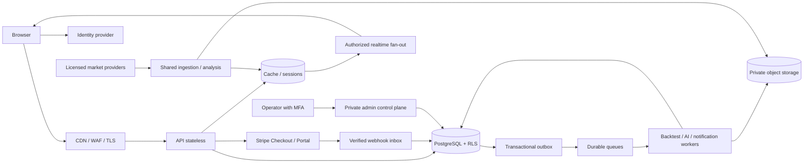

# Arhitectura de referință

**Regulă actuală: păstrăm toate funcțiile și taburile, inclusiv Pre-Earnings, Agents, Capital și AI Cockpit ca spații distincte.** [PRODUCT_PRESERVATION.md](PRODUCT_PRESERVATION.md) documentează traseele verificate și are prioritate față de propunerile inițiale de simplificare.

Deciziile de mai jos sunt propuneri tehnice pentru S03, nu servicii deja configurate. Păstrăm Python/FastAPI și migrăm incremental frontendul. Pornim ca aplicație modulară cu procese separate pentru API, ingestion și workers. Nu introducem zeci de microservicii sau Kubernetes ca precondiție pentru primii clienți.

## Infrastructură recomandată

| Componentă | Propunere inițială | Motiv / condiție |
|---|---|---|
| Frontend | Bundle static pe S3 + CloudFront, sau servire echivalentă cu CDN | Cache pentru assets; niciun secret și nicio pagină personală în cache public. |
| Edge | TLS, WAF, rate limiting, ALB | Rutele publice distincte de admin; login/signup și scrierile au limite specifice. |
| API | FastAPI în ECS/Fargate, minimum două replici la paid launch | Procese stateless; fără engine subprocess sau fișiere persistente personale pe replică. |
| Identitate | Cognito User Pool prin OIDC; Auth0 poate fi alternativă prin ADR | Parole gestionate de IdP; costurile MAU, email, MFA și cotele trebuie verificate. |
| Date tranzacționale | PostgreSQL administrat, Multi-AZ la paid launch | Users/workspaces, plăți, quotas, ordine paper și ledger. |
| Cache | Redis/Valkey administrat | Cache, rate limits, sesiuni opace și fan-out; nu singura copie a banilor/abonamentelor/joburilor. |
| Jobs | SQS + DLQ și outbox PostgreSQL | Livrare durabilă, idempotency și retry; acceptăm at-least-once, nu presupunem exactly-once. |
| Workers | Servicii separate CPU/memory, autoscaling după backlog | Backtest greu și AI nu consumă bugetul de răspuns al API. |
| Serii de piață/rapoarte | Object storage versionat, Parquet pentru istoric; DB pentru index/metadata | Evităm milioane de fișiere locale și încărcarea întregului istoric în răspunsuri. |
| Secrete / observabilitate | Secrets Manager/KMS, OpenTelemetry și platformă de logs/metrics | Audit, rotație, redactare secrete și bugete. |

O singură regiune UE este ipoteza inițială, nu o decizie de jurisdicție. Multi-AZ nu înseamnă multi-region. Rămânem pe o regiune până când cererea, latența, recuperarea sau obligațiile justifică replicarea regională. IaC descrie mediile; Docker Compose existent rămâne util pentru dezvoltare, nu ca dovadă de capacitate SaaS.

## Date comune versus date personale

**Comune:** catalog de instrumente, cotații și bare autorizate, calendar, articole permise, analize deterministe și AI comune. Cheia include provider, instrument/exchange, interval, timestamp/data version și drepturile de distribuție. Datele nu sunt „publice” doar pentru că sunt comune; access policy se aplică înainte de fiecare livrare.

**Personale:** watchlist, filtre salvate, alerte, prompturi/rapoarte private, backtesturi personalizate, portofolii paper, ordine, ledger, abonament, usage și notificări. Toate au workspace_id. Nu folosi un cache comun pentru un rezultat care include context personal.

**Operator:** chei de provider, configurare globală, enable/disable engine, model routing, Coding Agent, diagnostic intern, seed/import și administrare. Aceste funcții nu sunt parte din niciun abonament.

## Schema minimă și convenții

| Tabel / grup | Câmpuri și reguli obligatorii |
|---|---|
| users | UUID intern, issuer + subject unic, email verificat ca atribut, username opțional, status, created_at. Nu folosi emailul drept cheie imuabilă. |
| workspaces / memberships | Workspace personal creat idempotent, owner și membership. Separarea permite ulterior echipe fără refacerea identității. |
| watchlists / watchlist_items / user_settings | workspace_id, identificator instrument complet; UNIQUE(workspace_id, list_id, instrument_id). |
| alerts / notification_preferences | workspace_id, instrument_id, prag, status, versiune, canal, timezone; tranziții atomice. |
| paper_accounts / orders / positions / ledger_events | workspace_id în toate FK-urile; Decimal pentru sume; order idempotency key; evenimente imuabile și reconciliabile. |
| jobs / job_results / outbox | workspace_id sau explicit shared_scope; input hash, versiuni, status, lease, budget, încercări și rezultat privat. |
| billing_customers / subscriptions | workspace unic, provider IDs unice, plan_version, current_period, status canonic și reconciliation_at. |
| billing_events | provider event_id unic, signature_verified, received_at, processed_at, status și erori. |
| entitlement_snapshots / usage_ledger | plan version, perioada, rezervări/debitări/eliberări cu chei idempotente; niciun reset arbitrar lunar. |
| audit_events | actor, workspace, action, resource ID, request ID, timestamp UTC; PII minimă și retenție. |
| instruments / market_snapshots | exchange/MIC, asset class, quote currency, provider symbol, source timestamp, fetch timestamp, session, adjustment și license tags. |

RLS este defense-in-depth alături de filtrarea explicită. Runtime DB nu este owner și nu are BYPASSRLS; migrațiile au alt rol. Contextul tenant se setează local tranzacției și nu rămâne în pool. FK-uri compuse împiedică asocierea unei poziții A cu un cont B. Workerul citește proprietarul din jobul persistent, nu dintr-un mesaj client. [PostgreSQL RLS](https://www.postgresql.org/docs/17/ddl-rowsecurity.html)

Toate momentele sunt timezone-aware UTC în storage; timezone-ul utilizatorului influențează afișarea. Data calendaristică a unui eveniment și sesiunea bursei rămân distincte de timestamp. O sumă, un procent, o rentabilitate R și o cotă de utilizare sunt tipuri diferite, cu unități explicite.

## Autentificare și autorizare

Signup cu email și parolă, confirmare email, nume de utilizator/display name opțional. IdP deține parolele și resetarea; aplicația validează issuer, audience, semnătură, expiry și tipul tokenului. Preferăm OIDC authorization code + PKCE și un backend-for-frontend cu sesiune opacă în cookie Secure/HttpOnly/SameSite. Refresh tokenurile nu stau în localStorage; callbackul validează state/nonce, iar scrierile cu cookie au CSRF. Logout, logout-all și revocare sunt testate. [Autentificare Cognito](https://docs.aws.amazon.com/cognito/latest/developerguide/authentication.html)

User role și subscription plan sunt concepte diferite. Plata abonamentului de 10 USD nu acordă niciodată operator. User ID/workspace ID din payload sunt doar parametri de resursă ce trebuie validați, nu dovezi de identitate. MFA este disponibil tuturor și obligatoriu pentru operator. Quota și rate limits sunt per cont, adresă IP, dispozitiv și serviciu; nu sancționăm automat toți utilizatorii aflați în spatele aceluiași NAT.

Rute propuse: /api/v1/me, /workspaces/current, /watchlists, /alerts, /paper/accounts, /backtests/jobs, /ai/reports, /billing/checkout, /billing/portal, /billing/subscription, /usage și /events. /api/webhooks/stripe verifică semnătura providerului, nu sesiunea browserului. /internal/* și vechiul login cu cheie de operator nu sunt expuse de ingress-ul public. Fiecare rută nouă are politică de acces explicită, inclusiv downloaduri și stream subscriptions.

## Abonamente

Stripe Checkout și Portal gestionează datele cardului și operațiile self-service. Provider Customer se leagă server-side de workspace. Catalogul local definește features și limite; Price ID este doar identificatorul comercial. Redirectul success nu activează accesul. Backendul confirmă plata/starea canonică conform politicii de abonament și perioada exactă. [Subscription lifecycle](https://docs.stripe.com/billing/subscriptions/webhooks)

Webhookul verifică semnătura pe body nemodificat, persistă event_id unic și confirmă după scriere durabilă. Workerul tolerează duplicate și ordine diferită, verifică starea curentă la provider când este necesar și actualizează entitlement snapshot. Reconcilierea periodică repară evenimente ratate. [Stripe webhooks](https://docs.stripe.com/webhooks)

active/trialing sunt interpretate conform politicii; incomplete nu dă acces plătit. past_due intră într-o perioadă de grație explicită de decis, apoi read-only conform termenilor; canceled/unpaid nu pot lansa joburi premium. Există un singur Product/Price de 1000 cenți USD/lună, quantity=1; fără upgrade/downgrade, add-on-uri sau overage automat. Anularea păstrează accesul până la paid-through; reactivarea nu dublează facturarea. Refund/dispute nu șterg ledgerul și au proces documentat. Stripe Entitlements poate sincroniza features, dar nu înlocuiește contorul atomic local pentru compute. [Entitlements](https://docs.stripe.com/billing/entitlements)

## Calcul și realtime

Un feed se colectează și se analizează o singură dată pentru același input public. Milioane de conturi nu înseamnă milioane de cereri AI la fiecare refresh. Cererile personale sunt joburi cu limite, cost estimat afișat și cost real reconciliat. Cache-ul privat include workspace; cache-ul comun este permis numai pentru rezultate fără informații personale și cu drepturi compatibile.

API răspunde 202 pentru joburi costisitoare. Queue consumers sunt idempotent; outbox previne pierderea evenimentului între commit și publish. Limite separate pentru AI/backtest/notifications și fairness împiedică un cont foarte activ să blocheze platforma. Autoscaling se bazează pe latență/backlog/conexiuni, nu doar CPU. [ECS autoscaling](https://docs.aws.amazon.com/AmazonECS/latest/developerguide/service-autoscaling-targettracking.html)

Browserul primește snapshot apoi delta. Evenimentele personale sunt persistate, conexiunile au reconnect cursor și autorizare; datele de piață pot fi resincronizate din snapshot. Redis Pub/Sub poate fi mecanism de distribuție rapidă, dar nu singura sursă a notificărilor de plată/ordine. Nu livrăm istoricul integral și nici toate simbolurile la fiecare refresh.

## Migrare și recuperare

Introdu repository adapters și /api/v1 în paralel cu modul local; nu transforma fiecare singleton global într-un dicționar de milioane de utilizatori în RAM. Importul operatorului este explicit într-un singur workspace, cu backup, dry-run, reconciliere și oprire temporară a scrierilor. Nu folosi un dual-write permanent JSON + PostgreSQL fără protocol de consistență. Pentru schema live folosește expand/migrate/contract; rollbackul aplicației nu trebuie să ceară pierderea datelor.

Înainte de producție trebuie validate drepturile asupra datelor. yfinance avertizează că datele Yahoo sunt destinate uzului personal; licența bibliotecii nu autorizează vânzarea unui feed redistribuit. Același review este necesar pentru știri, TradingView și eToro. [Documentația yfinance](https://ranaroussi.github.io/yfinance/)

Exportul și ștergerea contului includ DB, obiecte, jobs, cache și politica de backup; păstrarea datelor necesare facturării se documentează separat. Regimul concret și termenele se verifică pentru firma și țările de lansare. [Drepturi privind datele personale — Comisia Europeană](https://commission.europa.eu/law/law-topic/data-protection/information-individuals_en)
